# The pinned-input metamodel

The source of the pinned-input class diagram in the Task 2 report
(`pinned-inputs.pdf`), mirroring `emf/bundles/metamodel/model/pinned-inputs.ecore`.
Every class is new in Task 2, so the drawing uses one fill throughout. The
closed vocabulary `BackupOutcome` is not drawn; the attribute's type names it.

Render with `scripts/diagrams/class-diagram.py --report`; the commands are in
that script's docstring.

```mermaid
classDiagram
    direction TB

    class NodeContract {
        +string apiVersion
        +string kind
        +string schemaVersion
        +string cluster
        +string labelPrefix
    }
    class Node {
        +string name
        +string site
        +string arch
        +string[] capabilities
    }
    class Allocatable {
        +string cpu
        +string memory
    }
    class Gpu {
        +string vendor
        +string model
        +string class
        +int memoryMib
    }
    class Disk {
        +string media
        +int usableGib
    }
    class ImagesLock {
        +string apiVersion
        +string kind
        +string schemaVersion
        +string name
    }
    class LockedImage {
        +string alias
        +string repository
        +string digest
        +int uid
        +int gid
    }
    class ClusterState {
        +string apiVersion
        +string kind
        +string schemaVersion
        +string cluster
        +string capturedAt
    }
    class Binding {
        +string claim
        +string node
    }
    class CurrentPlacement {
        +string process
        +string node
    }
    class RollbackBackup {
        +string request
        +string project
        +string job
        +BackupOutcome outcome
        +string finishedAt
    }
    class MigrationProof {
        +string apiVersion
        +string kind
        +string schemaVersion
    }
    class ProvenApplication {
        +string id
        +string testedAgainst
        +bool nonTransactional
    }
    class AssetFile {
        +string project
        +string from
        +string content
    }

    NodeContract "1" *-- "1..*" Node : nodes
    Node "1" *-- "1" Allocatable : allocatable
    Node "1" *-- "0..*" Gpu : gpus
    Node "1" *-- "0..*" Disk : disks
    ImagesLock "1" *-- "0..*" LockedImage : images
    ClusterState "1" *-- "0..*" Binding : bindings
    ClusterState "1" *-- "0..*" CurrentPlacement : placements
    ClusterState "1" *-- "0..*" RollbackBackup : backups
    MigrationProof "1" *-- "0..*" ProvenApplication : applications
```

