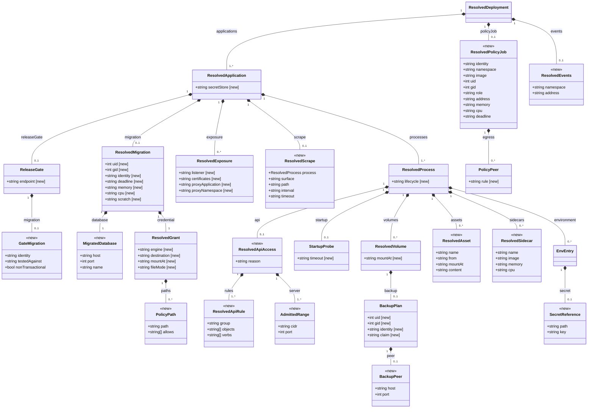

# The decision classes of the target metamodel that changed in Task 2

The source of the decision-class diagram in the Task 2 report
(`target-decisions.pdf`), cut from
`emf/bundles/metamodel/model/resolved-deployment.ecore`. A class marked
`<<new>>` is new in Task 2; every other class is a Task 1 class and lists only
the features Task 2 added, each marked `[new]`. A class contained in several
places is drawn under its first container only.

Render with `scripts/diagrams/class-diagram.py --report --changes`; the
commands are in that script's docstring.

