# The generated-file classes of the target metamodel, Task 1 against Task 2

The source of the generated-file class diagram in the Task 2 report
(`target-files-existing.pdf` and `target-files-added.pdf`), cut from
`emf/bundles/metamodel/model/resolved-deployment.ecore`. Every class but the
three helpers is a subclass of `Deliverable`. A class marked `<<new>>` is new
in Task 2; in a Task 1 class, a feature Task 2 added is marked `[new]` and one
it removed `[removed]`, with its Task 1 type. These are target-model classes that plan files, so both views use the target model's amber palette.

Regenerate from the repository root with the shared renderer:

```bash
F=docs/mde/task-2-transformations/Figures
for view in existing added; do
  python3 scripts/diagrams/class-diagram.py --report --changes \
    --font-size=14 --heading-font-size=15 \
    --source="$F/target-files.md" --layout="$F/target-files-$view-layout.json" \
    task2-target-files "$F/target-files-$view.drawio"
  /Applications/draw.io.app/Contents/MacOS/draw.io -x -f pdf --crop -b 4 \
    -o "$F/target-files-$view.pdf" "$F/target-files-$view.drawio"
done
```

```mermaid
classDiagram
    direction TB

    class Deliverable {
        <<abstract>>
        +string path
        +AdapterName adapter
    }
    class NamespaceFile {
        +string namespace
    }
    class IndexFile {
        +string namespace
        +string[] resources
    }
    class WorkloadFile {
        +ResolvedProcess[] processes [new]
        +ControllerKind controller
        +string strategy
        +string disruptionBudget
        +ResolvedProcess process [removed]
    }
    class SwitchoverFile {
        +ResolvedProcess[] processes [new]
        +ResolvedProcess process [removed]
    }
    class IdentityFile {
        +ResolvedProcess[] processes [new]
        +ResolvedProcess process [removed]
    }
    class NetworkPolicyFile {
        +ResolvedMigration migration [new]
        +ResolvedProcess process [removed]
        +PolicyPeer[] ingress [removed]
        +PolicyPeer[] egress [removed]
    }
    class IngressRouteFile {
        +ResolvedExposure exposure
        +string entryPoint
        +string certificateResolver
    }
    class MonitorFile {
        +ResolvedProcess process
        +string surface
        +string scrapePath
        +string interval
        +string timeout [new]
        +MonitorKind kind [new]
    }
    class SecretFile {
        +ResolvedApplication application [new]
        +ResolvedProcess process [removed]
        +ResolvedGrant[] grants [removed]
    }
    class MigrationFile {
        <<new>>
        +ResolvedApplication application
        +string upTag
        +string downTag
        +string role
    }
    class BudgetFile {
        <<new>>
        +ResolvedProcess[] processes
    }
    class RbacFile {
        <<new>>
        +ResolvedProcess[] processes
    }
    class ServiceFile {
        <<new>>
        +ResolvedProcess[] processes
    }
    class ClaimFile {
        <<new>>
        +ResolvedProcess[] processes
    }
    class ConfigMapFile {
        <<new>>
        +ResolvedProcess[] processes
        +ResolvedApplication application
        +string releaseGate
    }
    class BackupFile {
        <<new>>
        +ResolvedProcess[] processes
    }
    class ConnectionFile {
        <<new>>
        +string namespace
        +string address
    }
    class VaultPolicyFile {
        <<new>>
        +string namespace
        +string identity
        +ResolvedGrant[] grants
    }
    class PolicyJobFile {
        <<new>>
        +string part
        +string name
        +ResolvedPolicyJob job
    }
    class EventsFile {
        <<new>>
        +string part
        +ResolvedEvents events
    }
    class VaultRoleFile {
        <<new>>
        +string namespace
        +string identity
    }
    class ProcessPolicy {
        <<new>>
        +ResolvedProcess process
        +PolicyPeer[] ingress
        +PolicyPeer[] egress
    }
    class SecretHolder {
        <<new>>
        +string identity
        +string component
        +ResolvedGrant[] grants
    }
    class PolicyDocument {
        <<new>>
        +string file
        +string json
    }

    Deliverable <|-- NamespaceFile
    Deliverable <|-- IndexFile
    Deliverable <|-- WorkloadFile
    Deliverable <|-- SwitchoverFile
    Deliverable <|-- IdentityFile
    Deliverable <|-- NetworkPolicyFile
    Deliverable <|-- IngressRouteFile
    Deliverable <|-- MonitorFile
    Deliverable <|-- SecretFile
    Deliverable <|-- MigrationFile
    Deliverable <|-- BudgetFile
    Deliverable <|-- RbacFile
    Deliverable <|-- ServiceFile
    Deliverable <|-- ClaimFile
    Deliverable <|-- ConfigMapFile
    Deliverable <|-- BackupFile
    Deliverable <|-- ConnectionFile
    Deliverable <|-- VaultPolicyFile
    Deliverable <|-- PolicyJobFile
    Deliverable <|-- EventsFile
    Deliverable <|-- VaultRoleFile
    NetworkPolicyFile "1" *-- "0..*" ProcessPolicy : policies
    SecretFile "1" *-- "1..*" SecretHolder : holders
    PolicyJobFile "1" *-- "1..*" PolicyDocument : documents
```


