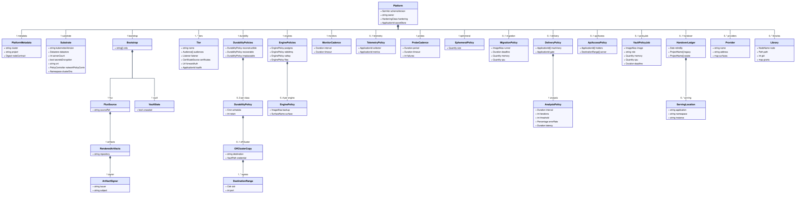

# Chapter 14: Platform Intent

Layer 1 has **two** authored documents, and this chapter is the second. Project
Intent (chapter 10) says what an Application needs; Platform Intent says what the
estate offers. Both are held to the same rule, **requirements and facts, never
mechanisms**, and one test decides which document a value lives in: the
contention test ([0004](../../docs/adr/model/0004-contention-decides-authority.md)).
A value an Application could state for itself belongs in chapter 10; a value that
must be unique across the estate or draws on a shared finite resource belongs
here.

Until [0045](../../docs/adr/model/0045-platform-intent-is-the-second-authored-document.md)
this document was called the Cluster Context, had no chapter, and acquired its
fields one decision at a time. The name changes because the content is
authored intent, not observed context, and because it now enters composition
the way every other authored document does.

## The document

```yaml
apiVersion: intent.jorisjonkers.dev/v1
kind: Platform
schemaVersion: 1.0.0
owner: joris
```

One Platform document per estate. It is published as an **Intent Fragment**
([chapter 40](40-composition.md#fragments)) by the repository that owns the
platform, pushed by digest like any project, and it is a **required participant**
whose staleness bound is the same seven days
([chapter 40](40-composition.md#participants)). There is no side channel: a
render that cannot find the platform fragment is `E_PARTICIPANT_MISSING`, and a
render against a stale one is `E_PARTICIPANT_STALE`.

The document is read exactly as a project file is, in the same YAML subset and
with the same schema refusals
([chapter 10](10-project-intent.md#reading-a-file)).

## The model



<sub>[Diagram source](#the-platform-intent-model) · generated by
[`scripts/diagrams/class-diagram.py`](../../scripts/diagrams/class-diagram.py)</sub>

The Platform document's classes and how they compose. A policy keyed by a
closed vocabulary is a class with one optional field per literal, so a policy
the platform does not offer is a field it does not write. Ten fields refer
into another document: a tier's `traefik`, each name in `delivery.machinery`,
`delivery.gate`, `delivery.reporter`, each name in `apiAccess.holders`,
`telemetry.collector`, `telemetry.metrics` and `secretStore` each name a
[privileged role](#privileged-roles)'s holder, and the `handover` ledger and
each library's `grants` name projects.

### Privileged roles

Each of the eight fields above hands the Application it names a role no
project file can give itself: every Canary's verdict, every grant's Vault
traffic, ingress to every routed or scraped Process, exemption from the
Release Gate, or Kubernetes API access. So each names the holder as
`<project>/<application>`: the Project that may hold the role, and the
Application that Project declares. It links only to that Application in that
Project. An Application of the same id that another project file declares does
not receive the role, and the reference stays unlinked, refused with the
field's own code below. The id alone binds nothing, so a role is never
something a project file claims by publishing a name
([0113](../../docs/adr/model/0113-a-privileged-role-names-the-project-that-holds-it.md)).

A Platform document is checked on its own and together with the project files
read beside it. On its own, a tier that carries `authenticated` needs its
`forwardAuth` ([Tiers](#tiers)), no group is granted one role twice
(`E_DUPLICATE_HUMAN_GRANT`, [Human grants](#human-grants)), and the `handover`
ledger puts no Project on both delivery paths (`E_HANDOVER_BOTH_PATHS`,
[chapter 60](60-setup.md#handing-over-one-project-at-a-time)). Together, every reference one makes into the
other resolves and every policy one asks for the other offers:

| condition | error |
|---|---|
| a tier's `traefik` names no Application its Project declares | `E_UNKNOWN_TIER_PROXY` |
| an exposure's or a route's audience is carried by no tier | `E_NO_TIER_FOR_AUDIENCE` |
| a Process's `engine` has no entry in `engines` | `E_NO_ENGINE_POLICY` |
| a Process's `engine` names a `surface` in `engines` that the Process does not provide | `E_BACKUP_SURFACE_NOT_PROVIDED` |
| a Process's `engine` names a `catalog` and a `catalogSurface` in `engines` that the Process does not provide | `E_CATALOG_SURFACE_NOT_PROVIDED` |
| a volume's Durability Class has no entry in `durability` | `E_NO_DURABILITY_POLICY` |
| a Process mounts a library `libraries` does not declare | `E_UNKNOWN_LIBRARY` |
| an Application's `l4Exposure` names an address `l4Addresses` does not declare | `E_UNKNOWN_L4_ADDRESS` |
| more Processes are exposed on a pool than its `range` holds addresses | `E_L4_ADDRESS_EXHAUSTED` |
| a tier names an `address` `l4Addresses` does not declare | `E_UNKNOWN_L4_ADDRESS` |
| a tier names an address, and no Process of its proxy provides the surfaces its listener reaches | `E_TIER_SURFACE_MISSING` |
| a tier issues through `acme`, and `acme` is absent | `E_NO_ACME_POLICY` |
| a tier issues through `acme`, and `secretStore` is absent | `E_NO_SECRET_STORE` |
| a Process of an acme tier's proxy declares `replicas` | `E_ACME_PROXY_REPLICATED` |
| two exposures dial the same port and protocol on one node through its node addresses | `E_NODE_PORT_TAKEN` |
| a Process mounts a library that grants its project nothing, or mounts it `write` where the grant is `read` | `E_LIBRARY_NOT_GRANTED` |
| a Process attaches to a VPN and `vpn` is absent | `E_NO_VPN_POLICY` |
| a Node Agent the node contract or the pools derive has no entry in `nodeAgents` | `E_NO_NODE_AGENT_POLICY` |
| a grant delivered as `env` or `file` where `secretsEncryption` is false | `E_SECRETS_AT_REST_REQUIRED` |
| a name in `delivery.machinery` names no Application its Project declares | `E_UNKNOWN_MACHINERY` |
| a name in `apiAccess.holders` names no Application its Project declares | `E_UNKNOWN_API_HOLDER` |
| a Process declares `api` in an Application `apiAccess.holders` does not name, or under an id a second Application also carries | `E_PROCESS_RBAC_GRANT` |
| `telemetry.collector` names no Application its Project declares with an `otlp` surface on one of its Processes | `E_UNKNOWN_TELEMETRY_COLLECTOR` |
| `telemetry.metrics` names no Application its Project declares | `E_UNKNOWN_METRICS_STACK` |
| `delivery.gate` names no Application its Project declares with an `http` surface on one of its Processes | `E_UNKNOWN_RELEASE_GATE` |
| `delivery.reporter` names no Application its Project declares with an `http` surface on one of its Processes, or a Project other than the Release Gate's | `E_UNKNOWN_REPORTER` |
| `secretStore` names no Application its Project declares with an `http` surface on one of its Processes | `E_UNKNOWN_SECRET_STORE` |
| a name in `mesh.enrolled` names no Project a project file declares | `E_UNKNOWN_ENROLLED_PROJECT` |
| an Application holds a grant, a backup that copies off-cluster, a backup that dumps over the network, or a changelog, and the platform names no `secretStore` | `E_NO_SECRET_STORE` |
| an Application moves its schema with a changelog and the platform declares no `migration` policy | `E_NO_MIGRATION_POLICY` |
| an Application moves its schema with a changelog and no Process of it switches `blue-green`: none is `continuous`, or the Application is `delivery.machinery` | `E_MIGRATION_UNGATED` |
| an Application's cutover is `continuous` and the platform declares no `delivery` policy | `E_NO_DELIVERY_POLICY` |
| a project file names a project the `handover` ledger puts on neither delivery path | `E_HANDOVER_UNLISTED` |
| a `handover.serving` location names an Application a project file read beside it declares in a Project the ledger does not put on `legacy`, or states an `instance` for an Application of more than one Process | `E_HANDOVER_SERVING` |
| a change derives a [Move](55-delivery.md#moves) of a Process whose `engine` entry carries no `move` | `E_MOVE_UNSUPPORTED` |
| a change derives a Move and the platform declares no `delivery.move` | `E_NO_MOVE_POLICY` |
| a Process declares `availability: replicated` and its `engine` entry maps no mechanism to it | `E_AVAILABILITY_UNSUPPORTED` |

A refusal names the document it points into as well as the path, because the
object at fault can sit in either: a proxy nothing declares is the tier's, and an
audience nothing carries is the exposure's.

## Where a vocabulary lives

A vocabulary is a closed set of literals a field may hold: `Engine`,
`HardeningClass`, `Datastore`, and the rest this specification
enumerates. One rule decides which authored document declares a vocabulary's
literals, applied per vocabulary rather than per document: **fixed in the
metamodel, in Project Intent, when either a model derivation branches on which
literal was named, or the literal is the Application's own authored intent, a
fact only its owner could state, for a reader past this model's edge to act on;
defined by the platform, or by whatever reads the projection past this model's
edge, only where neither holds, because the literal names a platform fact no
Process or Application could state for itself.**

`Engine`'s literals stay fixed by the first branch: `engine: postgres` derives
a database catalog no other engine derives, and answers an Asset's change
response differently than `engine: rabbitmq` does
([0019](../../docs/adr/model/0019-engine-is-process-vocabulary.md)). What each
literal *does*, the backup method, is still the platform's to state, in
`engines` above; only the set of names is Project Intent's.

Either way, a reference a Project Intent field makes into a platform-defined
set is checked as an invariant, the same way `Tier.traefik` is checked against
the Applications a project file declares ([Tiers](#tiers)): a literal this
document assigns no policy to is refused at the point the two documents are
read together, never accepted and left to fail silently downstream.

## What it does not contain

Three things a reader might expect here live elsewhere, each for a reason.

| not here | where | why |
|---|---|---|
| the foundation components, Vault, VSO, Traefik, the metrics stack, Gatus | project files the platform owns, as ordinary Applications ([The foundation is declared](#the-foundation-is-declared)) | an Application is an Application; a second way to declare one is the duplicate vocabulary [0003](../../docs/adr/model/0003-three-model-pipeline.md) exists to end |
| the node contract, site, arch, allocatable, gpus, disks per node | its own pinned input, authored once where nix reads it ([0048](../../docs/adr/model/0048-node-facts-are-authored-once.md), [chapter 60](60-setup.md#node-facts)) | folding it in would make nix read a deployment-model document or duplicate the facts |
| anything executable | the images lock, as a purpose-built image per engine ([Engines](#engines)) | [0014](../../docs/adr/model/0014-file-shaped-configuration-is-an-asset.md) applies to the platform's own files |

The Platform document names the node contract it was composed against, by
digest, so the pinned input set stays closed
([0006](../../docs/adr/model/0006-pinned-inputs.md)).

## Substrate facts

Facts about the cluster that decide other decisions
([0049](../../docs/adr/model/0049-datastore-and-restore.md)). Each is named for
what it is, never for how k3s is told about it: a CLI flag is a derivation
nobody authors, or an observation recorded under 0049, and it appears in no
authored file.

```yaml
substrate:
  kubernetesVersion: v1.31.4+k3s1
  datastore: sqlite                  # sqlite | etcd
  serverCount: 1
  secretsEncryption: false           # gates delivery: env and file (0030)
  cni: flannel
  networkPolicyController: embedded  # none | embedded | cni
  clusterDns: kube-system            # the namespace the cluster's DNS runs in
  upstreamNameservers: [9.9.9.10, 149.112.112.10] # what a Process serving DNS resolves through
  imagePull: 5m                      # the slowest pull a pod may wait on
```

| fact | read by |
|---|---|
| `kubernetesVersion` | schema validation of every rendered object; [0035](../../docs/adr/model/0035-network-policy-is-default-deny-and-render-only.md)'s evaluation |
| `datastore`, `serverCount` | the restore rehearsal; every decision resting on [0002](../../docs/adr/model/0002-kubernetes-is-the-substrate-for-one-applier.md) |
| `secretsEncryption` | `E_SECRETS_AT_REST_REQUIRED` ([0030](../../docs/adr/model/0030-secret-delivery-is-env-file-or-self.md)) |
| `cni`, `networkPolicyController` | whether a non-enforcing policy stage exists ([0035](../../docs/adr/model/0035-network-policy-is-default-deny-and-render-only.md)) |
| `imagePull` | every derived deadline ([chapter 20](20-resolved-deployment.md#derived-mechanics)): a Process's progress deadline, a `prepare` Process's run deadline and so the Release Gate's, each with this on top, rounded up to a whole second, because each runs from before the image is on the node. It is the longest an image pull takes on the slowest node a pod may land on, measured, not a margin; optional, and a substrate that states none allows nothing for a pull ([0105](../../docs/adr/model/0105-every-derived-deadline-allows-the-substrates-image-pull.md)) |
| `clusterDns` | the DNS baseline every egress policy carries ([chapter 16](16-dependencies.md#the-baseline)): the substrate runs the cluster's DNS, so where it runs is a fact about the substrate rather than a declared Application |
| `upstreamNameservers` | a Process that serves DNS ([chapter 10](10-project-intent.md#l4-exposure)): it resolves through these addresses, never the cluster's DNS, which may be down in the outage it serves through. Optional, but a set holding such a Process with none named is `E_NO_UPSTREAM_NAMESERVERS`. A node's own resolver is not this: DHCP and the LAN's resolver own it |

One fact holds on this substrate without a field, because nothing varies it:
**a pod off the host network binds any port without a capability.** k3s sets
`net.ipv4.ip_unprivileged_port_start` to 0 in every such pod, so a non-root
container with every capability dropped listens on port 80; a drill on the
estate's cluster bound it. No authored Process runs on the host network, so a
low port is never refused and never earns a capability
([chapter 10](10-project-intent.md#a-low-port-needs-no-capability)).

## The bootstrap set

A render cannot apply itself. The things that must exist before the first
rendered object can land are **recorded, not declared**
([0046](../../docs/adr/model/0046-the-foundation-is-declared.md)), and the set is
enumerated here so that growing it is a decision:

```yaml
bootstrap:
  flux:
    sourceRef: flux-system/platform          # the source that pulls the tree
    artifacts:                               # where each Project's render is fetched from
      repository: ghcr.io/jorisjonkers-dev/render
      signer:                                # the keyless identity Flux verifies against
        issuer: "https://token.actions.githubusercontent.com"
        subject: "https://github.com/JorisJonkers-dev/estate/.github/workflows/compose.yml@refs/heads/main"
      pullSecret: render-pull                # optional: the Secret a private repository is pulled with
  vault:
    unsealed: true                           # unseal is out of band
  crds:                                      # cluster-scoped schema, pinned
    - traefik.io/v1alpha1
    - secrets.hashicorp.com/v1beta1
    - monitoring.coreos.com/v1
    - flagger.app/v1beta1
    - identity.jorisjonkers.dev/v1             # the Client, once the Identity Provider serves it
    - metallb.io/v1beta1                       # the pools and advertisements of the l4-speaker Node Agent
```

| in the set | why it cannot be declared |
|---|---|
| k3s itself | it is what applies |
| the Flux source | `sourceRef` pulls the estate repository, which holds every Project's pinned source; `artifacts` says where those sources fetch each Project's render and whose keyless signature they accept ([chapter 55](55-delivery.md#rendered-artifacts-and-pins)), and, where that repository is private, `pullSecret` names the Secret in Flux's namespace each source pulls it with. The Secret is the bootstrap's, written beside Flux's own credentials: a pull credential is a secret value the model never holds, so the model names it and nothing more |
| Vault's unseal | a secret the model must never hold |
| the CRDs the estate uses | cluster-scoped schema that must exist before any object of that kind can apply; the components that *use* them are declared Applications |

Everything not in this table is a declared Application or a derived Node Agent.
Growing the table is a decision recorded here, and a component that should be
declared and is not is found by its Project's handover diff
([chapter 30](30-deliverables.md#a-projects-handover-diff)).

MetalLB's CRDs ship with a conversion webhook stanza that points at its
controller's webhook Service. No admission or conversion webhook is rendered,
and the estate serves one version of each kind, so the stanza is dropped when
the CRDs are pinned: the API server converts nothing, and nothing waits on a
webhook that is never there.

One entry is checked against what renders today: a `Client`
([chapter 17](17-sign-in.md#the-client)) applies only on a cluster that holds its
kind, so an Application declaring `client` beside a set that does not list
`identity.jorisjonkers.dev/v1` is `E_CLIENT_CRD_NOT_BOOTSTRAPPED` at composition.

## The foundation is declared

The foundation's controllers and servers are Applications in project files the
platform owns, with an `image`, Processes, `engine`, grants, `exposure`, volumes
and a Durability Class like any tenant Application
([0046](../../docs/adr/model/0046-the-foundation-is-declared.md)). Nothing
about them is hand-written, and every estate-wide invariant in
[chapter 40](40-composition.md#the-estate-wide-invariants) sees them. Each
platform project owns its part:

| project | owns |
|---|---|
| `edge` | both Traefik proxies and the DNS controller, external-dns |
| `secrets` | Vault, with no agent injector and no CSI provider, and the Vault Secrets Operator |
| `observability` | the Prometheus operator, Prometheus, Alertmanager, kube-state-metrics, the Grafana operator, Loki, Tempo, Pyroscope, Gatus, the telemetry collector and the log collector |
| `node` | the [Node Agents](#node-agents), which no project file declares |

What runs on the hosts themselves is the one split: a host-privileged agent is
a derived [Node Agent](#node-agents), and everything else is a declared
Application. The log collector is the second kind: Alloy tails pod logs through
the Kubernetes API with a cluster-scope read on pods and their logs, admitted
like any other API access ([Kubernetes API access](#kubernetes-api-access)),
runs one copy rather than one per node, and holds no host privilege. No log
canary runs per node: logs are read through the API, so a canary on every node
would test nothing per node.

Prometheus and Alertmanager take their configuration from the Prometheus
operator, which reads the monitors, rules and alert routing each Project
renders as objects of its own; it is the operator, not Prometheus, that
collects them. Gatus keeps the inbound shape below.

Configuration the render owns changes a pod's template whenever it changes:
an Asset is a ConfigMap named for its content, a proxy's static configuration
is its arguments, and a rotated credential restarts the Processes its sync
object names. So no reloader runs.

Their objects live where any Application's do, in `<project>-system` of the
project that declares them ([chapter 10](10-project-intent.md#application-identity)):
the worked [`edge`](examples/edge/edge.project.yml) project's in `edge-system`, the
[`observability`](examples/observability/observability.project.yml) project's in
`observability-system`, and a secrets project's in `secrets-system`. Every
derivation that names one (a tier's proxy, the collector a profile is handed, the
metrics stack a scrape admits, the Secret Store a grant reaches) resolves to
that namespace, and to no other.

Three consequences are normative:

- **No admission webhook is rendered**, and no chart's hook Job or aggregated
  user role: every optional webhook of a component is switched off, and the one
  a component required belonged to cert-manager, which a tier's own
  certificate retired.
- **No chart is rendered.** A component whose upstream ships a Helm chart is
  declared from its image; what the chart added (defaults and CRDs) is
  respectively what a declaration replaces and what the bootstrap set pins.
  `HelmRelease` and `HelmRepository` are not rendered kinds.
- **Two Traefik instances are two Applications**, placed by capability: one on the
  `public-ingress` node, one on a LAN node. That placement, and the tier facts
  below, are what keep LAN traffic off the Frankfurt proxy, not which adapter
  emitted the route.

The estate-scoped Deliverables that used to have adapters of their own, the
Gatus endpoints and the edge catalogs, are never rendered into a platform
Application's share, because a list there would change with every Project's
routes ([0117](../../docs/adr/model/0117-an-external-check-is-rendered-by-its-own-project.md)):

- **The external checks are each Project's own.** Every Application with an
  exposure renders one ConfigMap in its own namespace, in its own share,
  named `<application>-external-checks`, carrying the labels an
  Application's own object carries (`part-of` and `managed-by`) and one more,
  `estate.jorisjonkers.dev/external-checks: "true"`
  ([chapter 10](10-project-intent.md#the-label-set)), holding the checks its
  exposure derives
  ([chapter 16](16-dependencies.md#what-an-edge-derives-read-inbound)) under
  `endpoints` and nothing else. Gatus refuses a scalar setting two of its files
  define, so a Project's file may only add endpoints.
- **Gatus gathers them.** Its Application declares a checks sidecar that
  watches every ConfigMap carrying that label, in every namespace that carries
  `app.kubernetes.io/managed-by: deploy-kit`, and writes each as one file into
  the directory Gatus reads its configuration from. Gatus merges the files and
  reloads them in-process, so a Project's new or changed checks reach it
  without a restart. The `gatus` Process declares API access to `list` and
  `watch` ConfigMaps, and the Platform document admits the Application as a
  holder ([Kubernetes API access](#kubernetes-api-access)). Only Flux and the
  admitted holders write ConfigMaps in a Project's namespace, so a check comes
  from a render composition checked, or from a holder the platform named.
- **No edge catalog is rendered.** The Traefik Applications read every
  `IngressRoute` through their Kubernetes provider, and each Project's routes
  are already in its own namespace.

A route or exposure change therefore re-renders only its own Project's share.
No platform Application's Assets, pod template or pin move with it.

## Node Agents

Some of the foundation runs on the hosts themselves: an agent per node that
needs the host's devices, network or filesystems. A **Node Agent** is one of
these, and it is never declared. The Platform document holds a closed **Node
Agent catalog**, in the shape of the engine catalog: each entry pins the image
alias and what each copy requests, and the catalog fixes the privileges, which
no author declares. So `E_HARDENING_UNMET` does not apply to an agent, and no
Process can ask for the host network: no field of a project file names it.

```yaml
nodeAgents:
  gpu-device: { image: nvidia-device-plugin, memory: 64Mi, cpu: 10m }
  gpu-metrics: { image: dcgm-exporter, memory: 256Mi, cpu: 50m }
  node-metrics: { image: node-exporter, memory: 64Mi, cpu: 20m }
  l4-speaker:
    image: metallb-speaker
    memory: 64Mi
    cpu: 20m
    controller: { image: metallb-controller, memory: 64Mi, cpu: 10m }
```

| agent | runs on | what the catalog fixes |
|---|---|---|
| `gpu-device` | every node with an `nvidia` card in the node contract | the device plugin: privileged, the host's PIDs, the kubelet's device-plugin socket and the CDI directory, and time-slicing of **four shares per GPU** |
| `gpu-metrics` | the same nodes | the card counters: `SYS_ADMIN`, the kubelet's pod-resources socket read-only, and **one share** of the card it reads |
| `node-metrics` | every node | the host's metrics: the host network and PIDs, and `/proc`, `/sys` and `/` read-only, as a non-root user |
| `l4-speaker` | the nodes of every site with a pool-kind [L4 Address](#l4-addresses) | the announcer: the host network and `NET_RAW` alone; beside it a **controller**, which runs once with no privilege, and per pool an address pool and an advertisement |

Each agent is a DaemonSet held to exactly the nodes its row names, by name,
so a node the contract does not list runs none. A pool's address pool hands
its range out only to a Service that names the pool (`autoAssign: false`),
and its advertisement selects the nodes of the pool's site, so the address is
announced on that segment alone. A `gpu` requirement is granted one share of
a card, with no memory or fault isolation between the shares.

An agent the facts derive needs its entry: a node with an `nvidia` card and no
`gpu-device` entry, say, is `E_NO_NODE_AGENT_POLICY`. The GPU agents run under the
runtime class [`gpus`](#gpus) names for `nvidia`, so where it names none they are
`E_NO_GPU_POLICY`. An agent no node needs is
derived nowhere, and its entry renders nothing.

The agents are the **`node` Project**, which no project file declares: every
object it holds is derived from the catalog, the node contract and the pools,
in `node-system`, under one Reconcile Unit and one pin, and the handover ledger
hands it to the estate path like any other Project. It follows nothing, since
an agent needs only its node.

## Tiers

A tier is where the edge terminates. It declares its **edge facts**, in the
model's words, and the `traefik` adapter maps them to Traefik's
([0011](../../docs/adr/model/0011-authored-values-name-model-concepts.md)):

```yaml
tiers:
  - name: public-frankfurt
    audiences: [anonymous, authenticated]
    listener: tls                      # tls | plain
    certificates: acme                 # acme | none
    forwardAuth: {provider: identity/identity, surface: http, path: /gate/forward}
    proxiedBy: cloudflare              # optional: who forwards clients' requests to this edge
    traefik: edge/traefik-public       # <project>/<application>: the declared Application that is this tier's proxy
    ingressClass: traefik-public       # the class that proxy admits routes of
    dns: {target: ingress.jorisjonkers.dev, proxied: true}
    address: edge-frankfurt            # optional: the L4 Address its proxy listens on
  - name: lan
    audiences: [lan]
    listener: plain
    certificates: none
    traefik: edge/traefik-lan
    ingressClass: traefik-lan
    address: lan-edge

acme:                                  # how an acme tier's proxy registers and proves its names
  email: hostmaster@jorisjonkers.dev
  dnsProvider: cloudflare
  token: secret/data/platform/cloudflare
```

| fact | meaning |
|---|---|
| `audiences` | which audiences this tier carries; a route's audience selects its tier, and an audience no tier carries is `E_NO_TIER_FOR_AUDIENCE` |
| `listener` | whether the edge terminates TLS |
| `certificates` | how certificates are issued for what it terminates |
| `forwardAuth` | who authenticates for it: `provider`, a declared Application as `<project>/<application>`; `surface`, the surface one of its Processes answers on; `path`, where it answers; and optional `responseHeaders`, the headers the edge hands on to the route's Process. Never a URL: the edge asks the provider's Process where it runs, which follows the provider through a move and through the handover ledger's `serving` location while its Project is legacy. Required where `authenticated` is carried, `E_NO_FORWARD_AUTH_ENDPOINT` otherwise ([0023](../../docs/adr/model/0023-exposure-is-declared-by-audience.md)); a provider whose Project the set holds and which declares no such Application or surface is `E_UNKNOWN_FORWARD_AUTH_PROVIDER`. The Project that declares the tier's proxy renders the `forward-auth` Middleware ([chapter 30](30-deliverables.md#shared-middlewares)) |
| `proxiedBy` | `cloudflare`, or absent. Who forwards clients' requests to this edge, which decides the address a route's `rateLimit` counts a client by: absent, the connection's own address; `cloudflare`, the address Cloudflare forwards in `CF-Connecting-IP`, since every connection then comes from a Cloudflare edge. State it only when every request reaches the tier through Cloudflare, since a client that reaches the edge directly writes that header itself ([0110](../../docs/adr/model/0110-a-route-may-bound-its-request-rate.md)) |
| `traefik` | the platform Application whose proxy this tier is, as `<project>/<application>` ([privileged roles](#privileged-roles)); an Application its Project does not declare is `E_UNKNOWN_TIER_PROXY` |
| `ingressClass` | the ingress class this tier's proxy admits routes of, a Kubernetes name. Every route rendered for the tier carries it, and external-dns writes a record for a route by the same annotation, so one Traefik never serves another tier's routes. Optional in the document, but an exposure on a tier that names none is `E_TIER_WITHOUT_INGRESS_CLASS`: its routes would be admitted by no proxy |
| `dns` | optional: where the tier's public names point (`target`) and whether the DNS provider proxies them (`proxied`). Every route rendered for the tier carries both as the annotations the DNS controller writes its record from; a tier without it, such as the LAN's, publishes no record |
| `address` | the [L4 Address](#l4-addresses) the proxy listens on, by name; one `l4Addresses` does not declare is `E_UNKNOWN_L4_ADDRESS`. Absent, the proxy is exposed on none, and the substrate reaches it however it does |

**The proxy's ports follow from the listener** and are never authored: every
tier derives port 80 on its proxy, to the surface `web`, and a `tls` tier port
443 too, to `websecure`. They are L4 exposures of the proxy on the tier's
address, so they render as any exposure on that address does
([chapter 10](10-project-intent.md#l4-exposure)): a load balancer on a pool,
host ports on a node address, with the Process held to the pool's site or the
node. The proxy provides the surfaces its tier's listener reaches, or the tier
is `E_TIER_SURFACE_MISSING`. Where every tier a proxy serves is `tls`, a plain
request is sent to TLS.

**A tier that issues through `acme` owns its certificate.** On its own proxy it
derives an ACME resolver named for the tier, a `reconstructible` claim that
keeps the ACME state, and the DNS provider's token, read from the Secret Store
path `acme.token` through the one secret delivery, as `CF_DNS_API_TOKEN` for
Cloudflare. Nothing is shared between two proxies, and no `Certificate`, issuer
or hand-written TLS store is rendered. An acme tier under a document with no
`acme` is `E_NO_ACME_POLICY`, and under one with no `secretStore`
`E_NO_SECRET_STORE`. The ACME state sits on one claim, so the proxy runs one
copy: `replicas` on any of its Processes is `E_ACME_PROXY_REPLICATED`. An edge
proxy is delivery machinery, whose rolling switchover never runs two copies.

**The issuance allowance is shared.** Tiers that issue the same names draw on
one allowance at the certificate authority. Both of the estate's tiers issue
the same wildcard, so a lost claim on either reissues against the allowance of
both: five losses within seven days, counted across the tiers, exhaust it. The
claim stays `reconstructible`; losing it costs a reissue, never data.

**A route takes its TLS from its tier**: on an acme tier the resolver named for
the tier, on a `tls` tier that issues `none` the certificate the proxy already
holds, and on a `plain` tier none. So a route never names a resolver its tier's
proxy does not declare, and switching a tier to its own certificate edits no
route.

`entryPoint`, `certResolver` and every other Traefik spelling appear only in the
adapter. A route's audience is the **only** way it reaches a tier, so a `lan`
exposure can reach the LAN proxy and no other, by construction, not by which
adapter ran.

## Sign-in

The Platform document names who issues sign-ins for the estate
([chapter 17](17-sign-in.md#the-platforms-part)):

```yaml
signIn:
  issuer: https://auth.jorisjonkers.dev
  provider: identity
  contract: "1.2"
```

| fact | meaning |
|---|---|
| `issuer` | the Issuer URL every Client trusts, and what `${client:issuer}` resolves to |
| `provider` | the Application that is the Identity Provider; each of its Processes is granted write on every derived client credential path ([chapter 17](17-sign-in.md#credentials-and-placeholders)) |
| `contract` | optional: the Principal contract version the provider serves, `major.minor`, which every generated identity file states its application expects ([chapter 17](17-sign-in.md#generated-app-roles)); one platform change moves it for every application |

An Application declaring `client` while the Platform document has no `signIn`
is `E_NO_SIGN_IN_PROVIDER`, and a `provider` no project file declares is
`E_UNKNOWN_SIGN_IN_PROVIDER`, as an unknown Secret Store is. A tier carrying a `gated` Client names the
provider's Gate as its `forwardAuth` endpoint ([Tiers](#tiers)).

## The mesh

The Platform document names the Projects the ambient mesh enrols
([chapter 60](60-setup.md#service-mesh),
[0112](../../docs/adr/model/0112-east-west-traffic-is-mutually-authenticated-by-an-ambient-mesh.md)):

```yaml
mesh:
  enrolled: [home-portal, outline]
```

| fact | meaning |
|---|---|
| `enrolled` | each Project whose namespace, and so every Process in it, joins the mesh ([chapter 20](20-resolved-deployment.md#the-mesh)) |

A namespace is the unit of enrolment, and a Project's namespace holds every one
of its Applications, so a Project is enrolled whole or not at all. A name no
project file declares is `E_UNKNOWN_ENROLLED_PROJECT`. A Platform document with
no `mesh` enrols nothing, and so does the estate's until the drills chapter 60
names have passed.

## Durability policy

One policy per Durability Class
([0018](../../docs/adr/model/0018-durability-class-derives-a-backup.md)). The window
is one node's IO and the destination one remote target, so both are
platform-assigned. `retain` is how many copies a backup keeps, the newest, and
`offCluster` names where an `irreplaceable` copy also goes, the Secret Store
path of the credential that writes there, the key every copy is encrypted to,
and where that destination is on the network. A volume whose class has no policy here is `E_NO_DURABILITY_POLICY`,
and a policy for a class that derives a backup (`recoverable`, `irreplaceable`)
names both `schedule` and `retain`, or the document is refused on its own with
`E_DURABILITY_POLICY_INCOMPLETE`:

```yaml
durability:
  reconstructible: {}
  recoverable:   {schedule: "15 3 * * *", retain: 14}
  irreplaceable: {schedule: "45 2 * * *", retain: 90,
                  offCluster: {destination: s3://backup-storage/jorisjonkers-dev,
                               credential: secret/data/platform/backup/off-cluster,
                               recipient: age1s6v5qrx3mgcgk37gscv8y6z43rssksdct5lx3xk5xrtptjndqvhsnhj7h8,
                               egress: [{cidr: 203.0.113.0/24, port: 443}]}}
```

`recipient` is an [age](https://age-encryption.org) public key, `age1` and 58
more characters. The method encrypts each copy to it on the pod, before the
copy leaves the cluster, so the destination's provider never holds a readable
copy. Its private key is kept off the cluster, and only a restore uses it: a
key the cluster held would be lost with the cluster it protects against
([0018](../../docs/adr/model/0018-durability-class-derives-a-backup.md)). A
policy with `offCluster` and no `recipient`, or one that is not an age public
key, is refused with the document.

`egress` is the destination as a network policy can say it: one or more address
ranges, each with a port. A policy admits a range, never a hostname, so a
destination written only as a name is one no backup pod could be let through to
([chapter 16](16-dependencies.md#the-backup-identitys-policy),
[0091](../../docs/adr/model/0091-a-backup-identity-has-a-policy-of-its-own.md)).
It is stated here, beside the destination it locates, because the platform chose
that destination and nobody else knows where it is. At least one range is
required: an off-cluster copy with nowhere to go is not one.

## Priority

```yaml
priority:
  data: {name: platform-data, value: 1000000}
  critical: {name: platform-critical-app, value: 100000}
  criticalApplications: [auth/auth]
```

No author claims a priority: it follows from what a Process is. A Process whose
`engine` derives a backup, a datastore, runs at the `data` class, so it
schedules before what reads it. The foundation, every holder of a
[privileged role](#privileged-roles), and the Applications `criticalApplications`
names run at the `critical` class, so they keep scheduling when a node is short.
Every other Process runs at none. The render writes both classes as
`PriorityClass` objects, estate-scoped, preempting lower priorities and default
to no pod; a pod that names a class before it exists is refused at admission
and created again once it does. A name in `criticalApplications` whose Project
the set holds but which declares no such Application is
`E_UNKNOWN_CRITICAL_APPLICATION`.

## Libraries

A **Library** is a directory on one node that several projects share: the media
library the downloader writes, the importers file and the player reads
([0104](../../docs/adr/model/0104-a-library-is-a-host-directory-the-platform-grants.md)).
Which node holds it, where, which group owns it and who may use it are the
platform's, so the Platform document declares each one, keyed by its name:

```yaml
libraries:
  media:
    node: enschede-t1000-1
    path: /srv/media
    gid: 3001
    grants:
      immich: write
      jellyfin: read
```

| field | required | notes |
|---|---|---|
| `node` | yes | The node that holds the directory, by its name in the pinned node contract. |
| `path` | yes | The directory on that node: absolute, with no `.` or `..` segment, and never `/`. |
| `gid` | yes | The group that owns the directory, a number above 0. Every Process that mounts the library runs with it as a supplemental group. |
| `grants` | yes | The projects that may mount it, each `read` or `write`. At least one. |

A Process mounts a library by name
([chapter 10](10-project-intent.md#libraries)). Placing it on the library's node,
the volume objects and the group are derived from this declaration and the
mount. A library has no Durability Class: what it holds is no render's, and
backing it up is the platform's, outside the render.

## L4 Addresses

An **L4 Address** is an address a client off the cluster reaches a raw TCP or
UDP surface on ([chapter 10](10-project-intent.md#l4-exposure)). Which addresses
the estate announces, on which network, are the platform's, so the Platform
document declares each one, keyed by the name an Application's `l4Exposure`
writes:

```yaml
l4Addresses:
  lan-mqtt:
    kind: pool
    site: enschede
    range: 192.168.0.97/32
  mail-node:
    kind: node
    node: frankfurt-contabo-1
```

`kind` says how the address is reached, and each kind has its own fields.

| kind | field | required | notes |
|---|---|---|---|
| `pool` | `site` | yes | The site whose segment announces the pool: a range of IPv4 addresses on one site's network segment. Every Process exposed on it is held to this site. |
| `pool` | `range` | yes | The IPv4 range, in CIDR form, the address is taken from. A `/32` is one address. It sits outside the router's DHCP scope. |
| `node` | `node` | yes | The node, as the node contract names it, whose own address a client dials: for a site with no pool. Every Process exposed on it is held to this node, and each of its ports is a host port there. |

Each Service exposed on a pool takes one address of its range, as a load
balancer requesting the pool by its name, so the pool's name is also the name
of the address pool the cluster's load balancer announces from. The load
balancer is the `l4-speaker` [Node Agent](#node-agents), which declares each
pool and announces it from the nodes of the pool's site: an entry asserts that
the range is free on the site's segment.

A node address takes no address of a range, so it is never exhausted. What it
has to share is the node's ports: a node listens on a port and a protocol once,
so two exposures dialling the same one there, through any of its node
addresses, are `E_NODE_PORT_TAKEN`. The entry asserts that the node's address
reaches the node, and that no firewall of the substrate's drops the ports.

## GPUs

A Process that requires a GPU requests one share of its card's device resource
and runs under the runtime class that exposes the card
([chapter 10](10-project-intent.md#a-gpu-is-requested-not-only-selected)).
Which resource a vendor's cards advertise and which runtime class reaches them
are facts of the substrate the platform installs, so the Platform document
names both, keyed by the vendor as the node contract spells it
([0106](../../docs/adr/model/0106-a-gpu-request-is-derived-from-placement.md)):

```yaml
gpus:
  nvidia:
    resource: nvidia.com/gpu
    runtimeClass: nvidia-cdi
```

| field | required | notes |
|---|---|---|
| `resource` | yes | The extended resource the vendor's device plugin advertises. A Process requests one of it. |
| `runtimeClass` | yes | The `RuntimeClass` the container runs under, which exposes the card. |

A vendor the platform names nothing for cannot be requested: a Process whose
eligible cards are that vendor's is `E_NO_GPU_POLICY`
([chapter 40](40-composition.md#placement)). An entry asserts that every node
carrying the vendor's cards has the driver, the container toolkit and the
device plugin can run; the render installs neither the driver nor the toolkit.
The device plugin is the `gpu-device` [Node Agent](#node-agents), whose share
count is the catalog's.

## VPN

A Process that attaches to the VPN
([chapter 10](10-project-intent.md#vpn-attachment)) is handed one container
beside it that holds the tunnel. Which provider, which servers, the credential
and how the tunnel behaves are the platform's, so the Platform document declares
the VPN once
([0107](../../docs/adr/model/0107-a-vpn-attachment-is-a-derived-sidecar.md)):

```yaml
vpn:
  image: gluetun
  credential: secret/data/platform/vpn
  memory: 128Mi
  cpu: 50m
  settings:
    VPN_SERVICE_PROVIDER: protonvpn
    VPN_TYPE: wireguard
    SERVER_COUNTRIES: Netherlands
    PORT_FORWARD_ONLY: "on"
```

| field | required | notes |
|---|---|---|
| `image` | yes | An images-lock alias. The image is gluetun's, and its variables are the contract: the render sets them, and runs the image's `/gluetun-entrypoint healthcheck` until the tunnel is up. An alias the lock does not hold is `E_UNLOCKED_IMAGE`. |
| `credential` | yes | A Secret Store path prefix. Each attached Process reads its own path below it, `<credential>/<project>-<process>`, whose keys are the container's own variables, such as `WIREGUARD_PRIVATE_KEY`: a provider takes a key for one device, so two tunnels on one key knock each other off. It is synced to a Secret only that Process's VPN container reads, under the Process's identity. |
| `memory`, `cpu` | yes | What the container asks for. A node is eligible for an attached Process only where it fits the Process, its sidecars and this container together. |
| `settings` | no | Literal, non-secret variables. Each name is a variable name. `FIREWALL_INPUT_PORTS`, `VPN_PORT_FORWARDING` and `VPN_PORT_FORWARDING_UP_COMMAND` are refused here, because the render derives them from the attached Process. |

The VPN container is the one container the posture lets hold `NET_ADMIN` and
`NET_RAW`, and the one that runs as root
([Hardening policy](#hardening-policy)). Nothing in a Project authors it, so the
posture still has no exception a Project can write. It runs as a native sidecar,
started before the Process and kept running beside it.

## Engines

The method for an `engine` **is an image**: one purpose-built image per engine,
whose entrypoint performs the backup, resolved through the images lock like every
other image ([0011](../../docs/adr/model/0011-authored-values-name-model-concepts.md)).
The Platform document names the alias and nothing executable, and a Process
whose `engine` has no entry here is `E_NO_ENGINE_POLICY`.

```yaml
engines:
  postgres: {backup: postgres-backup, surface: postgres}
  rabbitmq: {backup: rabbitmq-backup, surface: management}
  mongo:    {backup: mongo-backup, surface: mongo}
  files:    {backup: file-backup}
  s3:       {backup: file-backup, catalog: garage-catalog, catalogSurface: admin}
```

`surface` is the surface of the Process the method connects to, where it dumps
over the network: `postgres` is dumped over its own protocol, `rabbitmq` through
its management API, `mongo` over its wire protocol, because a copy of the files
of a running `mongod` is not a consistent backup. A method that reads the volume alone, as `files` does, names
none. An `s3` is backed up by the files method too: its data blocks are never
changed in place, and the metadata database it keeps open is left on a
`reconstructible` volume of its own while the store writes consistent snapshots
of it to another, so no backup reads a database being written. The platform says it, because the platform chose the image and only the
image knows what it connects to; a project file has no word for it. It is the
one peer inside the cluster a backup pod is let through to, and the peer the
Process admits its own backups from
([chapter 16](16-dependencies.md#the-backup-identitys-policy)). A Process whose
engine names a surface it does not provide is `E_BACKUP_SURFACE_NOT_PROVIDED`:
the backup would reach nothing.

A shell command in an authored file is what [0014](../../docs/adr/model/0014-file-shaped-configuration-is-an-asset.md)
refuses for an Application, and it is refused here for the same reason: what the
image does is versioned and digested; a string in YAML is neither.

What a method image is handed is fixed, so one image serves every volume of its
engine: the volume, read-only, at `/data`; the backup claim at `/backup`; the
count to keep as `BACKUP_RETAIN`; for an off-cluster copy the destination as
`BACKUP_OFF_CLUSTER`, where under it this volume's copies go as
`BACKUP_OFF_CLUSTER_PATH` (`<project>/<process>/<claim>`), the key each copy is
encrypted to as `BACKUP_OFF_CLUSTER_RECIPIENT`, and its credential's keys as
variables; and for a method
that dumps over the network the Process it dumps, as `BACKUP_HOST`, the
Process's Service, and `BACKUP_PORT`, the port of the engine's `surface`, with
the keys of the credential it logs in with as variables. That credential is
derived, one per Process: the Secret Store's
`secret/data/<project>/<process>/backup`, held by the backup identity alone,
never the serving Process. The platform's operator writes it, because the
platform chose the method and only the method knows what it logs in as. It runs as the
user the images lock records for it, writes one copy, and prunes `/backup` to
the newest `BACKUP_RETAIN` before it exits.

### Catalog methods

An engine whose Processes own databases or buckets names how its catalog is
applied, in the same entry, the same way: as an image
([0102](../../docs/adr/model/0102-the-database-catalog-is-applied-by-its-engines-method.md)).

```yaml
engines:
  postgres: {backup: postgres-backup, surface: postgres, catalog: postgres-catalog}
  s3:       {backup: file-backup, catalog: garage-catalog, catalogSurface: admin}
```

`catalogSurface` is the surface the method applies the catalog over, where that
is not `surface`: an object store's buckets and keys are made through its admin
API, not the S3 surface its consumers reach, and its backup connects to no
surface at all. A Process whose engine names a `catalogSurface` it does not
provide is `E_CATALOG_SURFACE_NOT_PROVIDED`. An entry that names neither applies
no catalog.

`catalog` is an alias the images lock holds, `E_UNLOCKED_IMAGE` otherwise. The
method creates each database and its two roles the catalog names, adopts a
database that exists, and writes the Secret Store's database roles that issue
their credentials; or, for an object store, creates each bucket and each
project's key, and writes the key where the project reads it
([chapter 16](16-dependencies.md#applying-the-catalog)). An
entry with no `catalog` applies none: the catalog is still derived, and nothing
renders a job for it.

What the method image is handed is fixed: the catalog, as one JSON document at
`CATALOG_FILE`, and the Secret Store's address and the role it logs in as, as
`VAULT_ADDR` and `VAULT_ROLE`. It reads the login it applies the catalog with
from the Secret Store itself, at the location the catalog names, and runs as the
user the images lock records for it. A run that applies nothing new changes
nothing, so it is safe to repeat.

### Move methods

An engine whose data can be carried from one Instance to another names how, in
the same entry, the same way: as an image, and as the two facts about the
engine a [Move](55-delivery.md#moves) is derived from
([0095](../../docs/adr/model/0095-each-engine-states-how-its-data-moves.md)).

```yaml
engines:
  postgres:
    backup: postgres-backup
    surface: postgres
    move: {image: postgres-move, breaksOn: major, reverse: same-major}
```

| field | means |
|---|---|
| `move.image` | the method: one image whose entrypoint performs each step of a Move for this engine, named by the step it is handed |
| `move.breaksOn` | which change of the engine's version leaves the data unreadable in place, so that the change is a Move rather than a switchover: `major` or `minor`, read off the `version` the images lock records ([chapter 20](20-resolved-deployment.md#the-images-lock)) |
| `move.reverse` | when the method can replicate from the new Instance back to the old one, which a lossless rollback needs: `always`, `same-major` or `never` |

An entry with no `move` offers none: a change that needs one, of an engine whose
entry carries no `move`, is `E_MOVE_UNSUPPORTED`, and a Process of that engine
keeps the binding its data already has ([chapter 20](20-resolved-deployment.md#cluster-state)).
`reverse` is a statement about the engine that only running it can confirm, so
each value carries the drill that settled it in the Platform document's own
repository; an engine whose reverse direction has not been rehearsed says
`never`, which costs a rollback its replication and nothing else.

What the method image is handed is fixed, as a backup method's is: the step it
performs as `MOVE_STEP` (`start`, `sync`, `lag`, `fence`, `flip`, `unfence`,
`reverse`; the final lag is a second `lag`), the source and target Instances'
hosts and the engine's `surface` port as `MOVE_SOURCE_HOST`,
`MOVE_TARGET_HOST` and `MOVE_PORT`, the Stable Addresses the flip updates and
their namespace as `MOVE_FLIPS`, comma-joined, and `MOVE_FLIP_NAMESPACE`, and
where it logs in to the Secret Store as `VAULT_ADDR`, `VAULT_ROLE` and
`VAULT_CREDENTIALS_PATH`, the path of the credential it logs in with. That credential is derived, one per
Process with an open Move, the Secret Store's
`secret/data/<project>/<process>/move`, held by the move identity alone
([chapter 16](16-dependencies.md#process-identity)); the platform's operator
writes it, because only the method knows what it logs in as. A step exits zero
when it holds and non-zero when it does not; the `lag` step exits zero only
once the target has applied everything the source has committed.

What each engine's method does at each step is the method's, and the
engine catalog in [`docs/research/provider-moves.md`](../../docs/research/provider-moves.md#a-move-method-per-engine)
records the mechanism each one can use, with its sources. The facts this
document states are the two a derivation needs, and no more.

## Monitor cadence

```yaml
monitors:
  interval: 30s
  timeout: 10s
  labels:
    release: metrics-stack
```

One cadence for every monitor the estate renders, here for the same reason the
probe cadence below is: it is contended, and no Application knows better
([0004](../../docs/adr/model/0004-contention-decides-authority.md)).

`labels` is optional: the label set the monitoring stack selects its monitors
by. Every ServiceMonitor and PodMonitor the render writes carries it beside its
own labels, which win where a key is both, so a monitor is never written that
the stack does not read. Which labels the stack selects by is a fact of how the
platform installed it, and the same for every Project, so no Project writes it.
Each key and value is a Kubernetes label key and value.

## Telemetry

```yaml
telemetry:
  collector: observability/otel-collector
  metrics: observability/prometheus
  dashboards:
    instance: {dashboards: grafana}
    datasource: prometheus
```

Where telemetry goes, in two names, each a [privileged role](#privileged-roles)'s
holder, named as a tier names its proxy: `<project>/<application>`.

- **`collector`** is where every exporting Runtime Profile sends its telemetry
  ([chapter 10](10-project-intent.md#runtime-profiles)). The endpoint each
  profile is handed derives from it, as `http://` and the address of the
  Process of that Application that provides an `otlp` surface, so no project
  writes the collector's address and none can write it wrong.
- **`metrics`** is the metrics stack, the one peer every declared scrape surface
  admits ([chapter 16](16-dependencies.md#the-derived-allow-set)): each of its
  Processes, in its own namespace. `E_UNKNOWN_METRICS_STACK` where its Project
  declares no such Application.

- **`dashboards`**, optional, is the Grafana every Application's dashboards ship
  to ([chapter 10](10-project-intent.md#dashboards)): `instance`, the labels its
  Grafana instance carries, which each dashboard selects it by, and
  `datasource`, the data source a vendored dashboard's inputs map to. An
  Application that ships a dashboard where the block names none is
  `E_NO_DASHBOARD_POLICY`.

A Platform document without the block names neither: no profile is handed an
endpoint, and no scrape surface admits a metrics stack.

The block names the Application and nothing about how it receives: which
protocol and port are the collector's own `provides`, like any Application's.

That is the whole observability surface of this document. No receiver map, no
severity mapping, no rule catalog here: those belong to the monitoring stack and
its routing ([Monitoring](#monitoring)).

## Monitoring

```yaml
monitoring:
  grafana: observability/grafana
  prometheus: observability/prometheus
  alertmanager: observability/alertmanager
  receivers:
    - name: discord
      discord:
        webhook: {path: secret/data/platform/alertmanager-discord, key: webhook-url}
  routes:
    - {severity: critical, receiver: discord, repeat: 4h}
    - {severity: warning, receiver: discord, repeat: 12h}
```

The **monitoring stack** is three declared Applications by role, each as
`<project>/<application>`: `grafana`, `prometheus` and `alertmanager`. Only
they carry alert rules ([chapter 10](10-project-intent.md#alert-rules)). A role
whose Project the set holds but which declares no such Application is
`E_UNKNOWN_MONITORING_APPLICATION`; a set that holds no file of its Project,
such as one Project's own check, cannot tell, and the composition does.

Alerts have one routing, which renders as one `AlertmanagerConfig` in the
Alertmanager's namespace and routes the alerts of every namespace. A
**receiver** is named, and of one kind: `discord`, its webhook read from Vault
at `path` and `key` through the one secret delivery, as a grant on the
Alertmanager's Process; the routing names the Secret it lands in, never the
value. A **severity route** sends the alerts whose `severity` label is
`severity` to `receiver`, repeated every `repeat`; an alert that matches no
route reaches a `null` receiver and is not delivered. A route naming a receiver
the block does not declare is `E_UNKNOWN_RECEIVER`, and the Alertmanager reads
the Secret Store, so a platform naming none is `E_NO_SECRET_STORE` for it.

## Hardening policy

One posture for every container a Project runs
([0020](../../docs/adr/model/0020-hardening-is-one-platform-posture.md)). The
VPN container the render derives beside an attached Process is the one
container outside it ([VPN](#vpn)):

```yaml
hardening: restricted
```

The class is the platform's because it is uniform and contended: thirty
declarations of the only legal value are thirty copies of one decision
([0004](../../docs/adr/model/0004-contention-decides-authority.md)). A Process
therefore authors no hardening at all: it declares the paths it must write, and
an image that cannot meet the class is `E_HARDENING_UNMET`
([chapter 10](10-project-intent.md#pod-hardening)). There is no per-control
relaxation to author, because a relaxation carried with a reason is an override
under another name.

A second class earns a value here when an image exists that cannot meet
`restricted` and cannot be rebuilt. Until then this is one value, and the
vocabulary stays one value wide.

## Probe and ephemeral policy

One probe cadence for the estate
([0016](../../docs/adr/model/0016-probes-are-siblings-and-startup-targets-liveness.md)) and one
ephemeral size for a declared writable path
([0020](../../docs/adr/model/0020-hardening-is-one-platform-posture.md)):

```yaml
probes:    {period: 10s, timeout: 5s, failures: 3}
ephemeral: {size: 64Mi}
```

Both blocks name model concepts, not the target's fields
([0011](../../docs/adr/model/0011-authored-values-name-model-concepts.md)). They
did not always: until this amendment they were written `periodSeconds`,
`timeoutSeconds`, `failureThreshold` and `sizeLimit`, which are the Kubernetes
probe and volume field names, in the one document whose own rule is that no
authored value carries a target's spelling. `period` and `timeout` are
Durations, written as `monitors` above already writes them, so the unit is in
the value rather than in the name and the estate has one way to write ten
seconds. The `kubernetes` adapter is where the target's spelling is produced,
and it is the only place it appears.

## Migration policy

```yaml
migration:
  runner: liquibase-runner   # an image alias, resolved to a digest by the images lock
  deadline: 10m
  memory: 256Mi
  cpu: 100m
```

The estate has one migration system, Liquibase with YAML changelogs
([0026](../../docs/adr/model/0026-migration-is-declared-on-the-application.md)),
and the platform owns its runner: every Application declaring
`migration: {changelog}` builds its migration image `FROM` this runner's digest
([chapter 10](10-project-intent.md#migration)). The deadline and the requests
are the platform's too, because the runner is its image and a migration's length
is bounded estate-wide: a backfill that needs longer is split across releases.
The runner's contract, its `up` and `down` commands and how it reads its
credential, is [chapter 55](55-delivery.md#failure-and-undo)'s.

The block is optional. A Platform document without it offers no runner, and a
changelog read beside it is `E_NO_MIGRATION_POLICY`.

## Delivery policy

```yaml
delivery:
  machinery: [edge/traefik-public, edge/traefik-lan, delivery/flagger, delivery/release-gate]
  gate: delivery/release-gate
  reporter: delivery/reporter
  analysis:
    interval: 30s
    iterations: 4
    threshold: 3
    errorRate: 1%
    latency: 500ms
```

How a release is switched ([chapter 55](55-delivery.md#the-release-gate),
[0052](../../docs/adr/model/0052-an-application-is-the-release-unit.md)). Three
facts, all the platform's:

- **`machinery`** names the Applications that perform a switch: the Release
  Gate, Flagger, and the edge proxies. They are never gated, because a gate
  cannot gate its own release and a proxy bound to a host port cannot run two
  copies, so their `continuous` Processes derive a `rolling` switchover rather
  than `blue-green`. Each name links to the Application its Project declares,
  as a tier's proxy does: `E_UNKNOWN_MACHINERY` otherwise. Flux is not among
  them: it is in the bootstrap set, not an Application.
- **`gate`** names which of the machinery is the Release Gate: the Application
  every Canary's four webhooks ask, on its `http` surface. It links as a
  collector does, to an Application whose Process provides that surface:
  `E_UNKNOWN_RELEASE_GATE` otherwise.
- **`reporter`** names the Reporter: the Application Flux's events about every
  Project's unit are sent to, on its `http` surface, so each Rollout's stages
  reach its repository ([chapter 55](55-delivery.md#rollouts)). It names the
  Release Gate's Project, and links to the Application that Project declares
  whose Process provides that surface: `E_UNKNOWN_REPORTER` otherwise, and for
  a Reporter named in any other Project. As with every
  [privileged role](#privileged-roles), the name alone binds nothing. It is no machinery, since it switches nothing. The field is optional,
  and a platform that names no Reporter reports no Rollout past `pinned`.
- **`analysis`** is the cadence every `blue-green` member is analysed at, and
  what a check must stay under. `interval`, `iterations` and `threshold` are how
  often a check runs, how many passing checks promote, and how many failing
  ones roll back. `errorRate` is the share of a check's requests that may fail,
  a percentage of at most two decimals up to `100%`, and `latency` is the p95
  those requests must stay under, in whole milliseconds or seconds
  ([chapter 55](55-delivery.md#the-release-gate)). All five are required: a
  threshold nobody stated is not one the gate enforces. No Application authors
  its own, so every one is held to the same two numbers.
- **`move`** bounds a [Move](55-delivery.md#moves): `timeout`, how long the
  steps from the fence to the unfence may take before the gate puts the source
  back, and `retention`, how long the source Instance is kept, with reverse
  replication running, once the flip has held. `memory` and `cpu` are what
  each of its step Jobs requests, the method being a client of the engine
  rather than the engine. All four are the platform's: the write pause a
  timeout allows and the storage a retention costs are estate decisions, not
  an Application's.

```yaml
delivery:
  move:
    timeout: 300s
    retention: 7d
    memory: 128Mi
    cpu: 100m
```

A platform that omits `move` offers no Move: a change that derives one is
`E_NO_MOVE_POLICY`.

The platform owns the machinery's Applications in a project file of its own, the
worked [`delivery`](examples/delivery/delivery.project.yml) project, whose
Release Gate projects a `rolling` switchover and no gate
([`resolved.json`](examples/delivery/expected/resolved.json)).

The block is optional, and a platform that omits it offers no switch that keeps
serving: a `continuous` Application read beside it is `E_NO_DELIVERY_POLICY`,
because its blue/green switch has no cadence to be analysed at. A platform whose
every Application is `interrupted` needs neither the gate nor the block.

## Kubernetes API access

```yaml
apiAccess:
  holders: [delivery/flagger, delivery/release-gate, delivery/collector, observability/gatus]
  server:
    - { cidr: 10.43.0.1/32, port: 443 }
```

Who may call the Kubernetes API, and where it answers
([0092](../../docs/adr/model/0092-api-access-is-declared-on-the-process-and-admitted-by-the-platform.md)).
Two facts, both the platform's:

- **`holders`** names the Applications whose Processes may declare `api`
  ([chapter 10](10-project-intent.md#kubernetes-api-access)) at either scope.
  A rule that reaches the cluster is a privileged role, so these are the
  foundation's ([Privileged roles](#privileged-roles)). A Process says what
  it asks of the API; the platform says who is allowed to ask at all, because
  what a ServiceAccount may do to the cluster is a decision about the cluster,
  and a shared resource is the platform's to assign
  ([0004](../../docs/adr/model/0004-contention-decides-authority.md)). Each
  name links to the Application its Project declares, as the machinery's do:
  `E_UNKNOWN_API_HOLDER` otherwise. A declaration in an Application the list
  does not name is `E_PROCESS_RBAC_GRANT`. A name admits one Application: where
  two Applications of the set carry the id, neither is admitted, and each one's
  declaration is `E_PROCESS_RBAC_GRANT`, whatever else refuses the duplicate
  ([chapter 40](40-composition.md#the-estate-wide-invariants)).
- **`namespaceHolders`** names the Applications whose Processes may declare
  `api` rules scoped to their own namespace, and no other. Such a holder holds
  no privileged role and is not the foundation's, so a tenant Application that
  only manages objects beside itself, as agents-api does the pods it creates,
  is admitted here. A rule of theirs that reaches the cluster is
  `E_PROCESS_RBAC_GRANT`, at the rule. Optional; each name links to an
  Application as `holders`' do.
- **`server`** is where the API answers, as address ranges and a port each. A
  holder's egress policy admits them
  ([chapter 16](16-dependencies.md#kubernetes-api-access-is-declared-and-admitted)):
  the API server is no pod a selector reaches, so the policy needs an address,
  exactly as an off-cluster backup copy does
  ([Durability policy](#durability-policy)).

The list is not `delivery.machinery`. Machinery is what performs a switch and
is therefore never gated; a holder is what calls the API. Flagger and the
Release Gate are both, the Collector
([chapter 20](20-resolved-deployment.md#the-collector)) is a holder that switches
nothing, and an edge proxy is machinery that holds no access.

The block is optional. A Platform document without it admits nobody, and every
`api` declaration read beside it is refused.

## Human grants

```yaml
humanGrants:
  - group: oidc:k8s-admin
    clusterRole: cluster-admin
    reason: the platform owner administers the cluster with kubectl and headlamp over OIDC
```

Who among people may use the cluster, and as what
([0118](../../docs/adr/model/0118-a-human-grant-is-declared-in-the-platform-document.md)).
Who may administer the cluster is contended by every Project, so it is the
platform's ([0004](../../docs/adr/model/0004-contention-decides-authority.md)),
and a grant hangs off no Application: removing the tool a person uses, headlamp
or anything else, removes no one's access. Each **Human Grant** is three facts:

| field | required | notes |
|---|---|---|
| `group` | yes | The group, written exactly as the API server sees it, prefix included: `oidc:k8s-admin`, never `k8s-admin`. Who is in it is the identity provider's, and the prefix the control plane adds is a bootstrap fact the model does not restate. It names the binding, so it holds no `/`, `%` or whitespace. |
| `clusterRole` | yes | One of Kubernetes' built-in cluster roles, the `HumanGrantRole` vocabulary: `cluster-admin`, `admin`, `edit` or `view`. |
| `reason` | yes | Why the group holds the role, for whoever reviews the document. |

The subject is always a group and never a user, so membership stays where it is
reviewed. The grant is always cluster-wide: it names no namespace, and it
authors no rules. API access for a Process stays declared on the Process
([Kubernetes API access](#kubernetes-api-access)). Anything else is refused by
the schema: a `user`, a `namespace`, a role outside the four, or a grant with
no reason.

Each grant renders one `ClusterRoleBinding` of its role to its group, named
`human:<group>:<clusterRole>`
([chapter 30](30-deliverables.md#how-each-adapter-spells-the-projection)). A
grant belongs to no Project, so its binding is estate-scoped and applied by
the `estate-human-grants` unit, which follows nothing
([chapter 20](20-resolved-deployment.md#the-reconcile-unit)). A group granted
one role twice would render two bindings of one name, so the second grant is
`E_DUPLICATE_HUMAN_GRANT`. One group may hold two roles, each by its own grant.

The block is optional, and a Platform document without it grants no one
anything.

## The Vault policy job

```yaml
policyJob:
  image: vault-policy
  role: policy-admin
  memory: 64Mi
  cpu: 10m
  deadline: 120s
```

What every Vault policy job runs with: the job each Project's own unit carries
to write that Project's rendered Vault policies, auth roles and generated keys
into the Secret Store, and, while a datastore the old path runs has a catalog,
the one estate-scoped job that writes that catalog's
([chapter 30](30-deliverables.md#vault-configuration-is-rendered-not-applied),
[0087](../../docs/adr/model/0087-in-cluster-consumers-read-the-render.md)). Each is
derived, like a backup and a migration, from facts the platform states and no
project can:

- **`image`** is an alias the images lock holds, `E_UNLOCKED_IMAGE` otherwise:
  the binary the `delivery` project builds.
- **`role`** is the Vault role every job logs in as. The role itself, its
  binding to the ServiceAccount `vault-policy` in every namespace, and its
  policy, templated on that ServiceAccount's namespace so a job may write only
  policies, roles and keys of its own namespace, are a fixture created with the
  auth method
  ([chapter 30](30-deliverables.md#vault-configuration-is-rendered-not-applied)):
  a job cannot grant itself the privilege to write policies.
- **`memory`** and **`cpu`** are what its one container requests, and
  **`deadline`** how long **one attempt** may take, its start included, before
  that attempt is failed and another begins. A job never fails as a whole: it
  retries until an attempt succeeds, because its Project's unit is Ready only
  once it has, and writing the documents again is harmless
  ([0103](../../docs/adr/model/0103-a-derived-estate-job-retries-and-avoids-the-sd-cards.md)).

A job runs on no node that holds an `sdcard` medium. Its Project's unit waits on
it, so it must not wait on the slowest disks the estate has: its
eligible nodes are those whose allocatable fits `memory` and `cpu` and that hold
no such medium, and a node contract with none is `E_PLACEMENT_UNSATISFIABLE`.
No Process may ask for `sdcard`
([chapter 15](15-infrastructure-intent.md#the-model)); this is the one place the
model asks for its absence, and it asks for the derived job, not for anything a
project declares.

The block is optional, and it derives jobs only beside a `secretStore`: with no
Secret Store there is nothing to write into, and with no block the render
carries the documents alone and nothing applies them.

## The Secret Store

```yaml
secretStore: secrets/vault
```

The Application every grant is read from
([chapter 10](10-project-intent.md#secrets),
[0028](../../docs/adr/model/0028-grant-unit-is-the-path.md)). It links as the
Release Gate does, to an Application whose Process provides an `http` surface:
`E_UNKNOWN_SECRET_STORE` otherwise. A Process that holds a `kv` grant egresses
to that surface, and the Application it belongs to is ordered after the unit
that materialises its credentials
([chapter 20](20-resolved-deployment.md#the-reconcile-unit)).

The platform owns the Secret Store's Application in a project file of its own,
the worked [`secrets`](examples/secrets/secrets.project.yml) project. The field
is optional, and a platform that omits it offers no store: nothing it resolves
may hold a grant, copy a backup off-cluster or run a managed migration, each of
which reads a credential from the store (`E_NO_SECRET_STORE`).

## Handover ledger

```yaml
handover:
  retireBy: 2027-03-31
  legacy: [auth, data, edge, knowledge, notes, secrets]
  estate: [delivery, observability]
  serving:                       # where the old path runs what the estate path reaches
    - application: vault
      namespace: data-system
    - application: traefik-public
      namespace: ingress-system
      instance: traefik-ingress-system
    - application: platform-postgres
      namespace: data-system
      admin: {path: secret/data/platform/postgres, user: postgres.user, password: postgres.password}
```

Which delivery path each Project is on while the estate moves off `fleet-infra`:
`legacy` is still applied by the old path, `estate` by its pin, and `retireBy` is
the date the old path is removed. A Project on both is `E_HANDOVER_BOTH_PATHS`,
checked on this document alone; a project file read beside it and named on
neither is `E_HANDOVER_UNLISTED`. The steps are
[chapter 60](60-setup.md#handing-over-one-project-at-a-time)'s. The block is
optional, and is removed once `legacy` is empty.

**`serving` says where the old path actually runs a `legacy` Application** that
the estate path reaches: the Secret Store a grant reads, the tier's Traefik a
route is admitted from, a datastore an edge names. The old path did not place
them where their own declarations do, so while their Project is `legacy`, the
estate path reaches each one at its stated `namespace`, through the `instance`
label its pods and its Service carry (the Process's own name where `instance` is
left out). Every peer a policy admits or reaches, every address a Process is
handed, and the Vault policy job's own namespace follow the statement. A
location stands only while its Project is `legacy`, and is removed in the
change that moves the Project to `estate`, which then runs it where its
declaration says; a location for an Application of an `estate` Project, or one
`instance` for an Application of more than one Process, is `E_HANDOVER_SERVING`.
A location naming an Application no project file read beside it declares is not
refused, as the ledger's own names are not.

**`admin` says where the old path keeps a datastore's administrative login**,
for a datastore whose engine owns databases: the KV document's `path`, and the
keys of its `user` and `password`; or, for an object store, the `path` and the
key of the one admin `token` its admin API takes. A location whose login is not
the one its engine's catalog signs in with applies no catalog. While the datastore's Project is `legacy`, its
catalog is applied with that login
([chapter 16](16-dependencies.md#applying-the-catalog)); once the Project moves,
the location goes, and with it the `admin` the estate path no longer reads.

## Providers

Things the estate runs and this model does not deploy, that an Application may
depend on. A **provider is a fact, not a hole**
([0045](../../docs/adr/model/0045-platform-intent-is-the-second-authored-document.md)):
it has an address and surfaces, an edge resolves against it
([0024](../../docs/adr/model/0024-dependency-edges-resolve-against-the-union.md)), and
it carries no review date because it is not going away.

```yaml
providers:
  - name: stalwart
    address: 10.0.0.12
    surfaces: {smtp: 25, http: 8080}
```

An edge resolves against facts, never against exemptions: a hostname nobody
deploys and nobody depends on is outside the model, and nothing records it.

## There is nothing to override here

**Layer 1 has no generic override mechanism and this document carries no
overridable-derivations table.** A derived value has one declaring site, the
derivation, and an assignment has one author, the platform. The sole local
exception is capacity ([chapter 10](10-project-intent.md#capacity)):

```yaml
replicas:
  count: 2
  reason: Capacity retained after the Frankfurt consolidation; the replicas are spread across two nodes.
```

What used to sit in a ten-row table resolves three ways:

- **A process-class difference is a derivation bug.** If one rule is wrong for a
  whole class of Process, the rule is repaired and the estate re-rendered,
  which is what `startupDeadline` was, and why it is now one rule over
  `startupBudget` rather than a per-Process exception.
- **A platform policy stays platform policy.** Cadence, retention, ephemeral
  size, probe timing and route precedence are contended and shared; they are
  stated once here or derived, and no Application restates them.
- **An irreducible Application fact earns a named field** with its own authority,
  validation and example, not a generic entry pointing at a rendered field.

That is deliberately more demanding than adding a row. An unbounded exception
system becomes the normal configuration interface, and a value reachable two ways
has no single declaring site, which is the property chapter 16's
single-authority check exists to protect.

## Open in this chapter

1. **Whether one Platform document may describe two clusters.** It is one per
   estate today because the estate has one cluster; the union-across-clusters
   question in [chapter 40](40-composition.md#open-in-this-chapter) decides
   this with it.
   - **Owner:** joris.
   - **Settled by:** the second production cluster appearing, or the horizon in
     [0001](../../docs/adr/model/0001-estate-scale-and-ownership.md) passing
     without one.
   - **Blocks:** nothing in v1.

## Diagram sources

### The Platform Intent model

```mermaid
classDiagram
    direction LR

    class Platform {
        +SemVer schemaVersion
        +string owner
        +HardeningClass hardening
        +ApplicationId secretStore
    }
    class PlatformMetadata {
        +string cluster
        +string project
        +Digest nodeContract
    }
    class Substrate {
        +string kubernetesVersion
        +Datastore datastore
        +int serverCount
        +bool secretsEncryption
        +string cni
        +PolicyController networkPolicyController
        +Namespace clusterDns
        +IPv4[] upstreamNameservers
    }
    class Bootstrap {
        +string[] crds
    }
    class FluxSource {
        +string sourceRef
    }
    class RenderedArtifacts {
        +string repository
    }
    class ArtifactSigner {
        +string issuer
        +string subject
    }
    class VaultState {
        +bool unsealed
    }
    class Tier {
        +string name
        +Audience[] audiences
        +Listener listener
        +CertificateSource certificates
        +ProxiedBy proxiedBy
        +ApplicationId traefik
        +string ingressClass
        +string address
    }
    class DurabilityPolicies {
        +DurabilityPolicy reconstructible
        +DurabilityPolicy recoverable
        +DurabilityPolicy irreplaceable
    }
    class DurabilityPolicy {
        +Cron schedule
        +int retain
    }
    class OffClusterCopy {
        +string destination
        +VaultPath credential
        +AgeRecipient recipient
    }
    class DestinationRange {
        +Cidr cidr
        +int port
    }
    class EnginePolicies {
        +EnginePolicy postgres
        +EnginePolicy rabbitmq
        +EnginePolicy valkey
        +EnginePolicy mongo
        +EnginePolicy files
        +EnginePolicy s3
    }
    class EnginePolicy {
        +ImageAlias backup
        +SurfaceName surface
        +ImageAlias catalog
        +SurfaceName catalogSurface
    }
    class MonitorCadence {
        +Duration interval
        +Duration timeout
    }
    class TelemetryPolicy {
        +ApplicationId collector
        +ApplicationId metrics
    }
    class ProbeCadence {
        +Duration period
        +Duration timeout
        +int failures
    }
    class EphemeralPolicy {
        +Quantity size
    }
    class ApiAccessPolicy {
        +ApplicationId[] holders
        +ApplicationId[] namespaceHolders
        +DestinationRange[] server
    }
    class VaultPolicyJob {
        +ImageAlias image
        +string role
        +Quantity memory
        +Quantity cpu
        +Duration deadline
    }
    class DeliveryPolicy {
        +ApplicationId[] machinery
        +ApplicationId gate
        +ApplicationId reporter
    }
    class MoveMethod {
        +ImageAlias image
        +MoveBreak breaksOn
        +MoveReverse reverse
    }
    class MovePolicy {
        +Duration timeout
        +Duration retention
        +Quantity memory
        +Quantity cpu
    }
    class AnalysisPolicy {
        +Duration interval
        +int iterations
        +int threshold
        +Percentage errorRate
        +Duration latency
    }
    class MigrationPolicy {
        +ImageAlias runner
        +Duration deadline
        +Quantity memory
        +Quantity cpu
    }
    class Provider {
        +string name
        +string address
        +map surfaces
    }
    class Library {
        +NodeName node
        +Path path
        +int gid
        +map grants
    }
    class GpuVendor {
        +string resource
        +string runtimeClass
    }
    class ForwardAuth {
        +ApplicationId provider
        +SurfaceName surface
        +Path path
    }
    class TierDns {
        +string target
        +bool proxied
    }
    class Acme {
        +string email
        +string dnsProvider
        +VaultPath token
    }
    class DashboardPolicy {
        +map instance
        +string datasource
    }
    class Monitoring {
        +ApplicationId grafana
        +ApplicationId prometheus
        +ApplicationId alertmanager
    }
    class Receiver {
        +string name
        +VaultPath webhook
    }
    class SeverityRoute {
        +Severity severity
        +string receiver
        +Duration repeat
    }
    class HumanGrant {
        +string group
        +ClusterRole clusterRole
        +string reason
    }
    class L4Address {
        +string name
        +L4AddressKind kind
        +string site
        +Cidr range
        +string node
    }
    class PriorityPolicy {
        +ApplicationId[] criticalApplications
    }
    class PriorityClass {
        +string name
        +int value
    }
    class MeshPolicy {
        +ApplicationId[] enrolled
    }
    class SignIn {
        +Url issuer
        +ApplicationId provider
        +string contract
    }
    class NodeAgent {
        +string name
        +ImageAlias image
        +Quantity memory
        +Quantity cpu
    }
    class VpnPolicy {
        +ImageAlias image
        +VaultPath credential
        +Quantity memory
        +Quantity cpu
        +map settings
    }

    Platform "1" *-- "1" PlatformMetadata : metadata
    Platform "1" *-- "1" Substrate : substrate
    Platform "1" *-- "1" Bootstrap : bootstrap
    Platform "1" *-- "1..*" Tier : tiers
    Platform "1" *-- "1" DurabilityPolicies : durability
    Platform "1" *-- "1" EnginePolicies : engines
    Platform "1" *-- "1" MonitorCadence : monitors
    Platform "1" *-- "0..1" TelemetryPolicy : telemetry
    Platform "1" *-- "1" ProbeCadence : probes
    Platform "1" *-- "1" EphemeralPolicy : ephemeral
    Platform "1" *-- "0..1" MigrationPolicy : migration
    Platform "1" *-- "0..1" DeliveryPolicy : delivery
    Platform "1" *-- "0..1" ApiAccessPolicy : apiAccess
    Platform "1" *-- "0..1" VaultPolicyJob : policyJob
    DeliveryPolicy "1" *-- "1" AnalysisPolicy : analysis
    DeliveryPolicy "1" *-- "0..1" MovePolicy : move
    Platform "1" *-- "0..*" Provider : providers
    Platform "1" *-- "0..*" Library : libraries
    Platform "1" *-- "0..*" GpuVendor : gpus
    Platform "1" *-- "0..1" VpnPolicy : vpn
    Platform "1" *-- "0..1" Acme : acme
    Platform "1" *-- "0..1" Monitoring : monitoring
    Platform "1" *-- "0..*" HumanGrant : humanGrants
    Platform "1" *-- "0..*" L4Address : l4Addresses
    Platform "1" *-- "0..1" PriorityPolicy : priority
    Platform "1" *-- "0..1" MeshPolicy : mesh
    Platform "1" *-- "0..1" SignIn : signIn
    Platform "1" *-- "0..*" NodeAgent : nodeAgents
    Tier "1" *-- "0..1" ForwardAuth : forwardAuth
    Tier "1" *-- "0..1" TierDns : dns
    TelemetryPolicy "1" *-- "0..1" DashboardPolicy : dashboards
    Monitoring "1" *-- "1..*" Receiver : receivers
    Monitoring "1" *-- "1..*" SeverityRoute : routes
    PriorityPolicy "1" *-- "1" PriorityClass : data
    PriorityPolicy "1" *-- "1" PriorityClass : critical
    Bootstrap "1" *-- "1" FluxSource : flux
    FluxSource "1" *-- "1" RenderedArtifacts : artifacts
    RenderedArtifacts "1" *-- "1" ArtifactSigner : signer
    Bootstrap "1" *-- "1" VaultState : vault
    DurabilityPolicies "1" *-- "0..3" DurabilityPolicy : per class
    DurabilityPolicy "1" *-- "0..1" OffClusterCopy : offCluster
    OffClusterCopy "1" *-- "1..*" DestinationRange : egress
    EnginePolicies "1" *-- "0..5" EnginePolicy : per engine
    EnginePolicy "1" *-- "0..1" MoveMethod : move
```


