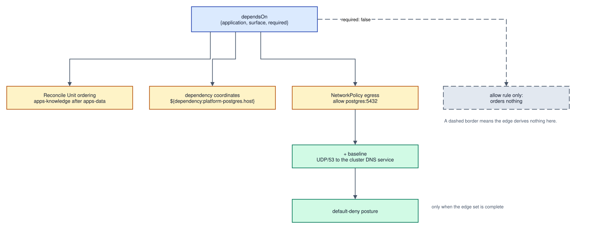
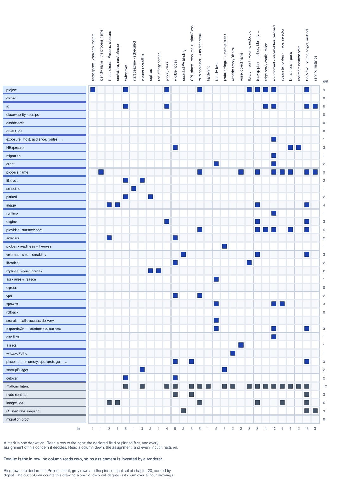
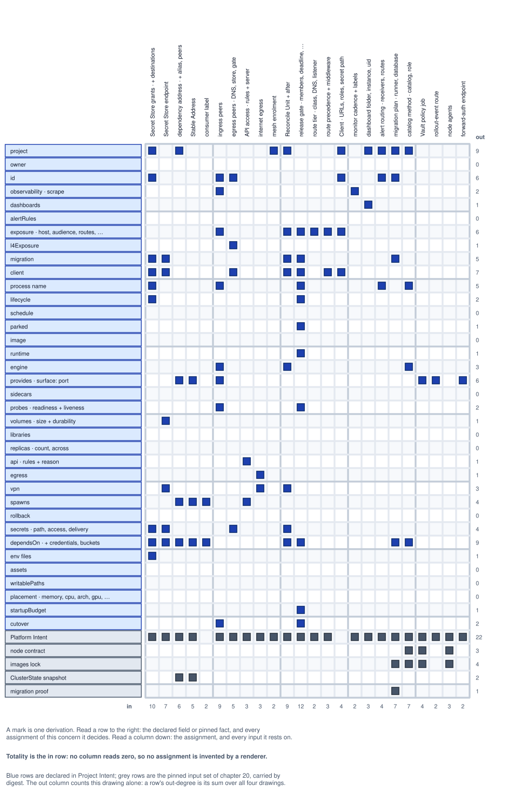
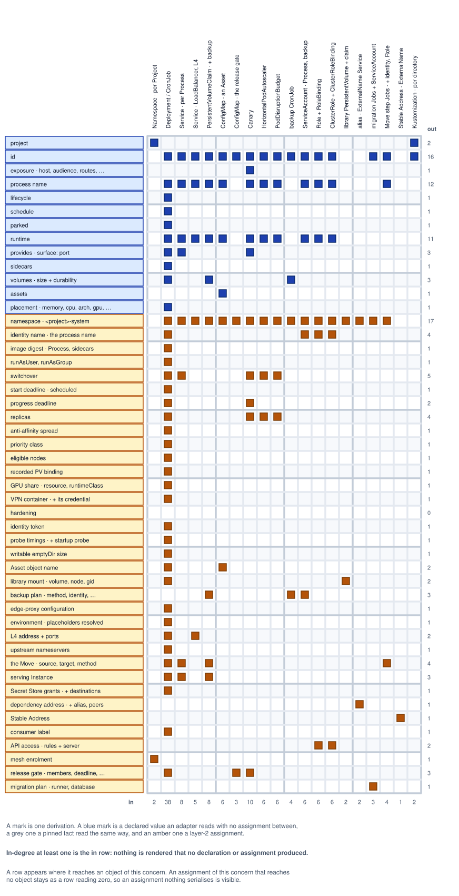
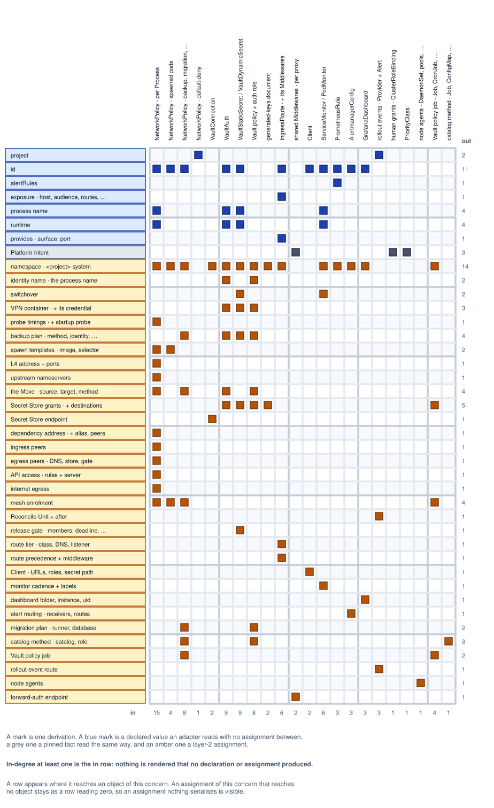
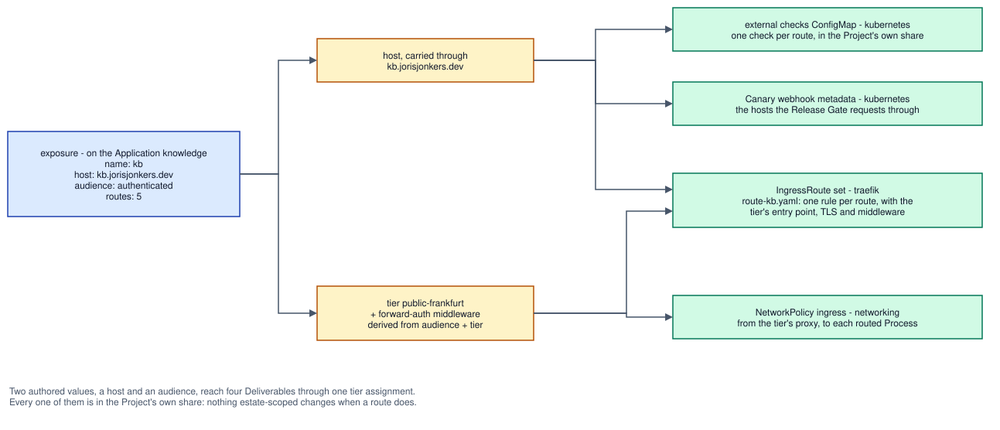
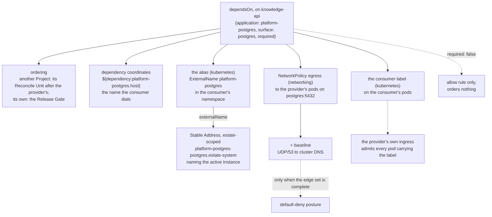
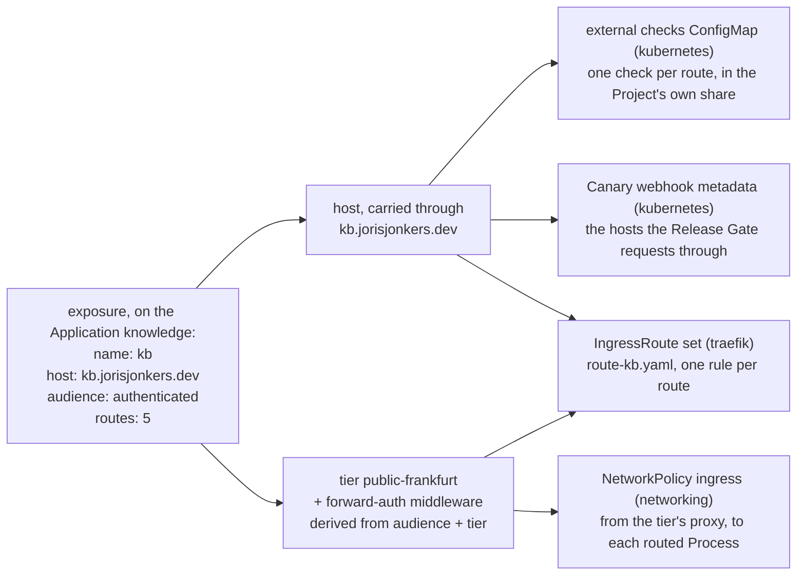

# Chapter 16: Dependencies, identity, and derivation

Chapter 10 defined what a project file declares: Applications, and the Processes
under them. This chapter defines what those declarations *produce*: the edge
set between Applications, the identity each Process authenticates as, the network
policy both derive, and the derivation map that gives this specification its one
machine-checkable property.

## Dependency edges

An edge is a triple. It names the provider, the surface, and whether the
consumer requires it
([0024](../../docs/adr/model/0024-dependency-edges-resolve-against-the-union.md)).

```yaml
dependsOn:
  - {application: platform-postgres, surface: postgres}
  - {application: auth, surface: http, required: false}
```

| field | required | meaning |
|---|---|---|
| `application` | yes | An Application Id, the only referencable identity ([0010](../../docs/adr/model/0010-flat-application-identity.md)). It must resolve in the composed union: `E_UNRESOLVED_APPLICATION`. |
| `surface` | yes | One surface declared by one of that Application's Processes. The port is written once, by the provider, and never restated by a consumer: `E_UNKNOWN_SURFACE` where the name matches nothing. |
| `required` | no | Defaults to `true`. |
| `buckets` | no | The buckets the consumer uses in an object store, each a name of up to 32 lower-case letters, digits and hyphens that begins and ends with a letter or a digit ([The bucket catalog](#the-bucket-catalog)). On an edge whose surface no `s3` Process provides it derives nothing, and is `E_BUCKETS_WITHOUT_OBJECT_STORE`. |

**`provides` moved to the Process; the edge did not.** A port is a property of
a process, so surfaces are declared by the Process that listens
([chapter 10](10-project-intent.md#ports-and-surfaces)). `dependsOn` still
targets `{application, surface}` and nothing a consumer writes changes. Surface
names stay unique within an Application, so the pair resolves to exactly one
Process, one port and one address: `{application: auth, surface: http}` is carried
by Process `auth-api`, and the consumer neither names that Process nor learns
it exists. A provider may move a surface between its own Processes without a
single consumer edit. The Application Id remains the only referencable identity, and
a Process is not referencable from outside its Application
([0052](../../docs/adr/model/0052-an-application-is-the-release-unit.md)).

Edges are declared **per Process**, and an Application's edge set is the union of
its Processes' edges. Within `knowledge` the API reaches Postgres while the
ingest worker reaches RabbitMQ, and neither inherits the other's egress.

An id alone would not carry enough. The only NetworkPolicy code this estate
ever wrote derived policy from credential claims matched to provider exports
carrying an endpoint, `src/deployment/render/networkpolicy.ts:68` returns
nothing when `!provider.endpoint`, and line 70 filters the credential set by
claim name, so a dependency with no credential, `knowledge` calling `auth`'s
`http` surface, produced neither a policy nor a coordinate. Chapter 10 forbids
the consumer writing `AUTH_API_URL` as a literal, so an id-only edge would leave
that dependency with no legal home at all. Naming the surface gives it one, and
puts the port in exactly one place.

### What an edge derives, read outbound



<sub>[Diagram source](#what-a-dependency-edge-derives) · edit by opening the SVG in draw.io</sub>

`required: false` yields an allow rule and orders nothing, so an optional
dependency cannot deadlock a rollout; the consumer's own startup code must
tolerate the provider being absent. `required: true` (the default) also orders.
A provider in another Project is ordered by Reconcile Unit ordering. A provider
in the consumer's own Project that switches `stop-start` is ordered by the
Release Gate: it holds a `blue-green` consumer's new version until the provider
has started its own ([chapter 55](55-delivery.md#release-order)). The graph of
required edges must be acyclic (`E_DEPENDENCY_CYCLE`,
[chapter 40](40-composition.md)).

An edge orders; it does not group. Things that must switch versions together are
Processes of **one Application**: an Application is the unit of atomic release, its
Processes switch together or none switches, and there is no mechanism to couple
two Applications ([0052](../../docs/adr/model/0052-an-application-is-the-release-unit.md)).
Atomicity is authored by drawing the Application boundary, because the graph cannot
see it: a frontend depends on its API, but a dependency edge does not mean the
two must cut over together, and deriving atomicity from every edge would make
the whole estate one unit. A lockstep pair that survives as two Applications is not
a missing feature: it is evidence the boundary is drawn wrong, and the fix is
redrawing it.

### What an edge derives, read inbound

The same edges read from the provider's side produce derivations no Application
could declare locally, because no Application knows its own consumers. They are
computable only over the composed union
([0042](../../docs/adr/model/0042-declarations-compose-from-intent-fragments.md)), which is this
chapter's hard dependency on [chapter 40](40-composition.md).

| inbound derivation | evidence it is needed |
|---|---|
| a database and owning user per consumer | `init-databases.sh` creates `auth_db`, `agents_db`, `knowledge_db` and `n8n_db`, one per Application claiming a Postgres credential. 98 lines the graph already knows. |
| NetworkPolicy **ingress** | a provider must admit its consumers, and only the inbound set says who they are. The provider's policy admits them by the [consumer label](#the-consumer-label) each carries, so the derivation lands in each consumer's own share rather than the provider's |
| browser origin allow-lists | `auth-api` hand-maintains `AUTH_CORS_ALLOWED_ORIGINS` with nine hostnames |
| rotation blast radius | "who breaks if I rotate this?" is the reader set of a Secret Subtree **path**, computed over readers of the path and never over declared key sets |

Two lists the old path also kept by hand are not inbound derivations, though
this table once counted them. The Gatus endpoint list (41 derived references in
288 lines) is one check per route of each exposure, which is the Application's
own: each Application renders its external checks in its own Project's share.
The two edge catalogs (30 and 28 derived references) are not rendered at all,
because the proxy reads each Project's routes itself
([chapter 14](14-platform-intent.md#the-foundation-is-declared)).

Which test suites exercise a provider together with its consumers is the same
inbound question. Whether that membership gates anything is not settled in this
specification, see [Delivery and co-testing](#delivery-and-co-testing).

### The Stable Address

A consumer never learns where its provider runs. Every surface that at least one
edge in the union names derives a **Stable Address**: a name that stays the same
for as long as the surface exists, whichever Instance of the provider currently
serves it
([0093](../../docs/adr/model/0093-a-provider-is-reached-through-its-stable-address.md)).

| part | derives as |
|---|---|
| name | `<application>-<surface>`, an Application Id and a surface name joined; both are DNS labels, and the pair is unique because the Id is unique in the union and the surface is unique in its Application |
| namespace | `estate-system`, one namespace for every Stable Address, rendered by the estate-scoped artifact ([chapter 55](55-delivery.md#rendered-artifacts-and-pins)), so that no Project's own namespace, and no move of a Project, changes it |
| target | the active Instance's address for that surface: the Process's Service in its Project's namespace, or for a provider the Platform document records, its `address` ([chapter 14](14-platform-intent.md#providers)) |
| port | the surface's port, unchanged: the name is an alias, not a proxy, so it cannot remap a port |

A consumer reaches the Stable Address,
`<application>-<surface>.estate-system.svc.cluster.local`, through its own
[alias](#the-alias), and `${dependency:<application>.port}` resolves to the
surface's port. A consumer's rendered configuration therefore depends on the
provider's Id and surface alone, never on its namespace, its Project or its
version, and a provider that moves changes one object, its Stable Address,
rather than every consumer's render.

The `kubernetes` adapter renders a Stable Address as a Service of type
`ExternalName` whose `externalName` is the target's DNS name. That choice has
three consequences, all recorded here because they bound what a Stable Address
can promise:

- **It flips new connections, not old ones.** The cluster DNS answers with a
  short TTL and a lookup after the flip returns the new target, but an
  established connection stays where it is. Moving a provider's consumers
  is therefore the job of the [Fence](55-delivery.md#moves), which closes the
  old Instance's connections; a consumer must reconnect and resolve its
  provider again when a connection drops, an obligation every consumer of a
  surface carries.
- **It cannot hide a port change.** A surface that changes its port still
  changes in two steps ([chapter 50](50-lifecycle.md#expand-and-contract)).
- **It is not a policy target.** Network policy selects pods, never Services,
  so a consumer's egress still names the provider's pods: while a
  [Move](55-delivery.md#moves) is open, the pods of every Instance of the
  provider ([The derived allow set](#the-derived-allow-set)).

An HTTP surface reached through name-based routing or TLS sees the Stable
Address as its `Host` and as the name to present a certificate for; a provider
whose surface depends on either declares the Stable Address among the names it
answers to. The estate's in-cluster HTTP surfaces route by Service and carry no
TLS between Processes, so none does today.

The forward-auth endpoint a tier names is a platform fact, not an edge
([chapter 20](20-resolved-deployment.md#the-forward-auth-endpoint)), and the
tier writes the authenticating surface's Stable Address as that endpoint, so a
move of `auth` repoints the edge's middleware with everything else. A surface
therefore derives a Stable Address when an edge names it or a tier's
forward-auth endpoint is its Stable Address, and no other surface does: a
Stable Address nobody resolves would be a declaration with out-degree zero,
which [property 3](#3-no-dead-declarations-no-declaration-has-out-degree-zero)
forbids.

### The alias

A consumer writes its provider's name as the provider's Application Id, the way a
person would: `http://prowlarr:9696`, never a cluster domain or a namespace
([0109](../../docs/adr/model/0109-a-consumer-reaches-its-provider-by-its-application-id.md)).
Every edge derives the name its consumer dials, and where the provider serves
outside the consumer's namespace, an **alias** that holds that name in it.

| the provider serves | the consumer dials | the alias |
|---|---|---|
| in the consumer's own namespace | the provider's own Service name | none: the name already resolves |
| at an address that is an IP | the IP | none: no name can stand for an IP |
| anywhere else | the alias's name | a Service of type `ExternalName` in the consumer's namespace, its `externalName` the Stable Address |

The alias is named after the provider's Application Id where the edges of the
consumer's Project name one surface of that Application, and
`<application>-<surface>` for each surface where they name several: a name
carries no port, and two surfaces may be two Services. One alias serves every
Process of the Project that holds an edge to it.
`${dependency:<application>.host}` resolves to the name the consumer dials.

An alias is a name in a namespace the Project already fills with Services of its
own. An alias that would take the name of a Service the Project renders (a
Process that provides a surface, and the `-primary` and `-canary` copies Flagger
names after a blue-green one) is refused, and so is a name two Applications'
aliases would both take: `E_ALIAS_COLLISION`.

An alias's `externalName` is the provider's Stable Address, so a provider's
move changes no consumer's render: only the Stable Address, which the
estate-scoped artifact delivers with the Projects that resolve it. Flux creates
each Stable Address once and never updates it, because a [Move](55-delivery.md#moves)
flips its target and a reconcile must not flip it back; its unit,
`estate-stable-addresses`, follows nothing, since an `ExternalName` needs no
target to exist and a consumer resolves it again until its target answers.

### The database catalog

The first row of that table has a producer
([0026](../../docs/adr/model/0026-migration-is-declared-on-the-application.md)). For a
provider Process whose [`engine`](10-project-intent.md#process) is a datastore
that owns databases, the inbound edge set derives a **catalog**: one entry per
consuming **project** naming its database and two Vault roles, the **owner**
role that changes the schema and the **data** role that reads and writes it
([0026](../../docs/adr/model/0026-migration-is-declared-on-the-application.md),
amending [0026](../../docs/adr/model/0026-migration-is-declared-on-the-application.md)'s one entry per consuming Application). Every consuming
Application of a project reads the project's one database; the owner role is
derived for the Application that moves the schema, and only for it
([chapter 10](10-project-intent.md#migration)).

**The names are fixed functions of the project.** A project's database is
`<project>_db`, the spelling the live estate already uses (`auth_db`,
`knowledge_db`), so adopting a project renames nothing in its datastore. Its
owner role is `<project>-owner`, and its data role `<project>-data`. No author
writes any of the three.

**`postgres` is the one engine that owns databases.** A `mongo` does not: its
one consumer today, Overleaf, creates the collections it needs in the database
its connection string names, and no second consumer shares the instance, so a
catalog would derive nothing anyone reads. An edge into a `mongo` derives the
network policy every edge derives, and no database, role or credential;
`credentials` on such an edge is refused, as on an edge to any provider that
owns no database (`E_CREDENTIALS_WITHOUT_DATABASE`). It gains a catalog, and a `catalog` method
in its Platform entry, the day a consumer needs a database of its own. A
`catalog` the Platform document names for an engine that owns no databases is
never applied.

The catalog is **data, not a procedure**. It renders as a `ConfigMap` and the
platform's engine catalog supplies the image and command that applies it, the
same split [0018](../../docs/adr/model/0018-durability-class-derives-a-backup.md) makes
for backups, and for the same reason: [0014](../../docs/adr/model/0014-file-shaped-configuration-is-an-asset.md)
forbids an executable Asset, and a rendered shell script is a diff no reviewer
can validate except by running it. What exists today is 98 lines of
`init-databases.sh` creating `auth_db`, `agents_db`, `knowledge_db` and `n8n_db`, one per Application claiming a Postgres credential, which is exactly the inbound
edge set.

**No password is rendered.** The catalog names a Vault role; Vault's database
secrets engine issues the credential, and `vso` projects it with the
`VaultDynamicSecret` it already emits, into the consuming Process's environment
or into files under a directory, as the edge says
([chapter 10](10-project-intent.md#migration)). The engine mount and its connection
configuration are platform fixtures like the auth method
([chapter 60](60-setup.md#secrets-at-rest)); what the render owns is the per-
consumer role name and the catalog entry.

The credential lives at `database/creds/<role>`, which a `database` grant names
by deriving it from the role
([0029](../../docs/adr/model/0029-a-grant-is-a-union-on-engine.md)). That was the
mismatch R20 recorded (a grant path is not the path a credential is read from)
and it is why the catalog could not render until the grant vocabulary became a
union on engine.

### The bucket catalog

An edge into an `s3` Process names the buckets its consumer uses, and the
inbound edge set derives the store's **bucket catalog** the way it derives a
database catalog: one entry per consuming **project**, naming its key and the
buckets that key may read and write
([0119](../../docs/adr/model/0119-an-edge-names-its-buckets-and-the-stores-method-mints-each-projects-key.md)).

```yaml
dependsOn:
  - {application: platform-garage, surface: s3, buckets: [assets, litestream]}
```

**The names are fixed functions of the project and the edge.** Each bucket is
`<project>-<name>`, the spelling the live estate already uses
(`karakeep-assets`, `karakeep-litestream`), so adopting a project renames no
bucket. A project holds one key per store, named after the project and scoped
to every bucket any of its edges names, and two of its Applications naming one
bucket share it. No author writes a bucket's full name or a key.

**The key is minted, not pre-generated.** The catalog method creates the key in
the store, and writes it to the project's derived document
`secret/data/<project>/<process>/s3`, keys `access-key-id` and
`secret-access-key`, where `<process>` is the store's. Where that document
already exists the method imports it instead, so a store rebuilt from nothing
gets every project's key back. No operator step comes before a new consumer.

**What a consumer reads.** An edge naming buckets hands its consumer three more
coordinates: `endpoint`, the store's S3 surface as an `http://` URL, and
`accessKeyId` and `secretAccessKey`, the project's key, which an env file reads
as `${dependency:<application>.accessKeyId}` and
`${dependency:<application>.secretAccessKey}`. The key is synced to the
consumer's environment like any `env` grant: the Process holds `read` on the
document, and nothing it authors names the path. A bucket's name is written as
the text it is, since the project and the edge fix it. On an edge naming no
bucket, all three are `E_UNRESOLVED_PLACEHOLDER`.

A bucket the platform owns rather than a consumer, such as one whose name is a public website's hostname, is not
a catalog entry: no edge names it.

### Applying the catalog

The catalog is applied in the cluster by its engine's method
([chapter 14](14-platform-intent.md#catalog-methods),
[0102](../../docs/adr/model/0102-the-database-catalog-is-applied-by-its-engines-method.md)),
as the Vault policy job applies the Vault documents, and for the same reason:
writing to a live datastore is an act by an identity with privilege, which is
delivery.

**What it names.** A datastore's applied catalog names every consuming project
the handover ledger puts on `estate`, or every consuming project where the
Platform document carries no ledger. A `legacy` project's database stays the old
path's until the project moves, so the estate path never takes over a database
an old-path Application still owns.

**Where it runs.** For each Process whose engine names a `catalog` method, where
the platform names the Vault policy job and the applied catalog names a
database or a key, the render derives one identity, `<process>-catalog`, in the
datastore's namespace, or the namespace a `serving` location states while the
datastore's Project is `legacy`. Its objects are its datastore's own: they are
in the artifact of the Project that runs the datastore, applied by that
Project's unit with the datastore itself, so the method signs in once the
datastore answers and retries until it does
([0116](../../docs/adr/model/0116-a-project-owns-every-object-it-delivers.md)).
The same unit's own Vault policy job writes the method's role, and the unit
follows the Secret Store's Platform Project
([chapter 20](20-resolved-deployment.md#the-reconcile-unit)); an Application of
another Project that reads the database follows that unit through its required
edge. While the datastore's Project is `legacy` it has no unit on the estate
path, so its catalog's objects and documents are in the estate-scoped artifact
instead, in the `estate-vso-secrets` Reconcile Unit, beside the estate-scoped
policy job that writes them. No Project's unit follows that one: a reader
retries until its database exists. Either way the catalog never waits on a
namespace or a Process that the unit applying it does not bring up:

| object | holds |
|---|---|
| the catalog | one JSON document: the datastore's `host` and `port`, the Secret Store's database `connection` its roles issue through, named after the datastore's Process, so two datastores of one engine never share one, the `admin` login's `path`, `user` and `password` keys, and the `databases`, each a `name`, an `owner` and a `data` role, in name order; or, for an object store, its `host` and `port` on the surface the catalog is applied over, the `admin` login's `path` and `token` key, and the `keys`, each a `name`, the `path` the key is written to and its `buckets`, in name order |
| the identity's Vault policy and auth role | `read` on the admin login's document and its metadata, and `create`, `read` and `update` on `database/roles/<role>` for each role the catalog names, or on each key's `path`, written by the Vault policy job like every identity's |
| a `ConfigMap`, a `Job` and an hourly `CronJob` | the method image, as the user the lock records, handed the catalog; the policy job's requests, deadline and eligible nodes, and its retries, spelled as its Job and CronJob are ([chapter 30](30-deliverables.md#vault-configuration-is-rendered-not-applied)); named `<process>-catalog-<12 hex>`, the digest of the catalog with what the pod runs with, so a changed catalog or method is a new Job, and marked for the applier to recreate it where only the render changed its template. Its pods carry the [consumer label](#the-consumer-label) of the datastore's surface, which the datastore's policy admits |

The method runs as the platform's operator would, once per run and in this
order, for each database the catalog names:

1. It creates the owner and data roles, without login, where they are absent.
2. It creates the database, owned by the owner role, where it is absent.
3. It **adopts** a database that exists and is owned by another role: that
   role's objects in it are reassigned to the owner role, once, and the role
   becomes a member of the owner role, so whatever still signs in as it keeps
   its access until its old path is retired. A run reassigns what an adopted
   role has created since. Adopting hands on whatever the role holds, so a
   database is adopted only from a role with no attribute beyond owning that
   owns no other database; any other, a superuser's among them, fails the run
   instead.
4. It grants the data role read and write on every table and sequence the owner
   role owns, and on those it creates later.
5. It writes the two database roles the Secret Store issues credentials from:
   each login it issues is a member of the owner or the data role, and acts as
   it on sign-in.

It never drops a role, a database or a privilege. A run applied twice changes
nothing the second time.

An object store's method runs, once per run and in this order, for each key the
catalog names:

1. It reads the key's document. Where it holds a key, the method imports that key
   into the store if the store lacks it; where it is absent, the method creates a
   key named after the project and writes its id and secret there.
2. It creates each of the key's buckets where it is absent.
3. It grants the key read and write on each of its buckets.

It never deletes a bucket, a key or a grant, and a run applied twice changes
nothing the second time.

**The admin login.** While the datastore's Project is `legacy`, the method signs
in with the login the old path keeps, which the datastore's `serving` location
names as `admin` ([chapter 14](14-platform-intent.md#handover-ledger)); a legacy
datastore with no `admin` applies no catalog. Once the Project moves, it signs
in with the derived `secret/data/<project>/<process>/catalog`, keys `user` and
`password`, or `token` for an object store, which the platform's operator
writes, as for a backup's and a move's login. A location whose `admin` is not
the shape its engine's catalog signs in with applies no catalog.

## Process identity

Every Process authenticates as its own principal. The ServiceAccount, the
Vault Kubernetes auth role and the Vault policy bound to it are derived **per
Process** ([0031](../../docs/adr/model/0031-identity-per-process.md)). The
ServiceAccount is named for the **Process alone**. The namespace is the
project's, `<project>-system`
([0009](../../docs/adr/model/0009-intent-is-authored-one-file-per-project.md)), so the principal a
Pod presents is `<project>-system.<process>`. No author writes an identity name
([0021](../../docs/adr/model/0021-runtime-mechanics-derive-from-cutover.md)).

The Vault role and its policy carry one name, **`<namespace>-<process>`**:
`auth-system-auth-api`. A ServiceAccount is unique in its namespace, and the
Secret Store has no namespaces: one `kubernetes` auth mount holds every
project's roles, and one list holds every policy. A role named for the Process
alone would be unique only as long as no two projects call a Process the same,
which nothing checks and nothing should.

The name is also the path the `vault-policy` adapter writes the two documents
at, `policies/<namespace>-<identity>`
([chapter 30](30-deliverables.md#vault-configuration-is-rendered-not-applied)),
and that is what keeps it unique. A hyphen does not separate two names that may
hold hyphens: project `a` with a Process `system-c`, and project `a-system`
with a Process `c`, both derive `a-system-system-c`. Written under the name,
the two claim one path, and a path has one owner: the render is refused with
`E_PATH_COLLISION` ([chapter 30](30-deliverables.md#path-allocation)) before
either document exists, so no project's role is ever written over another's.
A backup identity, a migration identity and a move identity are named by the
same rule. A **move identity**, `<process>-move`, exists only while a
[Move](55-delivery.md#moves) of its Process is open: it holds the engine
method's credential on both Instances and one Kubernetes permission, to update
the Stable Addresses that name the source, and it leaves the render with the
source's retirement. That permission is a Role in the Stable Addresses'
namespace, `estate-system`, narrowed by name to those Stable Addresses and
named `<namespace>-<process>-move`, as a cluster-wide name is, since that
namespace holds every Project's; its policy reaches both Instances on the
engine's surface, the Secret Store, the cluster's DNS and the API server.

| project | Application | Processes | ServiceAccount, in the project's namespace | Vault role and policy |
|---|---|---|---|---|
| `auth` | `auth` | `auth-api`, `auth-ui` | `auth-api`, `auth-ui` | `auth-system-auth-api`, `auth-system-auth-ui` |
| `knowledge` | `knowledge`, `knowledge-ingest` | `knowledge-api`; `knowledge-ingest-worker` | `knowledge-api`, `knowledge-ingest-worker` | `knowledge-system-knowledge-api`, `knowledge-system-knowledge-ingest-worker` |

The live cluster carries `auth-api` as that Process's role today. A role is
renamed when its Project is handed over to this path, by the Vault policy job
writing the new name; the old one is reported and a human removes it
([chapter 30](30-deliverables.md#vault-configuration-is-rendered-not-applied)).

A `<application>-<process>` prefix is what the project file makes absurd. Application
`auth` holds Process `auth-api`, so the prefixed rule would render
`auth-system.auth-auth-api` for no gain: `auth-api` is the process name. The uniqueness the prefix existed
to give moves to where a reader can check it: two Processes in one project may
not share a name, `E_DUPLICATE_PROCESS_NAME` at composition
([chapter 40](40-composition.md#identity)).

Vault's Kubernetes auth method binds a role to ServiceAccount names and
namespaces and to nothing finer, so two Pods presenting one ServiceAccount token
are one principal holding the union of the policies bound to it. Two things
follow. Deriving the account from the Application Id (which
`src/adapters/kubernetes.ts:665-669` does today, and which the previous version
of this chapter drew as `id --> ServiceAccount`) makes the grant levels of
[0012](../../docs/adr/model/0012-shared-intent-descends-and-is-lowered.md), now the three
of [0012](../../docs/adr/model/0012-shared-intent-descends-and-is-lowered.md),
documentation rather than a boundary. Under it, `knowledge-api`, which serves anonymous paths from
the public internet, authenticated as the principal holding `read` on
`secret/data/knowledge-system/vault-deploy-key`, the `0400` deploy key only the
ingest worker declares. And because the binding's other half is the namespace,
while a namespace now holds every Application of its project by construction, the
**namespace is not a trust boundary**: `auth-system` is shared, and no grant is
narrowed by living in it. What separates two Processes is the ServiceAccount
name alone, which is exactly why its uniqueness is checked across the whole
project rather than within one Application.

A Process's **effective grant set** is every level's `secrets` list merged with
its own, computed once by the lowering
([chapter 10](10-project-intent.md#the-effective-intent),
[0012](../../docs/adr/model/0012-shared-intent-descends-and-is-lowered.md)). Layer 2
reads the lowered Process, so a shared grant renders one policy statement per
Process that holds it, never one shared statement. Renaming a Process renames its identity: role,
policy and bindings churn, and the new identity must be granted before it
starts.

### What a grant confers

**The grant unit is the path.** A KV-v2 `read` returns the whole document stored
at that path ([0008](../../docs/adr/model/0008-vault-read-is-per-path.md)), so a
policy naming a key subset would promise a narrowing the store never enforces.
The previous version of this chapter promised exactly that, "`read` on the
granted path and keys only", and it was false. That claim is deleted.

That is the `kv` engine's rule. A grant is a union on `engine`
([0029](../../docs/adr/model/0029-a-grant-is-a-union-on-engine.md)): a `database`
grant names a role and confers a read on `database/creds/<role>`, and a `transit`
grant names a key and the operations it performs, each conferring exactly one
Vault path. The unit is still one path per grant; what differs is which path the
declaration derives.

`keys:` documents the keys a reader expects and feeds validation; it confers
nothing, and no author may read it as an access boundary. `keys: ['*']` is not
vocabulary. The boundary can therefore be drawn only at the path, which fixes
the Secret Subtree layout: **no path may hold keys for more than one reader
set** ([0028](../../docs/adr/model/0028-grant-unit-is-the-path.md)).
`secret/data/platform/postgres` splits per consumer, and until it does, every
one of its readers holds `read` on its neighbours' credentials.

### Worked trace: one secret grant

```yaml
# the knowledge project file: the grant sits on the Application, since both
# Processes hold it
project: knowledge
owner: joris
applications:
  - id: knowledge
    secrets:
      - path: secret/data/platform/postgres/kb    # one path, one reader set
        keys: [user, password]                    # documentation + validation
        access: read
        delivery: env
        rotation: {tolerates: restart}
```

```
# platform/env/knowledge-api/base.env
DB_USER=${secret:secret/data/platform/postgres/kb#user}
DB_PASSWORD=${secret:secret/data/platform/postgres/kb#password}
```

The placeholder's path half **byte-matches** the granted path, no mount table,
no `data/` strip, no engine taxonomy
([0030](../../docs/adr/model/0030-secret-delivery-is-env-file-or-self.md)). The `#<key>` half
selects which value fills the variable and confers nothing.

| derives | detail |
|---|---|
| `VaultStaticSecret` | in the project's namespace, `knowledge-system`, syncing the granted path |
| `Secret` | the synced document, every key at the path, because that is what a read returns; not a projection of `keys:` |
| `envFrom` secretRef | where the two placeholders resolve; they never become literal `env` entries |
| Vault policy + auth role | bound to `knowledge-api` in `knowledge-system`, carrying the tier's capabilities on the granted **path**. `read` covers the whole document |
| `rolloutRestartTargets` | from `tolerates: restart`, no longer hand-declared |
| engine choice | static, because `restart` does not require `delivery: self` |
| `NetworkPolicy` egress | to the Secret Store, from the Processes holding the grant and not from their siblings |
| Secret Subtree cross-check | the `data` project must declare this path and list this Application as a reader |
| reader set and roll impact | the readers of the path, over the composed union |
| **inbound**, on the provider | one database and one owning user in `init-databases.sh` |

The last two are computable only over the composed union, which is this
chapter's dependency on [chapter 40](40-composition.md).

Splitting access from binding buys a bidirectional check the single-document
form could not express:

| condition | error |
|---|---|
| a `delivery: env` grant with no matching placeholder | `E_UNBOUND_SECRET_GRANT`, a dead grant, property 3 |
| a `${secret:…}` placeholder whose path byte-matches no grant | `E_UNAUTHORISED_SECRET_REFERENCE` |
| `delivery: env` with `rotation.tolerates: reload` | impossible; a pod's environment is fixed for its lifetime |
| `delivery: env` or `file` on a non-KV engine (`transit/`, `database/`) | impossible; `self` is the only legal delivery for a key that is never materialised or a credential minted per lease |
| `access: self-roll` on a path other Applications read, unacknowledged | `E_ROLL_AFFECTS_OTHER_READERS`, computed over the readers of the path |
| `delivery: env` or `file` where the pinned Platform Intent does not advertise secrets at rest | `E_SECRETS_AT_REST_REQUIRED` ([chapter 60](60-setup.md#secrets-at-rest)) |

The roll-impact check is the one nothing in the estate has today:
`secret/platform/observability` holds the Prometheus token, the Discord webhook
and the Grafana client secret in one document, and one CronJob rolls one of
those keys.

## Network policy

Policy is **default-deny and derived**. A Process's legal flows are exactly its
declared edges, the surfaces it declares, the exposure routes that name it, its
effective grant set, and a platform baseline no Application authors
([0035](../../docs/adr/model/0035-network-policy-is-default-deny-and-render-only.md)).

It is evaluated **per pod**, and it has to be. A namespace holds every Application
of its project ([0009](../../docs/adr/model/0009-intent-is-authored-one-file-per-project.md)), so a
namespace wall separates nothing and no isolation claim may rest on one.
Isolation in this model is the derived edge set plus per-Process identity
([0031](../../docs/adr/model/0031-identity-per-process.md)), both per Process, both
readable in one file.

Opt-in was already measured here and it lost: three NetworkPolicy objects exist
for roughly thirty processes, so the cluster is effectively open east-west.
Three of thirty is what opt-in produces on this estate, and the number is the
argument. Default-deny is expressible only because the edge set is complete: every legal flow named by a declaration someone owns.

The producer is the `networking` adapter
([0035](../../docs/adr/model/0035-network-policy-is-default-deny-and-render-only.md)): every
`NetworkPolicy` in the estate, per Process from the allow set below plus the two
baseline rules, per backup identity from its backup plan
([The backup identity's policy](#the-backup-identitys-policy)), per migration
identity from its migration plan
([The migration identity's policy](#the-migration-identitys-policy)), and one
namespace-wide default-deny per project. Nothing else
emits one, which is what makes the DNS assertion checkable against a single
producer.

### The derived allow set

| rule | derived from | direction |
|---|---|---|
| to a provider's surface port | each `dependsOn` edge of the Process; for an edge to a provider, to the address and port the Platform document gives it ([chapter 14](14-platform-intent.md#providers)) | egress |
| from every pod carrying the consumer label of a surface | each surface the Process provides, read off the Process alone; the label is on every consumer's pods ([The consumer label](#the-consumer-label)) | ingress |
| to the Secret Store | any grant in the Process's effective set | egress |
| from the route tier carrying the audience | a route on the Application's `exposure` naming this Process | ingress |
| from the metrics stack, to the scrape port | the Process's `scrape` surface | ingress |
| to every scrape port | each Process of the metrics stack the Platform document's `telemetry.metrics` names: the Process every Application of the set names in its `scrape`, where it runs, on its scrape surface's port, the other side of the rule above | egress |
| to Flux's controllers, on their metrics port | each Process of the metrics stack, where the Platform document records `bootstrap.flux.metrics` ([chapter 14](14-platform-intent.md#fluxs-metrics)): the pods the `app.kubernetes.io/part-of: flux` label Flux's install gives its controllers selects, in the namespace `bootstrap.flux.sourceRef` names, on that port alone | egress |
| from the Process's own backup identity, to the surface its backups dump | the surface the Platform document's `engines` names for the Process's `engine` | ingress |
| from the Release Gate, to a gate member's first surface | the Process being a member of its Application's release-gate inputs ([chapter 20](20-resolved-deployment.md#the-release-gate)), and the Platform document's `delivery.gate` naming the gate: every Process of the gate, on the port the member's Canary service targets, where the gate's own requests arrive ([chapter 55](55-delivery.md#the-release-gate)) | ingress |
| to every pod carrying the member label, on any port | every Process of the Application the Platform document's `delivery.gate` names ([The member label](#the-member-label)) | egress |
| from Flux's notification controller, to the Reporter's `http` surface | the Platform document's `delivery.reporter` naming the Application ([chapter 14](14-platform-intent.md#delivery-policy)): the first of its Processes that provides the surface, and no other. The peer is in the namespace `bootstrap.flux.sourceRef` names and is selected by the `app` label Flux's own install gives the controller, because Flux is in the bootstrap set and no Process, so nothing renders a label for it | ingress |
| to where the Kubernetes API answers, by address | the Process's `api`, and the Platform document's `apiAccess.server` ([Kubernetes API access is declared and admitted](#kubernetes-api-access-is-declared-and-admitted)) | egress |
| between a provider's Instances, on the surface its engine's move method syncs over | an open Move of the provider ([chapter 55](55-delivery.md#moves)): from the target Instance to the source while the sync runs, and back while reverse replication runs | egress and ingress |

While a [Move](55-delivery.md#moves) of a provider is open, every rule above
that names the provider's pods names the pods of **every** Instance of it: a
consumer's egress admits the source and the target alike, and both admit the
consumer. The flip of the [Stable Address](#the-stable-address) then needs no
policy change in any consumer's Project, which is what lets it happen at once,
and the rules narrow to the one remaining Instance when the source is retired.

A peer on another Application is admitted, and reached, where it runs: the
`<project>-system` of the project that declares it, under its Process's name.
While that project is still `legacy`, the old path may run it elsewhere, so the
peer is where the handover ledger's `serving` states it runs, and so is the
address a Process is handed for it
([chapter 14](14-platform-intent.md#handover-ledger)).

### The consumer label

A provider admits its consumers without naming them. Every Process whose edge
reaches a surface of an Application carries, on its pods, the label
`consumes.deploy-kit.jorisjonkers.dev/<application>.<surface>: "true"`, named
by the provider's Application id and the surface. The provider's policy admits,
on each surface it provides, every pod carrying that surface's label in any
namespace labelled `app.kubernetes.io/managed-by: deploy-kit`. The rule is read
off the Process's own surfaces and never off the union's edges, so it is in the
policy whether or not anything consumes the surface, and a consumer added,
changed or removed changes its own share alone
([0116](../../docs/adr/model/0116-a-project-owns-every-object-it-delivers.md)).

A migration's runner reaches its datastore the same way: its pods carry the
label of the surface its Application's edge names
([The migration identity's policy](#the-migration-identitys-policy)), so the
datastore admits it as it admits every consumer, and names no migration
identity. So does a catalog method: the pods of its Job and its CronJob carry
the label of the surface its engine connects on
([Applying the catalog](#applying-the-catalog)). An edge to a provider derives no label: it reaches
an address, and the model renders no policy for what answers there.

The label is rendered only from an edge the union resolved, on pods only this
model renders, in namespaces only it manages, so a pod carries it only where a
declaration someone owns put it there. A consumer the old path still runs
carries no label, so a provider's policy admits it once its Project is handed
over; until then the policy set is render-only
([Audit before enforce](#audit-before-enforce)).

A label's name is at most 63 characters of letters, digits, `-`, `_` and `.`,
starting and ending with a letter or digit. An Application whose id, joined by a
dot to a surface one of its Processes provides, is no label name is refused at
that Process as soon as the fragment is read: `E_SURFACE_LABEL_INVALID`.

### The member label

The Release Gate reaches every gate member without naming one. The pods of every
member, a Process its Application's release-gate inputs name, carry
`gated.deploy-kit.jorisjonkers.dev/release-gate: "true"`. The gate's policy
admits egress to every pod carrying it, in any namespace labelled
`app.kubernetes.io/managed-by: deploy-kit`, on any port, and each member's
policy admits the gate on the one port its Canary service targets, the port of
its first surface. The gate's rule reads no Project's Processes, and a member's
rule reads the Platform document's `delivery.gate` alone, so a member added,
changed or removed changes its own share and never the gate's
([0116](../../docs/adr/model/0116-a-project-owns-every-object-it-delivers.md)).

The gate's rule names no port because members serve on many and no one fact of
the delivery Project holds them; the member's own ingress is what bounds it. The
label is rendered only on a Process the release-gate inputs name, on pod
templates only, never in a selector, the same trust as the consumer label's.

### The baseline

Two rules are in the rendered set for every Process and appear in no
declaration:

| baseline rule | why it cannot be optional |
|---|---|
| **egress UDP/53 to the cluster DNS service**, in every policy carrying `Egress` in `policyTypes`, admitted by the namespace the Platform document's `substrate.clusterDns` names ([chapter 14](14-platform-intent.md#substrate-facts)) | once any egress policy selects a pod, all unmatched egress is denied, DNS included. The dead renderer generation shows the failure: `providerPolicy` (`src/deployment/render/networkpolicy.ts:86-102`) emits an egress rule to the provider's pod and nothing else, so the consumer cannot resolve the `svc.cluster.local` name the coordinate derivation just handed it, and fails with a DNS timeout diagnosed as "Postgres is down". TCP/53 rides the same rule, for truncated responses. |
| **ingress from the metrics stack** to any declared scrape port, and the metrics stack's **egress** to it | the same file omits it; a process that silently loses scrape stops alerting, which is the failure observability exists to prevent. Either side alone loses it: the metrics stack's own policy denies what the target's admits |

A Process that serves DNS is the one exception to the DNS rule. It must keep
answering while the cluster's DNS is down, so it resolves through the Platform
document's upstream nameservers instead
([chapter 10](10-project-intent.md#l4-exposure)): its policy carries no rule
to the cluster's DNS and admits those addresses, on UDP and TCP port 53.

The DNS half is checkable statically: **every rendered NetworkPolicy carrying
`Egress` in `policyTypes` also matches UDP/53**. A `conftest` rule asserts it
over the rendered set, and that assertion is the property this baseline exists
to hold.

A baseline rule is not authorable and not exceptable from an Application document. An
exception to one is a change to the derivation, reviewed once, applied to every
Process at once.

### The mesh tunnel

In a namespace the Platform document enrols in the ambient mesh
([chapter 14](14-platform-intent.md#the-mesh)), every policy the `networking`
adapter renders there admits what the mesh moves traffic onto:

| rule | derived from | direction |
|---|---|---|
| the tunnel port beside the application port | every ingress rule above | ingress |
| the tunnel port beside the provider's port | every egress rule to a pod, the cluster's DNS excepted | egress |
| from the address the mesh rewrites the kubelet's probes to, on each probe port | a Process the kubelet probes | ingress |

An enrolled peer arrives on, and connects to, ztunnel's tunnel port rather than
the application port, and the kubelet's probes arrive from the one link-local
address ambient rewrites them to; a default-deny policy that admits neither
starves every enrolled Process the day policy is enforced. The cluster's DNS is
never enrolled ([chapter 60](60-setup.md#service-mesh)), so its rule stays as
the baseline states it. The rules are the enrolled side's alone: whether the
peer is enrolled changes nothing in this Project's render, so one Project's
enrolment re-renders that Project only. The port and the address are facts of
the mesh, not of any document
([chapter 20](20-resolved-deployment.md#the-mesh)).

### The backup identity's policy

A backup runs as its own identity, in its own pods
([chapter 10](10-project-intent.md#storage-and-durability)), and the namespace's default-deny
selects those pods like any other. So each backup identity has a policy of its
own, derived from its backup plan and from nothing an Application authors
([0091](../../docs/adr/model/0091-a-backup-identity-has-a-policy-of-its-own.md)):

| rule | derived from | direction |
|---|---|---|
| to the Process it backs up, on the surface the method dumps | the `surface` the Platform document's `engines` names for the Process's `engine` ([chapter 14](14-platform-intent.md#engines)); none where the method reads the volume alone | egress |
| to the cluster DNS service | the baseline, as for every policy carrying `Egress` | egress |
| to each address range of the off-cluster destination, on its port | the `egress` of the class's `offCluster` ([chapter 14](14-platform-intent.md#durability-policy)); none for a class that keeps its copies in the cluster | egress |

Nothing reaches a backup pod: it serves nothing, so its policy admits no ingress.

**The Secret Store is not a peer.** A backup holds its destination's credential,
and the credential it dumps its Process with, through grants delivered `env`, so the operator reads the Secret Store and the
pod mounts no token and never calls it
([The token is mounted only where the pod authenticates](#the-token-is-mounted-only-where-the-pod-authenticates)).
A rule to a service the pod cannot authenticate to would admit nothing it uses.

The other half is on the Process: its own policy admits its backup identity on
the dumped surface, the last row of the allow set above. One without the other
is a backup the datastore's own default-deny turns away.

### The migration identity's policy

A migration runs as its own identity too, in the pods of its two Jobs
([chapter 55](55-delivery.md#failure-and-undo)), and the default-deny selects
them like any other. Its policy is derived from the migration plan
([chapter 20](20-resolved-deployment.md#the-migration)):

| rule | derived from | direction |
|---|---|---|
| to the datastore holding the project's database, on the surface the Application's edge names | the plan's `database` | egress |
| to the Secret Store | the plan's `credential`: the runner logs in and reads the owner credential itself | egress |
| to the cluster DNS service | the baseline, as for every policy carrying `Egress` | egress |

Nothing reaches a migration pod, so its policy admits no ingress. Here the
Secret Store **is** a peer, where for a backup it is not: the credential is
delivered `self`, so the pod mounts its token and calls the store.

The other half is on the datastore, and it is the consumer rule: the runner's
pods carry the [consumer label](#the-consumer-label) of the surface the
Application's edge names, and the datastore admits every pod that carries it.
No datastore's policy names a migration identity, so an Application that gains
or drops a changelog changes its own share alone.

### The token is mounted only where the pod authenticates

`automountServiceAccountToken` derives from what the Process presents its token
to, and from nothing else
([0031](../../docs/adr/model/0031-identity-per-process.md)):

| the Process | token |
|---|---|
| holds at least one grant with `delivery: self` | mounted |
| declares `api`, and is admitted to hold it | mounted |
| holds only `env` or `file` grants, or none at all, and declares no `api` | **not** mounted |

The obvious rule (no grant, no token) is wrong, and `platform-postgres` is the
counter-example. It holds a grant and needs no token: under `delivery: env` the
VSO operator performs the Vault read and projects the result, so the pod never
authenticates to anything. Under `delivery: file` the kubelet does the
projecting. `delivery: self` means *the pod itself* presents its ServiceAccount
token to Vault, and `api` means it presents it to the Kubernetes API. Those are
the two things a token is for.

This is [0041](../../docs/adr/model/0041-no-process-rbac-in-v1.md)'s reasoning
applied to the token instead of the Role, and it reaches the same place: the
privilege a Process of this estate actually needs is smaller than the default,
and the field that says so already exists.

### No Role grants what an absence already denies

Three Applications share `data-system`, and the only thing stopping `platform-valkey`'s
ServiceAccount from reading `platform-postgres`'s Secret is that no Role grants
it. That is an absence rather than a boundary, and the model turns it into a
checked property rather than rendering RBAC
([0041](../../docs/adr/model/0041-no-process-rbac-in-v1.md)).

**v1 renders no `Role`, `ClusterRole`, `RoleBinding` or `ClusterRoleBinding` for
a Process that declares no `api`**, and no Process holds Kubernetes API access
the Platform document did not admit: `E_PROCESS_RBAC_GRANT`, checked where the
project files are read beside the Platform document
([chapter 14](14-platform-intent.md#kubernetes-api-access)) and held as an
estate-wide invariant over the composed union
([chapter 40](40-composition.md#secrets)). Under `delivery: env` and
`delivery: file` the kubelet projects the Secret and the pod never calls the API,
so a least-privilege Role for these Processes grants nothing; rendering sixty
objects that grant nothing would make an empty Role read as an oversight and
give a future broad grant somewhere to hide.

### Kubernetes API access is declared and admitted

A Process that genuinely calls the Kubernetes API is the case the rule above
refuses to guess at. It declares what it asks, in `api`
([chapter 10](10-project-intent.md#kubernetes-api-access)), and the Platform
document admits its Application by name
([chapter 14](14-platform-intent.md#kubernetes-api-access),
[0092](../../docs/adr/model/0092-api-access-is-declared-on-the-process-and-admitted-by-the-platform.md)).
An admitted declaration derives these, and nothing else derives any of them:

| derived | from |
|---|---|
| a `Role` in the Process's namespace holding its `namespace`-scoped rules, `core` spelled as the unnamed group, where it has any | the Process's `api.rules` |
| a `RoleBinding` of that role to the Process's one ServiceAccount | the Process's identity ([Process identity](#process-identity)) |
| a `ClusterRole` holding its `cluster`-scoped rules, where it has any | the Process's `api.rules` |
| a `ClusterRoleBinding` of that role to the same ServiceAccount | the Process's identity |
| a mounted token, where it holds a rule | the declaration itself ([above](#the-token-is-mounted-only-where-the-pod-authenticates)) |
| egress to where the API answers, by address | the Platform document's `apiAccess.server` |

A declaration with no rules derives the egress alone: no role, no binding and
no token, because the Process authenticates to the API with its users' own
tokens and holds nothing itself. It is admitted all the same, since the way to
the API server is the platform's to give.

A rule's scope decides its role. A `namespace` rule reaches only the
Process's own namespace, so it is a `Role` there, named for the identity. A
`cluster` rule, and a rule that names no scope, reaches every namespace and the
kinds no namespace holds, so it is a `ClusterRole`. The `ClusterRole` and its
binding are cluster-scoped, so no namespace holds two apart: both are named
**`<namespace>-<identity>`**, the name the identity's Vault role carries, for
the same reason. Writing a rule at the narrower scope is how a holder that
writes only its own records, as the Release Gate does its release records,
keeps that write out of every other namespace. A platform that admits an
Application to its own namespace alone, in `apiAccess.namespaceHolders`, gives
it `namespace` rules and nothing more
([chapter 14](14-platform-intent.md#kubernetes-api-access)).

Admission is by id, so it holds only for an id one Application carries. A
second project that names an Application of its own after an admitted one is
not the Application the platform meant, and nothing in the set says which is:
both declarations are refused, rather than either rendered.

Nothing narrows a rule: the model renders the rules as declared. What keeps a
grant small is that it is written down, with a reason, in the repository whose
code needs it, and that the platform names who may write one at all. A rule on
`secrets` is legal for an admitted holder and is exactly as visible as any
other: Flagger reads the Secret a pod names to learn that it is excluded from
configuration tracking ([chapter 55](55-delivery.md#secret-rotation)), and it
declares that one verb.

The worked [`delivery`](examples/delivery/delivery.project.yml) project holds the
estate's three holders: Flagger, the Release Gate and the Collector.

### Spawn templates

A Process that declares a spawn template
([chapter 10](10-project-intent.md#spawn-templates)) derives, for each:

| derived | from |
|---|---|
| `namespace` rules to `get`, `list`, `watch`, `create` and `delete` pods and to `get` their logs, beside the Process's own | the template's existence |
| a label every pod carries, `deploy-kit.jorisjonkers.dev/spawned-from: <process>-<template>`, and the consumer label of each edge | the template's name and `dependsOn` |
| one `NetworkPolicy`, named `<process>-<template>`, selecting that label: ingress from the Process alone on the surfaces the template provides; egress to its edges' peers, the cluster's DNS and, where declared, the internet | the template |
| egress in the Process's own policy to those pods, on those surfaces | the template's `provides` |
| the variables `SPAWN_<NAME>_IMAGE` and `SPAWN_<NAME>_LABELS` | the images lock and the labels above |

The rules are `namespace` rules, so an Application admitted to its own
namespace alone may hold them. A provider admits the pods by the consumer label
they carry, as it admits any consumer, so neither names the other.

### Internet egress

A Process that reaches public addresses no edge names (a crawler, a workflow
engine calling APIs it was configured with, a browser fetching what it is
given) says so on the Process, with a reason, and names no destination:

```yaml
processes:
  - name: karakeep
    egress:
      to: internet
      reason: The browser fetches the pages it bookmarks.
```

`to` is a closed vocabulary whose one member is `internet`, and `reason` is
required. Nothing is admitted: like a capacity exception, the declaration is a
choice its owner writes down, visible in the repository whose code needs it.
It derives one egress rule in the Process's own policy, after its peers: an
`ipBlock` of `0.0.0.0/0` on every port, **except** a fixed set no author and
no Platform fact can change:

| excepted | is |
|---|---|
| `10.0.0.0/8`, `172.16.0.0/12`, `192.168.0.0/16` | the private ranges, the cluster's pod and Service ranges and every LAN among them |
| `100.64.0.0/10` | the tailnet |
| `169.254.0.0/16` | link-local, cloud metadata among it |
| `127.0.0.0/8` | loopback |

The set is fixed rather than read from the Platform document, so a new LAN or a
changed pod range cannot open a hole the rule did not intend. Inside the
estate a Process reaches what its edges derive, and nothing else.

Two limits follow from the substrate, not the model:

- **IPv6 is not admitted.** The rule names an IPv4 block only, so a Process
  that declares internet egress reaches no public IPv6 address.
- **A pod's own node is always reachable.** Kubernetes admits traffic from a
  pod to the node it runs on whatever a policy says, so the excepted ranges do
  not cover the node's own address.

A `to` outside the vocabulary, a missing or empty `reason`, and any authored
range are refused by the schema (`schema`), at the field.

A Process attached to the VPN derives the same rule without declaring it,
because the tunnel's endpoint is a public address
([chapter 10](10-project-intent.md#vpn-attachment)); its reason says so. The
Process's own traffic is the VPN container's to route, and a policy cannot see
inside the tunnel: what leaves the pod is the tunnel, to the provider.

### Audit before enforce

Default-deny does not ship on `networking.k8s.io/v1` alone. That API has no
audit, dry-run or log-only mode (a policy is enforced the moment it selects a
pod), and k3s's embedded kube-router controller has none either. The previous
setup checklist made "default-deny NetworkPolicy is in **audit** mode, not
enforce" a hard precondition of the first production apply, and that item could
never be ticked: a grep for `cilium|calico|kube-router|flannel` across `src/`,
`spec/`, `schemas/`, `fixtures/` and `docs/` returned zero hits, and no decision
had picked a CNI. It becomes satisfiable only through a CNI carrying a
non-enforcing policy stage ([chapter 60](60-setup.md#cni),
[0035](../../docs/adr/model/0035-network-policy-is-default-deny-and-render-only.md)).

**Render-only is the v1 stage**
([0035](../../docs/adr/model/0035-network-policy-is-default-deny-and-render-only.md)). The
`networking` adapter emits the complete policy set and the tree is diffed in
review; nothing loads it until [0035](../../docs/adr/model/0035-network-policy-is-default-deny-and-render-only.md)
picks a CNI with a non-enforcing stage. What v1 owes is the policies, and
promoting them is a rollout decision waiting on a premise nobody has settled,
so an unpicked CNI does not block the render.

| stage | what runs | exit criterion |
|---|---|---|
| render-only, **v1** | the policy set is rendered and diffed in review; nothing is loaded | the CNI decision lands |
| audit | the set is loaded into the non-enforcing stage; observed flows are diffed against the rendered allow set | **zero undeclared flows over 14 days** |
| enforce | the set is enforced estate-wide | - |

An edge whose target resolves to neither an Application in the union nor a
provider is `E_UNRESOLVED_APPLICATION`, and one resolving to a provider without
coordinates for that surface is `E_PROVIDER_WITHOUT_COORDINATES`
([0024](../../docs/adr/model/0024-dependency-edges-resolve-against-the-union.md)). Both
existed as silence before: `{application: stalwart, surface: smtp}` derived no
coordinates and therefore no egress rule, producing a valid policy with a
missing rule, a timeout on-call rather than a build error.

One cost is accepted rather than mitigated: an undeclared east-west path (this
estate is known to hold some) stays invisible until promotion, and then breaks
a process.

The second cost this section used to accept is now refused. A typo in a
`surface` name is `E_UNKNOWN_SURFACE` on the consuming edge, and a target
outside both namespaces is `E_UNRESOLVED_APPLICATION`; a rendered policy can no
longer be silently short a rule while every gate stays green. What remains
genuinely silent is a flow nobody declared at all, which is what the audit stage
exists to find.

## The derivation map

The normative set of derivations, as four matrices: two halves, each split by
concern. A **mark is one derivation**: read a row to the right for everything
that input decides, and a column down for everything an output rests on.
Two hundred arrows between two tall columns is a hairball no layout fixes
(which line ends where stops being answerable), so the relation is carried by
position instead.

The first half has the fields of Project Intent and the pinned input set of
[chapter 20](20-resolved-deployment.md#pinned-inputs) as rows, and the layer-2
assignments as columns. The second has those assignments **and** the declared
fields and pinned facts an adapter reads directly as rows, and the Deliverables
as columns. Each half is split by concern: **workload**, what a pod runs and the
objects that run it, and **wiring**, the identity, secrets, network, edge,
monitoring and ordering around it, with the estate-scoped objects. The `in` row
under each grid is the in-degree of that column and the `out` column the
out-degree of that row within that drawing, so both properties below are
countable off the drawings: a column's in-degree is read off the one drawing
that holds it, and a row's out-degree is its sum over all four.

The marks are the derivations the production compiler performs, in
`src/resolve/` and in the renderers under `src/adapters/`. A derivation the
compiler does not perform is not drawn, whatever another chapter says it
renders.



*Workload assignments: every declared field and pinned fact, and the assignment
of what a pod runs that it decides. No column reads zero: that is provenance.*



*Wiring assignments: every declared field and pinned fact, and the identity,
network, edge, monitoring and ordering assignment it decides. No column reads
zero.*



*Workload Deliverables: every declaration and assignment, and the object that
runs a pod it reaches. No column reads zero: that is in-degree at least one. A
blue mark is a declared value that reaches the object with no assignment in
between.*



*Wiring Deliverables: every declaration and assignment, and the policy, secret,
edge, monitoring or estate-scoped object it reaches. No column reads zero.*

<sub>[Diagram source](#the-derivation-map) · edit by opening the SVG in draw.io</sub>

Two edges carry the amendment. `namespace` hangs off `project`, not off `id`, so
ten live namespaces come out unchanged and no Application can name its own
([0009](../../docs/adr/model/0009-intent-is-authored-one-file-per-project.md)). And `placement`
feeds both the eligible-node set and, read directly by the adapter, the
controller's requests and limits, so the numbers a Process asks for and the
nodes it may land on are one declaration compared against one pinned input: the
node contract's `allocatable`, never a live read
([0017](../../docs/adr/model/0017-placement-is-hard-dimensions.md)). The request
it is compared as is the Process's own with its sidecars and its VPN container
beside it, twice over for a `continuous` cutover, which needs room for both
versions at once; a library holds it to the library's node, and an L4 exposure
to its address's site or node. No node satisfying every declared dimension is
`E_PLACEMENT_UNSATISFIABLE` at build, before an object is rendered. Eligibility
is not bin-packing: three Processes asking `memory: 2Gi` each pass against a
4096Mi node, and the scheduler refuses the third at apply.

There is no derived hostname. `exposure` hangs off the **Application**, and the
`host` it carries is a full authored FQDN
([0023](../../docs/adr/model/0023-exposure-is-declared-by-audience.md)), so every
object that names the host reads the declaration itself rather than a value
layer 2 assembled from a label, a tier policy and a cluster domain: the
IngressRoute, the Canary's webhook metadata, the Client's URLs, and every
`${exposure:…}` placeholder that names it. The Platform Intent contributes to no
hostname. What layer 2 still decides on that path is the route tier (its ingress
class, DNS publication, listener and certificates) and each route's precedence
and middleware chain, which is why the exposure row keeps a mark in both
columns. `provides` stays on the Process, so the two ends of a route are
declared in the same document without a port ever being restated: the
Application says which host and path, the Process says which port.

Two derived values are not columns. The **Application revision** is a digest
over the resolved element, so it rests on every other assignment of its
Application at once; it reaches the Canary's webhook metadata, the annotation on
a gated Application's VSO objects, the migration Jobs' names and an open Move's
target Instance ([chapter 20](20-resolved-deployment.md#the-application-revision)).
And every Deliverable's **path** is written by its adapter from `project` and
`id`, which is what the `Kustomization` column records: no step derives a path
plan ahead of the adapters.

Three rows read zero in all four drawings. `owner` is carried into the
Effective Intent and read by nothing that renders. `rollback` is read by a check
alone, which refuses an irreversible Move it does not acknowledge, and derives
no value. And the `hardening` assignment is recorded in the projection, while
the `kubernetes` adapter writes the one `restricted` posture as a constant.
Each is [open below](#open-in-this-chapter) rather than hidden by the drawing.

The map is dense on purpose and is not meant to be read by eye. Its value is
that the three properties below are **checkable by a script** over the
renderer's attribution table, which
[0037](../../docs/adr/model/0037-six-registered-adapters-satisfy-one-port.md) requires every Deliverable to
carry.

### Worked trace: one exposure declaration



<sub>[Diagram source](#worked-trace-one-exposure-declaration) · edit by opening the SVG in draw.io</sub>

Before this model the estate kept that host in six places, with two conformance
tests (`route-auth-conformance.test.js`, `gatus-route-coverage.test.js`)
existing only to detect when the six disagreed. Under property 1 those tests
have nothing left to check: every object on the path reads the one declaration,
so nothing downstream restates the host. That upstream is an **Application**
field: one host fronting two Processes, `auth.jorisjonkers.dev/api` to
`auth-api` and `/` to `auth-ui`, is a single exposure with two routes, and it is
unexpressible while `exposure` sits on a Process.

The hostname is no longer assembled. `host` is the full FQDN as authored and is
carried through untouched; what layer 2 decides on this path is the tier that
carries the audience and the middleware chain that follows from it,
`contentPolicy` included
([chapter 20](20-resolved-deployment.md#authority)).

## The three properties

An earlier draft said the criterion was "any node with two inbound arrows is a
bled concern". That is wrong. A `Deployment` legitimately draws on image,
configuration, grants, probes, placement and hardening, many inbound arrows, no
bleed. Convergence on an *object* is normal; convergence on the same *field* of
an object is the defect.

### 1. Provenance: no Deliverable has in-degree zero

Every rendered object is reachable from at least one declaration or one pinned
input. An object with no inbound edge is hand-written, and must become derived
before its Project hands over
([chapter 30](30-deliverables.md#a-projects-handover-diff)).

This is the property that was violated seven ways over: `reachability.yml`, both
edge catalogs, both IngressRoutes and the Gatus endpoint each declared
`kb.jorisjonkers.dev` independently, with no declaration upstream of any of
them.

### 2. Single authority: no field has two declaring sites

For each field of each Deliverable, exactly one declaration is its authority.
Checked against the attribution table rather than the diagram, because the
diagram is object-level and this property is field-level. That granularity gap
is deliberate: drawing it per-field would make the map unreadable without making
the check any stronger. Which side of the layer boundary each field's authority
sits on is settled once, in
[chapter 20](20-resolved-deployment.md#authority).

### 3. No dead declarations: no declaration has out-degree zero

A declared field that derives nothing is ceremony, and this property is the one
that would have caught the estate's clearest example.
`rollbackTargetRetention` was validated for `minimumDays >= 90` and
`acknowledged: true`, appeared in the readiness scorecard, was documented in
three `PLATFORM.md` files as failing *never*, and was read by no renderer or
adapter. Every application declared the identical value. Out-degree zero.

No surface is exempt from this check. The override mechanism that used to be
exempt is deleted
([0022](../../docs/adr/model/0022-a-derived-value-has-one-declaring-site.md)), so the
dead-declaration property now runs over every declaration in every project file.

## What the properties would have caught

| defect | property | how it presents |
|---|---|---|
| `kb.jorisjonkers.dev` in seven places | 1 | six Deliverables with in-degree zero |
| `rollbackTargetRetention` inert | 3 | a declaration with out-degree zero |
| `platform.layer` wrong in 7 of 7 applications | 3 | out-degree zero, it fed a registry, never the Reconcile Unit |
| a ServiceAccount per Application, two Processes sharing one principal | 2 | one identity field with two Processes' grant sets declaring it |
| 41 Gatus checks, no notifier | 1 | `notifier route` unreachable from any declaration |
| 60 duplicated `OTEL_*` lines | 2 | six declaring sites for one field |
| a secret granted but never referenced | 3 | a `delivery: env` grant with out-degree zero |
| a `gpu-model-gtx960m` term no node advertises | 3 | out-degree zero, the scheduler dropped the soft term without an event and it rendered nothing; every dimension is now hard, so it is `E_PLACEMENT_UNSATISFIABLE` at build |

## Delivery and co-testing

This chapter derives the edge set, the identities and the policy set; it does
not say who applies them or in what order a release runs, which is
[chapter 55](55-delivery.md)'s. Whether dependency on other units for testing
gates a deploy is co-testing, and stays parked in
[docs/adr/deferred/](../../docs/adr/deferred/README.md).

## Open in this chapter

1. **The CORS predicate.** `AUTH_CORS_ALLOWED_ORIGINS` lists nine hostnames, and
   the inbound derivation above claims they are the inbound edge set projected
   onto the hosts those Applications declare. The shape is right; the predicate is not
   established. A browser origin is needed only by a consumer making
   cross-origin requests *to* `auth-api`, whereas an OIDC redirect flow (what
   `GrafanaOidc`, `N8nOidc` and `RabbitMqOidc` exercise) needs no CORS entry.
   The derivation is probably "inbound edges declaring a browser surface", not
   "all inbound edges".
   **Owner:** joris.
   **Settled by:** diff `auth-api`'s live `AUTH_CORS_ALLOWED_ORIGINS` against
   the inbound edge set, classifying each of the nine as browser or redirect.
   **Blocks:** rendering the allow-list at all; it stays hand-maintained until
   the predicate is written here.
2. ~~**Nothing enforces the rendered policy set.**~~ Decided: render-only is
   v1's stage ([0035](../../docs/adr/model/0035-network-policy-is-default-deny-and-render-only.md)),
   so this is not a gap in the model but the first stage of a sequence whose
   exit criterion is [0035](../../docs/adr/model/0035-network-policy-is-default-deny-and-render-only.md)'s lab
   evaluation. That evaluation is 0035's own settling test and is recorded
   there, not here.
3. **Three rows with out-degree zero.** [The derivation map](#the-derivation-map)
   draws `owner`, `rollback` and the `hardening` assignment reaching nothing,
   which [property 3](#3-no-dead-declarations-no-declaration-has-out-degree-zero)
   forbids. `owner` is documented as who is notified, and nothing renders a
   notification target; `rollback` acknowledges an irreversible Move, which is
   admission rather than a derived value; `hardening` has one value, which the
   `kubernetes` adapter writes without reading it.
   **Owner:** joris.
   **Settled by:** for each row, either a derivation the compiler performs, or
   a rule in this chapter that exempts an acknowledgement from property 3.
   **Blocks:** property 3 holding over the map as drawn.

## Diagram sources

Each diagram above is drawn in draw.io and committed as an SVG with the editable
diagram embedded, so opening the `.svg` in draw.io recovers the drawing. The
mermaid below is the same structure in text, kept so a diagram change shows up in
a plain diff. **Where the two disagree the SVG is the diagram and the mermaid is
what gets fixed**, the same precedence this repository uses between a chapter and
an ADR.

### What a dependency edge derives



### The derivation map

```mermaid
flowchart LR
    subgraph DEC["Declared, Project Intent (layer 1)"]
        d_project["project"]
        d_owner["owner"]
        d_id["id"]
        d_obs["observability<br/>scrape"]
        d_dash["dashboards"]
        d_rules["alertRules"]
        d_exp["exposure<br/>host, audience, routes, …"]
        d_l4["l4Exposure"]
        d_mig["migration"]
        d_client["client"]
        d_name["process name"]
        d_life["lifecycle"]
        d_sched["schedule"]
        d_parked["parked"]
        d_image["image"]
        d_runtime["runtime"]
        d_engine["engine"]
        d_prov["provides<br/>surface: port"]
        d_side["sidecars"]
        d_probes["probes<br/>readiness + liveness"]
        d_vol["volumes<br/>size + durability"]
        d_lib["libraries"]
        d_rep["replicas<br/>count, across"]
        d_api["api<br/>rules + reason"]
        d_egress["egress"]
        d_vpn["vpn"]
        d_spawns["spawns"]
        d_rollback["rollback"]
        d_sec["secrets<br/>path, access, delivery"]
        d_dep["dependsOn<br/>+ credentials, buckets"]
        d_env["env files"]
        d_assets["assets"]
        d_writ["writablePaths"]
        d_place["placement<br/>memory, cpu, arch, gpu, …"]
        d_budget["startupBudget"]
        d_cut["cutover"]
    end

    subgraph PIN["Pinned inputs, each carried by digest (chapter 20)"]
        p_plat["Platform Intent"]
        p_node["node contract"]
        p_lock["images lock"]
        p_cs["ClusterState snapshot"]
        p_proof["migration proof"]
    end

    subgraph ASW["Assignments, workload (layer 2)"]
        a_ns["namespace<br/>project-system"]
        a_ident["identity name<br/>the process name"]
        a_img["image digest<br/>Process, sidecars"]
        a_uid["runAsUser, runAsGroup"]
        a_switch["switchover"]
        a_start["start deadline<br/>scheduled"]
        a_dl["progress deadline"]
        a_rep["replicas"]
        a_spread["anti-affinity spread"]
        a_prio["priority class"]
        a_nodes["eligible nodes"]
        a_bind["recorded PV binding"]
        a_gpu["GPU share<br/>resource, runtimeClass"]
        a_vpn["VPN container<br/>+ its credential"]
        a_hard["hardening"]
        a_token["identity token"]
        a_probe["probe timings<br/>+ startup probe"]
        a_writ["writable emptyDir size"]
        a_asset["Asset object name"]
        a_lib["library mount<br/>volume, node, gid"]
        a_backup["backup plan<br/>method, identity, …"]
        a_proxy["edge-proxy configuration"]
        a_envr["environment<br/>placeholders resolved"]
        a_spawn["spawn templates<br/>image, selector"]
        a_l4["L4 address + ports"]
        a_ns53["upstream nameservers"]
        a_move["the Move<br/>source, target, method"]
        a_inst["serving Instance"]
    end

    subgraph ASR["Assignments, wiring (layer 2)"]
        a_grants["Secret Store grants<br/>+ destinations"]
        a_store["Secret Store endpoint"]
        a_addr["dependency address<br/>+ alias, peers"]
        a_stable["Stable Address"]
        a_cons["consumer label"]
        a_in["ingress peers"]
        a_out["egress peers<br/>DNS, store, gate"]
        a_apir["API access<br/>rules + server"]
        a_inet["internet egress"]
        a_mesh["mesh enrolment"]
        a_unit["Reconcile Unit + after"]
        a_gate["release gate<br/>members, deadline, …"]
        a_tier["route tier<br/>class, DNS, listener"]
        a_route["route precedence + middleware"]
        a_cli["Client<br/>URLs, roles, secret path"]
        a_mon["monitor cadence + labels"]
        a_dsh["dashboard folder, instance, uid"]
        a_alert["alert routing<br/>receivers, routes"]
        a_migp["migration plan<br/>runner, database"]
        a_cat["catalog method<br/>catalog, role"]
        a_pjob["Vault policy job"]
        a_events["rollout-event route"]
        a_agents["node agents"]
        a_fauth["forward-auth endpoint"]
    end

    subgraph DLW["Deliverables, workload (layer 3)"]
        k_ns["Namespace<br/>per Project<br/>kubernetes"]
        k_work["Deployment / CronJob<br/>kubernetes"]
        k_svc["Service<br/>per Process<br/>kubernetes"]
        k_lb["Service<br/>LoadBalancer, L4<br/>kubernetes"]
        k_pvc["PersistentVolumeClaim<br/>+ backup<br/>kubernetes"]
        k_cm["ConfigMap<br/>an Asset<br/>kubernetes"]
        k_gcm["ConfigMap<br/>the release gate<br/>kubernetes"]
        k_can["Canary<br/>kubernetes"]
        k_hpa["HorizontalPodAutoscaler<br/>kubernetes"]
        k_pdb["PodDisruptionBudget<br/>kubernetes"]
        k_bkp["backup CronJob<br/>kubernetes"]
        k_sa["ServiceAccount<br/>Process, backup<br/>kubernetes"]
        k_role["Role + RoleBinding<br/>kubernetes"]
        k_crole["ClusterRole + ClusterRoleBinding<br/>kubernetes"]
        k_libpv["library PersistentVolume + claim<br/>kubernetes"]
        k_alias["alias<br/>ExternalName Service<br/>kubernetes"]
        k_mig["migration Jobs + ServiceAccount<br/>kubernetes"]
        k_movej["Move step Jobs<br/>+ identity, Role<br/>kubernetes"]
        k_stable["Stable Address<br/>ExternalName<br/>kubernetes"]
        k_kust["Kustomization<br/>per directory<br/>kubernetes"]
    end

    subgraph DLR["Deliverables, wiring (layer 3)"]
        n_proc["NetworkPolicy<br/>per Process<br/>networking"]
        n_spawn["NetworkPolicy<br/>spawned pods<br/>networking"]
        n_ident["NetworkPolicy<br/>backup, migration, …<br/>networking"]
        n_deny["NetworkPolicy<br/>default-deny<br/>networking"]
        v_conn["VaultConnection<br/>vso"]
        v_auth["VaultAuth<br/>vso"]
        v_sec["VaultStaticSecret / VaultDynamicSecret<br/>vso"]
        v_pol["Vault policy + auth role<br/>vault-policy"]
        v_gen["generated-keys document<br/>vault-policy"]
        t_ir["IngressRoute<br/>+ its Middlewares<br/>traefik"]
        t_mw["shared Middlewares<br/>per proxy<br/>traefik"]
        k_client["Client<br/>kubernetes"]
        m_mon["ServiceMonitor / PodMonitor<br/>prometheus"]
        m_rule["PrometheusRule<br/>prometheus"]
        m_amc["AlertmanagerConfig<br/>prometheus"]
        g_dash["GrafanaDashboard<br/>grafana"]
        k_ev["rollout events<br/>Provider + Alert<br/>kubernetes"]
        k_hg["human grants<br/>ClusterRoleBinding<br/>kubernetes"]
        k_pc["PriorityClass<br/>kubernetes"]
        k_agent["node agents<br/>DaemonSet, pools, …<br/>kubernetes"]
        k_pjob["Vault policy job<br/>Job, CronJob, …<br/>vault-policy"]
        k_cat["catalog method<br/>Job, ConfigMap, …<br/>kubernetes"]
    end

    d_project --> a_ns
    d_name --> a_ident
    d_image & d_side & p_lock --> a_img
    d_image & p_lock --> a_uid
    d_project & d_id & d_life & d_parked & d_cut & p_plat --> a_switch
    d_sched --> a_start
    d_life & d_budget & p_plat --> a_dl
    d_parked & d_rep --> a_rep
    d_rep --> a_spread
    d_project & d_id & d_engine & p_plat --> a_prio
    d_l4 & d_side & d_lib & d_vpn & d_place & d_cut & p_plat & p_node --> a_nodes
    d_vol & p_cs --> a_bind
    d_place & p_plat & p_node --> a_gpu
    d_project & d_name & d_prov & d_vpn & p_plat & p_lock --> a_vpn
    p_plat --> a_hard
    d_client & d_api & d_spawns & d_sec & d_dep --> a_token
    d_probes & d_budget & p_plat --> a_probe
    d_writ & p_plat --> a_writ
    d_name & d_assets --> a_asset
    d_project & d_lib & p_plat --> a_lib
    d_project & d_name & d_image & d_engine & d_prov & d_vol & p_plat & p_lock --> a_backup
    d_project & d_id & d_prov & p_plat --> a_proxy
    d_project & d_id & d_exp & d_mig & d_client & d_name & d_runtime & d_prov --> a_envr
    d_spawns & d_dep & d_env & p_plat --> a_envr
    d_name & d_spawns & p_plat & p_lock --> a_spawn
    d_l4 & d_name & d_prov & p_plat --> a_l4
    d_l4 & p_plat --> a_ns53
    d_project & d_id & d_name & d_image & d_engine & d_prov & d_vol & d_dep --> a_move
    d_place & p_plat & p_node & p_lock & p_cs --> a_move
    d_id & d_name & p_cs --> a_inst
    d_project & d_id & d_mig & d_client & d_name & d_life & d_sec & d_dep --> a_grants
    d_env & p_plat --> a_grants
    d_mig & d_client & d_vol & d_vpn & d_sec & d_dep & p_plat --> a_store
    d_project & d_prov & d_spawns & d_dep & p_plat & p_cs --> a_addr
    d_prov & d_spawns & d_dep & p_plat & p_cs --> a_stable
    d_spawns & d_dep --> a_cons
    d_id & d_obs & d_exp & d_name & d_engine & d_prov & d_probes & d_cut --> a_in
    p_plat --> a_in
    d_id & d_l4 & d_client & d_sec & p_plat --> a_out
    d_api & d_spawns & p_plat --> a_apir
    d_egress & d_vpn & p_plat --> a_inet
    d_project & p_plat --> a_mesh
    d_project & d_exp & d_mig & d_client & d_engine & d_vpn & d_sec & d_dep --> a_unit
    p_plat --> a_unit
    d_exp & d_mig & d_client & d_name & d_life & d_parked & d_runtime & d_probes --> a_gate
    d_dep & d_budget & d_cut & p_plat --> a_gate
    d_exp & p_plat --> a_tier
    d_exp & d_client & p_plat --> a_route
    d_project & d_id & d_exp & d_client --> a_cli
    d_obs & p_plat --> a_mon
    d_project & d_dash & p_plat --> a_dsh
    d_project & d_id & d_name & p_plat --> a_alert
    d_project & d_id & d_mig & d_dep & p_plat & p_lock & p_proof --> a_migp
    d_project & d_name & d_engine & d_dep & p_plat & p_node & p_lock --> a_cat
    d_prov & p_plat & p_node & p_lock --> a_pjob
    d_prov & p_plat --> a_events
    p_plat & p_node & p_lock --> a_agents
    d_prov & p_plat --> a_fauth
    d_project & a_mesh --> k_ns
    d_id & d_name & d_life & d_sched & d_parked & d_runtime & d_prov & d_side --> k_work
    d_vol & d_place & a_ns & a_ident & a_img & a_uid & a_switch & a_start --> k_work
    a_dl & a_rep & a_spread & a_prio & a_nodes & a_bind & a_gpu & a_vpn --> k_work
    a_token & a_probe & a_writ & a_asset & a_lib & a_proxy & a_envr & a_l4 --> k_work
    a_ns53 & a_move & a_inst & a_grants & a_cons & a_gate --> k_work
    d_id & d_name & d_runtime & d_prov & a_ns & a_switch & a_move & a_inst --> k_svc
    d_id & d_name & d_runtime & a_ns & a_l4 --> k_lb
    d_id & d_name & d_runtime & d_vol & a_ns & a_backup & a_move & a_inst --> k_pvc
    d_id & d_name & d_runtime & d_assets & a_ns & a_asset --> k_cm
    d_id & a_ns & a_gate --> k_gcm
    d_id & d_exp & d_name & d_runtime & d_prov & a_ns & a_switch & a_dl --> k_can
    a_rep & a_gate --> k_can
    d_id & d_name & d_runtime & a_ns & a_switch & a_rep --> k_hpa
    d_id & d_name & d_runtime & a_ns & a_switch & a_rep --> k_pdb
    d_id & d_vol & a_ns & a_backup --> k_bkp
    d_id & d_name & d_runtime & a_ns & a_ident & a_backup --> k_sa
    d_id & d_name & d_runtime & a_ns & a_ident & a_apir --> k_role
    d_id & d_name & d_runtime & a_ns & a_ident & a_apir --> k_crole
    a_ns & a_lib --> k_libpv
    a_ns & a_addr --> k_alias
    d_id & a_ns & a_migp --> k_mig
    d_id & d_name & a_ns & a_move --> k_movej
    a_stable --> k_stable
    d_project & d_id --> k_kust
    d_id & d_name & d_runtime & a_ns & a_probe & a_spawn & a_l4 & a_ns53 --> n_proc
    a_move & a_addr & a_in & a_out & a_apir & a_inet & a_mesh --> n_proc
    d_id & a_ns & a_spawn & a_mesh --> n_spawn
    d_id & a_ns & a_backup & a_move & a_mesh & a_migp & a_cat & a_pjob --> n_ident
    d_project --> n_deny
    a_ns & a_store --> v_conn
    d_id & d_name & d_runtime & a_ns & a_ident & a_vpn & a_backup & a_move --> v_auth
    a_grants --> v_auth
    d_id & d_name & d_runtime & a_ns & a_switch & a_vpn & a_backup & a_grants --> v_sec
    a_gate --> v_sec
    a_ns & a_ident & a_vpn & a_backup & a_move & a_grants & a_migp & a_cat --> v_pol
    a_ns & a_grants --> v_gen
    d_id & d_exp & d_prov & a_ns & a_tier & a_route --> t_ir
    p_plat & a_fauth --> t_mw
    d_id & a_cli --> k_client
    d_id & d_name & d_runtime & a_ns & a_switch & a_mon --> m_mon
    d_id & d_rules & a_ns --> m_rule
    d_id & a_ns & a_alert --> m_amc
    d_id & a_ns & a_dsh --> g_dash
    d_project & a_unit & a_events --> k_ev
    p_plat --> k_hg
    p_plat --> k_pc
    a_agents --> k_agent
    a_ns & a_grants & a_mesh & a_pjob --> k_pjob
    a_cat --> k_cat
```



### Worked trace: one exposure declaration


