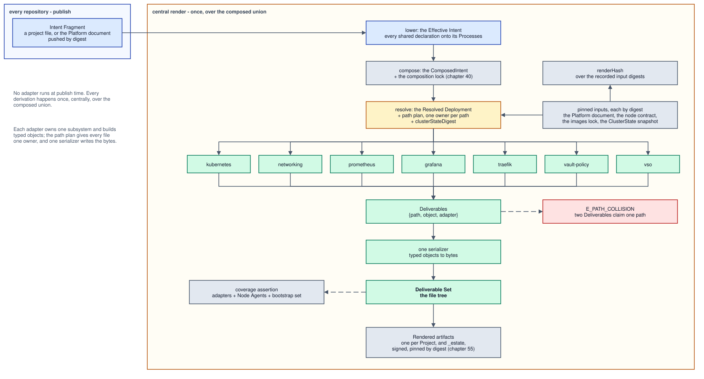
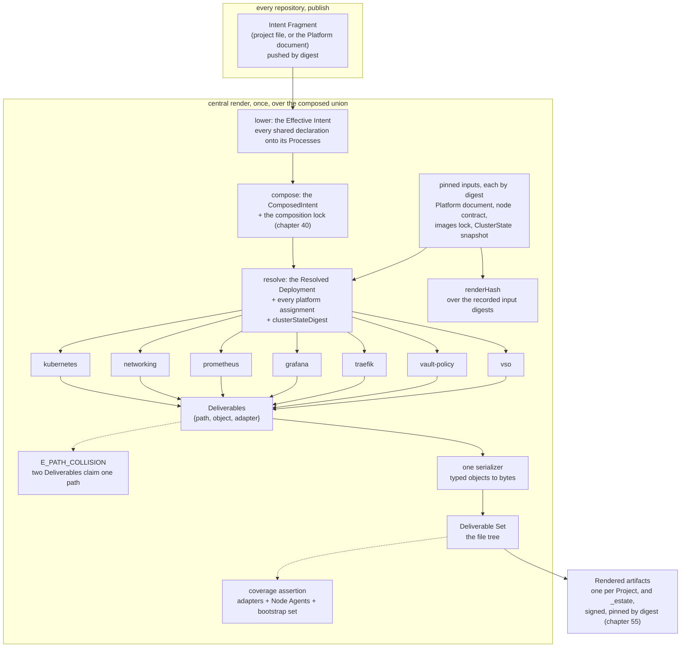

# Chapter 30: Deliverable Set

Layer 3. Never authored, and the property that makes the other two layers
worth separating) it contains **no decisions**.

## The rule

> A Deliverable's content **and its path** are a pure function of the Resolved
> Deployment: the path follows from the Project and the Application the
> projection names, spelled by one set of directory helpers every adapter shares
> ([0036](../../docs/adr/model/0036-path-authority-is-layer-2.md), normative in
> [Path allocation](#path-allocation)).

Layer 2 decided everything (chapter 20). Layer 3 serialises. If a renderer has to
choose, the choice belongs one layer up, and the choice being made here is the
defect, because a decision taken during serialisation appears in no schema, is
recorded in no lock, and is invisible in the published projection an Application owner
reads back.

A path is therefore not a choice an adapter makes. Where an object lands
follows from whose it is: an Application's objects in its own directory, a
per-project object such as `namespace.yaml` or the namespace-wide default-deny
in its Project's directory, once, and an estate-scoped one under `estate/`. The
roots are spelled once, in the shared directory helpers, and an adapter names
only the file below them. An Adapter declares a `defaultPath` in the registry,
which states where its output lands; it describes the adapter, and nothing reads
it to place a file. A path two Deliverables claim is refused once every adapter
has run and before anything is written (`E_PATH_COLLISION`).

## Adapters

An **Adapter** is a named renderer registered in one registry. A **Deliverable**
is the unit of output and of attribution:

```ts
{ path: string, object: TypedObject, adapter: string }
```

Every Deliverable names its producing adapter. That is what makes the
attribution assertion below possible without new machinery.

An adapter is a model-to-model step: it maps the Resolved Deployment into the
narrow Kubernetes and Vault object model (`TypedObject`), and nothing more. The
Deliverable's `object` is that model object, and its `content` is the output of
the one serializer turning that object into bytes. An adapter never formats
bytes itself: there is exactly one serializer, so determinism, key order and
line endings are one module's responsibility
([0058](../../docs/adr/architecture/0058-every-step-links-through-one-trace.md)).
A Deliverable holds `path`, `object` and `adapter`; it has no `content` string
an adapter would write, and no `executable` flag: nothing in the model is
executable ([0014](../../docs/adr/model/0014-file-shaped-configuration-is-an-asset.md)).

**The registry is the enumeration**
([0037](../../docs/adr/model/0037-six-registered-adapters-satisfy-one-port.md), rewritten by
[0047](../../docs/adr/model/0047-one-publication-path.md)): nothing renders
that is not registered, `adapterContract()` is the only list, and a change to the
set is a decision with its own ADR. The set is seven, one per subsystem, and every
one of them is a **central** adapter running once over the composed union:

| adapter | subsystem | emits |
|---|---|---|
| `kubernetes` | processes | per Application: the controller (for the monitoring stack's Prometheus and Alertmanager, the Prometheus operator's `Prometheus` and `Alertmanager`, [chapter 14](14-platform-intent.md#the-operators-objects)), `Service` (none for a `blue-green` Process, whose Services Flagger generates), the `Canary` of each `blue-green` Process with its `HorizontalPodAutoscaler` where it declares `replicas` ([Flagger-ready objects](#flagger-ready-objects)), `ServiceAccount` (and each backup identity's), `ConfigMap` (including every inbound-derived Asset, each gated Application's `<application>-release-gate`, [chapter 20](20-resolved-deployment.md#the-release-gate), and each routed Application's `<application>-external-checks`, [chapter 14](14-platform-intent.md#the-foundation-is-declared)) `PersistentVolumeClaim` (and each backup claim, and each library claim), the cluster-scoped `PersistentVolume` of each library a project mounts, `PodDisruptionBudget` above one replica, the backup `CronJob`, the migration identity with its per-revision migration `Job` and suspended down `Job` ([chapter 55](../../spec/v1/55-delivery.md#failure-and-undo)), `Namespace` per project, the kustomize `Kustomization` per directory, and the cluster-scoped `Client` of each Application that declares `client` ([chapter 17](17-sign-in.md#the-client)) |
| `networking` | policy | every `NetworkPolicy`: the namespace's default-deny ([0035](../../docs/adr/model/0035-network-policy-is-default-deny-and-render-only.md)), and one per Process, per spawn template ([chapter 16](16-dependencies.md#spawn-templates)), per backup identity ([chapter 16](16-dependencies.md#the-backup-identitys-policy)), per migration identity ([chapter 16](16-dependencies.md#the-migration-identitys-policy)), per open Move's step identity ([chapter 20](20-resolved-deployment.md#the-move)), and per Vault policy job and catalog method ([chapter 14](14-platform-intent.md#the-vault-policy-job)) |
| `prometheus` | monitoring | one `ServiceMonitor` or `PodMonitor` per Application that declares `observability`, from the named surface and the Platform document's cadence, carrying the labels its `monitors` names. A `PrometheusRule` per rule-group file the monitoring stack's Applications carry, and one `AlertmanagerConfig` on its Alertmanager, from the Platform document's `monitoring` ([chapter 14](14-platform-intent.md#monitoring)) |
| `grafana` | monitoring | one `GrafanaDashboard` per dashboard file an Application ships, in its own namespace and its Project's folder, selecting the Grafana instance the Platform document names (`allowCrossNamespaceImport`), its JSON verbatim, and a vendored file's data source inputs mapped to the Platform's data source |
| `traefik` | edge | one `IngressRoute` **per exposure**, in its Application's own namespace and in its Application's own directory as `route-<exposure>.yaml`, so a Project's routes are its own share ([0023](../../docs/adr/model/0023-exposure-is-declared-by-audience.md), [0047](../../docs/adr/model/0047-one-publication-path.md)), including the derived `/.auth/` route of each gated Client ([chapter 17](17-sign-in.md#what-the-edge-derives)); and the shared `Middleware` set once per tier proxy's namespace, in the proxy's own directory ([Shared Middlewares](#shared-middlewares)). A route's `redirectTo` is a `RedirectRegex` Middleware of the route's own, `<application>-<exposure>-<n>-redirect`, beside its IngressRoute. Each `IngressRoute` carries its tier's ingress class as the `kubernetes.io/ingress.class` annotation, and, where the tier publishes its names, `external-dns.alpha.kubernetes.io/target` and `…/cloudflare-proxied` from the resolved exposure's `dns`: the tier's `target` and `proxied`, or its `direct` and `"false"` for an exposure that is not `proxied` |
| `vso` | secret delivery | `VaultConnection` per namespace, `VaultAuth` per identity that holds a synced grant, `VaultStaticSecret`, `VaultDynamicSecret` |
| `vault-policy` | secret store | one policy and one auth role per Process identity, as JSON ([0040](../../docs/adr/model/0040-vault-policy-is-a-deliverable.md)) |

**There is one publication path.** A repository publishes its Intent Fragment
by digest ([chapter 40](40-composition.md#fragments)) and nothing else; no
adapter runs at publish time. The five publish-time `*-fragment` producers of the
previous generation, and the `adapter-compat` map that paired them with their
consumers, are deleted: every kind they emitted is derived centrally from the
same declaration, so they were a second render of the same intent, and their
map's digest padded `renderHash` for no reason but to pair them. An Application owner
who wants to see their own render runs the same core locally over the same pinned
inputs: a use-case, not a second adapter set.

Three former adapters are gone. The Gatus endpoints are reclassified as each
Application's own external checks, rendered by `kubernetes` into its Project's
share and gathered by the `gatus` Application, and the two edge catalogs are
deleted outright, since the proxy reads each Project's routes itself
([chapter 14](14-platform-intent.md#the-foundation-is-declared)). Image metadata is a
**projection of the images lock** and joins the Resolved Deployment artifact set
([chapter 20](20-resolved-deployment.md#publish-back)). `flux-root` (one Flux
`Kustomization` per layer, with `dependsOn` and health checks) is one delivery
mechanism's reading of the Reconcile Unit DAG, and is taken up by
[chapter 55](55-delivery.md#rendered-artifacts-and-pins), where each Project's
pinned source is what a Kustomization applies. `flux-packs` and `flux-source` had nothing left to render once the
foundation was declared ([0046](../../docs/adr/model/0046-the-foundation-is-declared.md)).

A second, unregistered renderer generation exists in the tree being replaced: `src/deployment/render/`, 14 modules and 1,967 lines, reachable from neither
entry point, imported only by 11 test files, yet inside the `--lines 90` coverage
gate that guards every pull request. It is deleted in the code pass, and nothing
it contains is promoted for free: bringing its behaviour back is a port across
the adapter port and costs what writing a new adapter costs.

### The edge proxy

A tier's proxy is a Traefik the platform declares as an Application like any
other ([chapter 14](14-platform-intent.md#the-foundation-is-declared)), and its
static configuration is derived, never authored: the `kubernetes` adapter
writes it as the container's arguments on the Process of the tier's `traefik`
Application that provides a `web` surface.

| argument | from |
|---|---|
| `--entryPoints.web.address`, `--entryPoints.websecure.address`, `--entryPoints.traefik.address` | the Process's `web`, `websecure` and `admin` surfaces, each where it provides one |
| `--entryPoints.websecure.http.tls=true` | the tier's `listener: tls`, where the Process provides `websecure` |
| `--ping`, `--metrics.prometheus`, each on the `traefik` entry point | the `admin` surface, where the Process provides one |
| `--providers.kubernetescrd.ingressClass` | the tier's `ingressClass` ([chapter 14](14-platform-intent.md#tiers)) |
| `--certificatesresolvers.<tier>.acme.email`, `.storage`, `.dnschallenge.provider` | an acme tier's resolver, named for the tier: the platform's `acme` account, the state file on the tier's `acme` claim, and its DNS provider, whose token arrives as the provider client's variable ([chapter 14](14-platform-intent.md#tiers)) |
| `--providers.kubernetescrd.allowCrossNamespace`, `allowEmptyServices` | always: a route names Middlewares in the proxy's namespace, and a route to a Process with no ready pod answers 503 rather than vanishing |
| `--log.format`, `--accesslog`, `--accesslog.format` | always JSON |

One Traefik filters on one class, so two tiers that name one proxy with two
classes are `E_TIER_CLASS_UNFILTERED`: the second tier's routes would be
admitted by no proxy.

## The adapter port

Every adapter satisfies one typed port
([0037](../../docs/adr/model/0037-six-registered-adapters-satisfy-one-port.md)):

> **Documents in, attributed Deliverables out. Deterministic. No ambient reads. A
> path claimed twice is a build error.**

| invariant | normative statement | failure |
|---|---|---|
| one input shape | An adapter receives the Resolved Deployment as parsed, pinned documents and nothing else. There is no discriminated union and no hand-set input string. | compile error |
| attributed output | Every returned Deliverable carries `adapter`, set by the port, not by the adapter. | compile error |
| deterministic | Same documents in, byte-identical Deliverables out, in a stable order. | the adapter contract test |
| no ambient reads | No environment variable, clock, network or filesystem read inside `render`. Reading manifests from disk is the caller's job; the parsed documents are passed in. | the dependency rule `the-chain-reads-nothing-ambient` |
| one owner per path | Two adapters may never claim the same output path, and no two objects one ServiceAccount: a Vault role is bound to the account's name and namespace alone, so a second owner of the name would hold the first one's role. | `E_PATH_COLLISION` |
| safe paths | Every path is relative and normalised; `..` and absolute paths are rejected. | the adapter contract test |

Each of these is stated because the seam does not have it today. The registry
declares `render: (input: never) => RenderResult` under a comment calling the
entries "intentionally heterogeneous"; `never` accepts every function, both call
sites launder the argument through a double cast, and the only runtime check is
`typeof render === "function"`. Which of three declared input shapes an adapter
receives is one string comparison, `adapter.input === "canonical-artifacts"`, and
the five publish-time producers match no branch of their own, they fall through
to the `deploy-config` branch and are handed the wrong document. One of them
reads raw manifests from disk inside `render`. `E_PATH_COLLISION` has **zero
occurrences under `src/`**, while the writer applies each prepared file in turn:
two adapters sharing a path both write, second wins, silently, both reporting
`action: "create"`. The collision check belongs where the Deliverable set is
assembled, once every adapter has run and before anything is written
([Path allocation](#path-allocation)), and it must exist in code before the
coverage assertion means anything.

Two ratchets carry the port:

- **The `@ts-nocheck` count may only fall.** It stands at 10 files under `src/`,
  four of them registered adapters (`adapters/kubernetes.ts` and three flux
  adapters), while `tsconfig.json` sets `"strict": true` and the lint rule that
  would catch the pragma is off. The count becomes a CI gate; the four adapter
  files lose the pragma before v1.
- **The ambient-input prohibition has no public escape hatch.** The helper that
  skips it is a test-only path and stops being exported; tests pass the documents
  explicitly.

Narrowing the port is cheap now and expensive later. Once adapters outside this
repository register through the public `registerAdapter` export, the port is a
compatibility surface every out-of-tree adapter pins, and narrowing it means a
major toolkit release, a version number separate from `schemaVersion`
([0032](../../docs/adr/model/0032-the-resolved-deployment-is-a-versioned-artifact.md), chapter 40).

## Vault configuration is rendered, not applied

`vso` emits the operator's Kubernetes objects: one `VaultConnection` per project
namespace, to the Secret Store's endpoint the projection carries; one
`VaultAuth` per identity that holds a grant delivered `env` or `file`, a
Process or a backup identity, in its Application's directory; and one
`VaultStaticSecret` per such grant, beside it, or a `VaultDynamicSecret`. A
grant delivered `self` is read by the Process itself and syncs nothing. The
objects are applied with the Application they serve, by its Project's own
unit: the namespace and the ServiceAccount a `VaultAuth` names exist only once
that unit applies, and its pod waits on the Secret. Every destination Secret it asks for is excluded from
Flagger's configuration tracking, and a restart target names a `blue-green`
Process's `<name>-primary`, so rotating a value never starts a release
([chapter 55](55-delivery.md#secret-rotation)). None of those is a policy or an auth role, so until
[0040](../../docs/adr/model/0040-vault-policy-is-a-deliverable.md) the policy
that [0029](../../docs/adr/model/0029-a-grant-is-a-union-on-engine.md) derives had
no output at all, and a derivation with no output is not total
([0005](../../docs/adr/model/0005-derivation-is-total.md)).

The `vault-policy` adapter emits, **per identity that holds a grant** (each
Process, each backup identity that holds its destination's or its peer's credential, and
each migration identity, which holds its database's owner credential), two
documents, at `apps/<project>/vault-policy/policies/<namespace>-<identity>.{policy,role}.json`
in its own Project's share, under the name Vault holds both by:

| document | derived from |
|---|---|
| the Vault policy | the Process's grants and their access tiers: `read` on the granted path, `patch` for `self-roll`, `create`/`update`/`delete` on a prefix for `custody`, nothing for `self-renew` |
| the Kubernetes auth role | the identity's ServiceAccount and namespace ([0031](../../docs/adr/model/0031-identity-per-process.md)), bound to that one policy by its name, `<namespace>-<identity>`; the role carries the same name, which is what its `VaultAuth` asks for ([chapter 16](16-dependencies.md#process-identity)) |

One document per identity, not per Application: identity is per Process, so a
two-Process Application produces two policies and a diff says which principal's
privilege changed. Both are JSON, which Vault accepts and which lets the one
serializer own key order.

A Project whose grants generate keys ([chapter 10](10-project-intent.md#generated-keys))
adds one more document beside them, `apps/<project>/vault-policy/policies/<namespace>.generated.json`:
`keys`, each a `path`, a `key`, its `bytes` and its `encoding`, the defaults
filled in, and, for a key that adopts a value, `adopt`, the `path` and the
`key` of the location, once each, in path then key order. The `node` Project
holds no grant, and writes the same documents for the speaker's memberlist key
([chapter 14](14-platform-intent.md#node-agents)): the `l4-speaker` identity's
policy and role, and `node-system.generated.json`, beside its own job. Its
connection, the speaker's `VaultAuth` and the `VaultStaticSecret`
`l4-speaker-memberlist` are `vso`'s, in `apps/node/vaultconnection.yaml` and
`apps/node/l4-speaker/vso.yaml`.

**Rendered here, applied in the cluster.** Writing a policy into Vault is an act
against a live system by an identity with privilege, which is delivery
([0087](../../docs/adr/model/0087-in-cluster-consumers-read-the-render.md)). The
**Vault policy job** writes them, **one per Project** that holds a document:
a Job in that Project's own share and unit, in that Project's namespace, whose
image is the `delivery` project's
([0116](../../docs/adr/model/0116-a-project-owns-every-object-it-delivers.md)).
A grant's Secret syncs once its role exists, and the unit is Ready once the job
has succeeded, so no Application of the Project serves before Vault holds what
it reads. The job is derived and never declared as a Process: its input is the
render itself. The Platform document says which image it is, which Vault role
it logs in as and what it requests
([chapter 14](14-platform-intent.md#the-vault-policy-job)); where the platform
names no job, or a Project holds no document, none is rendered for it.

The render hands the documents to the job in a `ConfigMap`, so the job writes
exactly its own Project's documents of the render that applied it, and nothing
else. Vault holds every name in one place, so two documents of one name, in
one Project or in two, are `E_PATH_COLLISION`: a hyphen does not keep
`a-system` + `system-c` apart from `a-system-system` + `c`. The
ConfigMap and the Job share one name, `vault-policy-<12 hex>`, the first twelve
hex digits of the SHA-256 of the canonical JSON (RFC 8785) of one object:
`documents`, each of the Project's documents under its file name, and what the pod runs with,
the job's `image`, `uid`, `gid`, `memory`, `cpu`, `deadline` and
`eligibleNodes`. A Job's template cannot
change once created, so a changed policy set or a new image is a new Job, and
the one it replaces leaves the render with it. Both implementations compute the
name from those alone, so it is the same name wherever the same grants are
rendered under the same job.

The name covers what the job is handed, not everything the render spells into
its template: a hardening control or a label the compiler adds changes the
template under the same name. The Job therefore carries
`kustomize.toolkit.fluxcd.io/force: Enabled`, so the applier recreates it
where an update would be refused, and it runs once more from the same
documents. Every catalog method's Job carries the same mark, and neither
`CronJob` does, since a CronJob's template can be updated in place.

Five files sit beside `policies/`, in `apps/<project>/vault-policy/`, and the
directory's index applies the first four. The Project's index lists the
directory, so a Project with an Application named `vault-policy` claims the
same paths and is refused (`E_PATH_COLLISION`):

| file | adapter | holds |
|---|---|---|
| `configmap.yaml` | `vault-policy` | the immutable `ConfigMap`, each document under its file name as canonical JSON on one line, in name order |
| `job.yaml` | `vault-policy` | the `Job`, marked `kustomize.toolkit.fluxcd.io/force: Enabled`: the locked image, `VAULT_ADDR` the Secret Store's endpoint, `VAULT_ROLE` the platform's role, `POLICIES_DIR` where the ConfigMap is mounted read-only, `restartPolicy: OnFailure`, the token mounted because the job logs in with it; the pod's `activeDeadlineSeconds` the platform's deadline, so it bounds one attempt, and a required node affinity on `kubernetes.io/hostname` `In` the job's `eligibleNodes`; the Job's `backoffLimit` `2147483647`, the most the API holds, and no deadline of its own, so it retries until an attempt succeeds |
| `cronjob.yaml` | `vault-policy` | the `CronJob` `vault-policy`: the same pod as the Job, `@hourly`, `concurrencyPolicy: Forbid`, so a Vault restored without what the render holds gets it back within the hour; its job template's `backoffLimit` `6` and `activeDeadlineSeconds` `3000`, so a run that cannot succeed, its ConfigMap replaced and pruned by a later render, fails before the next is due rather than holding it off |
| `serviceaccount.yaml` | `vault-policy` | the `ServiceAccount` `vault-policy`, the identity the platform's role is bound to in every namespace |
| `networkpolicy.yaml` | `networking` | the job's own policy: egress to the Secret Store and the cluster's DNS, no ingress; listed by no index, like every policy |

Each datastore whose catalog the render applies
([chapter 16](16-dependencies.md#applying-the-catalog)) adds two files named for
its identity, `<process>-catalog`, and its identity's policy and auth role to
its Project's `policies/`, beside every other identity's. The two files are its
own Project's: they land in `apps/<project>/<application>/`, the directory of
the Application that runs the datastore, and that directory's index lists the
first. Only while the datastore's Project is `legacy` does it have no share on
the estate path: then the two files land in `estate/vso-secrets/`, listed by
its index, its documents in `estate/vso-secrets/policies/`, and the
**estate-scoped policy job** beside them writes those documents alone:

| file | adapter | holds |
|---|---|---|
| `<process>-catalog.yaml` | `kubernetes` | the `ServiceAccount` `<process>-catalog`; the immutable `ConfigMap` `<process>-catalog-<12 hex>`, the catalog as canonical JSON on one line under `catalog.json`; the `Job` of the same name, marked `kustomize.toolkit.fluxcd.io/force: Enabled`, the locked method image, `CATALOG_FILE` where the ConfigMap is mounted read-only, `VAULT_ADDR` the Secret Store's endpoint, `VAULT_ROLE` `<namespace>-<process>-catalog`, the policy job's requests and deadline, `restartPolicy: OnFailure`, the token mounted because the method logs in with it; and the `CronJob` `<process>-catalog`, the same pod, `@hourly`, `concurrencyPolicy: Forbid`. The twelve hex digits are the first of the SHA-256 of the canonical JSON of the `catalog`, and the `image`, `uid`, `gid`, `memory` and `cpu` it runs with |
| `<process>-catalog-networkpolicy.yaml` | `networking` | the method's own policy: egress to the surface the catalog is applied over, the Secret Store and the cluster's DNS, no ingress; listed by no index |

All of them are in the datastore's namespace: the method runs beside the
datastore it writes into.

A Project's own job is in that **Project's namespace**, `<project>-system`. The
estate-scoped job is in the namespace of the catalog it writes, the one the
handover ledger states the old path runs that datastore in, so each writes
names of its own namespace alone; catalogs the old path runs in two namespaces
would need two such jobs, and the render stops rather than write one.

- It authenticates as the platform's role, a platform fixture created with the
  auth method and bound to the ServiceAccount `vault-policy` in every
  namespace, because a job cannot grant itself the privilege to write
  policies. The role's policy is templated on the ServiceAccount's namespace:
  it may write policies and auth roles named `<namespace>-*`, and keys under
  `secret/data/<namespace>/`, and nothing else. Vault templates names, not
  what a policy grants, so the writer is trusted as far as the render is
  ([0087](../../docs/adr/model/0087-in-cluster-consumers-read-the-render.md)).
- It writes each policy and each auth role under its rendered name,
  `<namespace>-<identity>`, and leaves an unchanged one as it is.
- It then writes each generated key Vault does not hold, under its own
  namespace's prefix only, check-and-set against the version it read, and
  never changes a key Vault holds. A key that adopts a value is written with
  the value its location holds, and generated only where the location holds
  none.
- It never deletes. A role and policy Vault holds that the render no longer
  names are reported, and a human removes them.
- A job that fails holds its own Project's unit, and no other: no Application
  of that Project serves against policies Vault does not hold yet, and every
  other Project reconciles as it would.

**The auth method itself is a platform fixture.** Mounting `kubernetes` auth,
configuring its JWT issuer and CA, and creating the KV mounts are estate-unique
and draw on a shared resource, so by
[0004](../../docs/adr/model/0004-contention-decides-authority.md) they are
platform-assigned, and they are Assets of the declared `vault` Application in the
platform's secrets project ([0046](../../docs/adr/model/0046-the-foundation-is-declared.md),
[chapter 60](60-setup.md#secrets-at-rest)) rather than per-Application render. The
per-Application render owns what varies per Process and nothing else.

## The rollout events

Where the Platform document names a Reporter
([chapter 14](14-platform-intent.md#delivery-policy)), each Project's share
holds the route Flux's events about its own unit take to it: a `Provider` and
an `Alert`, both `notification.toolkit.fluxcd.io/v1beta3`, at
`apps/<project>/rollout-events/provider.yaml` and
`apps/<project>/rollout-events/alert.yaml`, with the index that applies them,
which the Project's index lists. What each says is
[chapter 55](55-delivery.md#rollouts)'s. They are derived per Project from two
facts the model already holds, the namespace Flux's own objects live in and
the address of the Reporter's `http` surface, and from the Project's own name
([0116](../../docs/adr/model/0116-a-project-owns-every-object-it-delivers.md)).

Both are attributed to the `kubernetes` adapter, which owns the indexes and
every object no other subsystem does. They are Flux's kinds and not a
workload's, but an eighth adapter for two objects that vary with nothing but
one address would be a registration with no subsystem behind it.

## Attribution

**Every Deliverable is attributed to exactly one Adapter**
([0037](../../docs/adr/model/0037-six-registered-adapters-satisfy-one-port.md)). Attribution is a property of
the producer, declared in the registry, not a property of the output that an edit
could lose:

- Every registry entry declares a `defaultPath`, and registration throws
  `adapter definition missing defaultPath` without one. It states where the
  adapter's output lands; the path a Deliverable carries is the adapter's own,
  spelled through the shared directory helpers
  ([0036](../../docs/adr/model/0036-path-authority-is-layer-2.md)).
- `adapterContract()` is the only enumeration of the set. A tool that needs to
  know who produces what reads it; nothing reconstructs ownership by scanning
  rendered YAML.
- An adapter emits a file set, every file of it a Deliverable naming that adapter
  and no other.
- A file no adapter claims cannot ship silently. It becomes a ledger entry with
  an owner and a reason, or the build fails.

There is **no target-neutral deliverable IR**. Nomad appears in this estate only
in a `flux-modules` denylist and in a reserved `extensions.nomad` slot annotated
*"Reserved extension area for future Nomad inputs. No renderer consumes it in
this feature."*, with `renderer_status: design_only` enforced by the artifact
validator. An abstraction with one consumer is shaped entirely by that consumer,
so a neutral IR built today would be Kubernetes-shaped and wrong for Nomad on the
day Nomad arrived. If a second target ever exists, that is when the abstraction
gets lifted, with two real consumers to shape it.

Two adapters may render objects of the same **kind**, `kubernetes` creates the
Application's own `ServiceAccount`, `vso` mirrors the VSO operator's `ServiceAccount`
into each target namespace. That is allowed: attribution is per Deliverable, and
single authority is per **field**, not per kind. What is never allowed is two
adapters claiming one path.

### Path allocation

Each adapter writes its own paths, from the Project and the Application the
projection names, through the one set of directory helpers every adapter shares
([0036](../../docs/adr/model/0036-path-authority-is-layer-2.md)), never
configured per Application:

```
<gitopsRoot>/apps/<project>/<application>/<object>.yaml
<gitopsRoot>/apps/<project>/namespace.yaml
<gitopsRoot>/apps/<project>/libraries.yaml
<gitopsRoot>/apps/<project>/aliases.yaml
<gitopsRoot>/apps/<project>/networkpolicy.yaml
<gitopsRoot>/apps/<project>/vaultconnection.yaml
<gitopsRoot>/apps/<project>/vault-policy/policies/<namespace>-<identity>.{policy,role}.json
<gitopsRoot>/apps/<project>/<application>/route-<exposure>.yaml
```

The project's `libraries.yaml` holds, per library it mounts, the cluster-scoped
`PersistentVolume` and the claim bound to it (`kubernetes`), in library name
order, each volume before its claim, and is written only where a Process of the
project mounts one: a claim several Applications share belongs to none of their
directories. The project's `aliases.yaml` holds its [aliases](16-dependencies.md#the-alias)
(`kubernetes`), in name order, and is written only where an edge derives one:
every Process holding an edge to the same provider shares one alias, whose
`externalName` is the provider's Stable Address. The project's
`networkpolicy.yaml` is its one namespace-wide default-deny
([chapter 16](16-dependencies.md#network-policy)), a per-project object with an
owner, the `networking` adapter. Under an Application's directory the objects
are `workload.yaml`, `serviceaccount.yaml`, `canary.yaml`, `pdb.yaml`,
`migration.yaml` and `client.yaml`, the cluster-scoped `Client` an Application
declaring `client` derives ([chapter 17](17-sign-in.md#the-client))
(`kubernetes`), `networkpolicy.yaml` (`networking`) and
`podmonitor.yaml` (`prometheus`), each written only where it holds an object. Every
directory the render writes carries a `kustomization.yaml` (`kubernetes`)
listing what that directory applies: its files and, for a project's directory,
each Application's directory beside its `namespace.yaml`. **No kustomization
lists a `networkpolicy.yaml`** while chapter 16's stage is render-only
([Audit before enforce](16-dependencies.md#audit-before-enforce)): the policy set
is in the artifact, reviewed and signed with everything else, and applied by
nothing, and none lists a Vault document, which is no Kubernetes object.

Everything under `apps/<project>/` is that Project's share, whatever the
Project is named, and everything under `estate/` is estate-scoped, so it is
the `_estate` artifact's ([chapter 55](55-delivery.md#rendered-artifacts-and-pins)).
The two roots never meet: an estate-scoped directory under `apps/` would be
the directory of whichever Project carried its name, and that Project's whole
render would be published as the estate's. Each IngressRoute still stays in
its Application's own namespace
([Forbidden in a Deliverable](#forbidden-in-a-deliverable)).

### How each adapter spells the projection

Each adapter is the one place its target's vocabulary is spelled, and it
spells only what the projection holds:

| model value | adapter | spelled as |
|---|---|---|
| a `blue-green` Process | `kubernetes` | a `Deployment` with no `replicas` and a `RollingUpdate` of surge 1, unavailability 0, which Flagger scales and promotes; a `Canary` whose `service` is the Process's first surface and whose four webhooks are the gate's `endpoint` with `/may-start`, `/checks`, `/may-promote` and `/rollback`, each carrying the Application, the Process and the Application revision |
| a `stop-start` Process | `kubernetes` | a `Deployment` of its `replicas` with a `Recreate` strategy, and a `Service` named for the Process that selects its `instance` and serves each of its surfaces by name |
| a Process the Prometheus operator runs | `kubernetes` | in place of a `Deployment`, a `Prometheus` or `Alertmanager` named for the Process ([chapter 14](14-platform-intent.md#the-operators-objects)): `image`, `version`, `replicas`, `serviceAccountName`, `automountServiceAccountToken`, `priorityClassName`, `securityContext`, `affinity`, `resources` and `volumes` as its pod's; `podMetadata` its pod's labels less `name`, `instance` and `managed-by`, and its annotations; `portName` its surface's name; one entry of `containers` named for the operator's container (`prometheus`, `alertmanager`) with the Process container's `env`, `securityContext`, `volumeMounts` and probes; the flags that are fields as those fields and the rest as `additionalArgs`. A `Prometheus` also carries `scrapeInterval` and `evaluationInterval` as the cadence's `interval` and `scrapeTimeout` as its `timeout`; `serviceMonitorSelector` and `podMonitorSelector` matching the cadence's `labels`, `{}` where it names none, each with a `{}` namespace selector; `ruleSelector` matching `app.kubernetes.io/managed-by: deploy-kit` with a `{}` namespace selector; and `alerting` naming the Alertmanager's namespace, Service and surface at API `v2`. An `Alertmanager` carries `alertmanagerConfigSelector` matching `app.kubernetes.io/managed-by: deploy-kit` in its own namespace and `alertmanagerConfigMatcherStrategy: None`. A rotation's restart target is the StatefulSet `<container>-<process>` |
| a `scheduled` Process | `kubernetes` | a `CronJob` named for the Process at its `schedule`, `concurrencyPolicy: Forbid` and its `startDeadline` as `startingDeadlineSeconds`; its job's pod is the pod a `Deployment` would hold, with `restartPolicy: OnFailure`. No `Service`, no `Canary` and no budget |
| a `rolling` Process | `kubernetes` | a `Deployment` of its `replicas` with a `RollingUpdate` of surge 0, unavailability 1: pod by pod and never a pod more, because a proxy on a host port and a controller with no leader election cannot run two copies; the same `Service` a `stop-start` Process gets, and no `Canary`, because nothing gates the machinery |
| a `blue-green` Process of more than one replica | `kubernetes` | a `HorizontalPodAutoscaler` of the Process's name beside its `Canary` in `canary.yaml`, scaling its `Deployment` between a `minReplicas` and a `maxReplicas` that are both the count; the Canary's `autoscalerRef` names it, so Flagger keeps a copy for the primary |
| any Process of more than one replica | `kubernetes` | a `PodDisruptionBudget` of the Process's name in the Application's `pdb.yaml`, `maxUnavailable: 1`; a `blue-green` Process's selects `app.kubernetes.io/name: <name>-primary`, any other's the Process's `instance` |
| an Application's `migration` | `kubernetes` | in the Application's `migration.yaml`: the `ServiceAccount` of the plan's `identity`, the `Job` `<identity>-<tag>` and, where the plan holds `testedAgainst`, the `Job` `<identity>-down-<tag>`, the tag the first 12 hex digits of the Application revision. Each is labelled as the identity with `component: none`, so every pod keeps the identity as its `instance`; carries `kustomize.toolkit.fluxcd.io/ssa: IfNotPresent`, so the applier creates it and never updates it; and has `suspend: true`, `backoffLimit: 0`, `restartPolicy: Never` and the plan's `deadline` as `activeDeadlineSeconds`. Its one container, `migration`, runs the `runner` as the plan's `uid` and `gid` with the token mounted, the plan's `memory` as request and limit and its `cpu` as request, an `emptyDir` of the plan's `scratch` at `/tmp`, and the arguments `up <tag>`, or `down` and the tag of `testedAgainst`. Its variables are the runner's contract ([chapter 55](55-delivery.md#failure-and-undo)): the plan's `database`, the Application's `secretStore`, the role `<namespace>-<identity>` and the one path of the plan's `credential`, then `HOME` at its scratch `/tmp` |
| a migration plan's `egress` | `networking` | one `NetworkPolicy` named for the migration identity, after every Process's in the Application's `networkpolicy.yaml`, selecting the identity's `instance`; `policyTypes` both and no ingress rule; one egress rule per peer as above |
| a Stable Address | `kubernetes` | in `estate/stable-addresses/`, written where a delivered Project resolves one: `namespace.yaml`, the `estate-system` Namespace, and `services.yaml`, one `Service` of type `ExternalName` per Stable Address in name order, named `<application>-<surface>`, its `externalName` the active Instance's Service or the provider's recorded address, annotated `kustomize.toolkit.fluxcd.io/ssa: IfNotPresent` so Flux creates it once and never updates it |
| a Human Grant | `kubernetes` | one `ClusterRoleBinding` per grant in `estate/human-grants/clusterrolebindings.yaml`, in the order the Platform document lists them, named `human:<group>:<clusterRole>` and labelled `managed-by` alone; its `roleRef` the built-in `ClusterRole` of the grant's `clusterRole`, its one subject the `Group` of the grant's `group`, spelled as written ([chapter 14](14-platform-intent.md#human-grants)) |
| a held `api` | `kubernetes` | in the Application's `rbac.yaml`, labelled as the Process is: for its `namespace`-scoped rules a `Role` and a `RoleBinding` in its namespace, both named for its identity, then for its `cluster`-scoped rules a `ClusterRole` and a `ClusterRoleBinding`, both named `<namespace>-<identity>`, a scope with no rule rendering neither, so a block with no rules renders no `rbac.yaml` at all; one rule per declared rule, `apiGroups` its one `group` with `core` spelled `""`, `resources` its `objects`, `verbs` its `verbs`; the binding's one subject the Process's `ServiceAccount` in its namespace |
| a Process's `spawns` | `kubernetes` | the rules its templates derive in its `Role`, after its own `namespace` rules, and `SPAWN_<NAME>_IMAGE` and `SPAWN_<NAME>_LABELS` in its container's environment, after its own variables |
| a Process's `placement` | `kubernetes` | a required node affinity on the Process's pod template, one term matching `kubernetes.io/hostname` `In` the node its volume is `boundTo` where it has one, and otherwise every one of its `eligibleNodes`, in the projection's order. Written whole even where every node is eligible: the set is what layer 2 resolved from the pinned node contract, and a node added to the contract re-renders every Project. Never a preference, which the scheduler may drop ([chapter 20](20-resolved-deployment.md#layer-2-does-not-assign-a-node)) |
| a volume | `kubernetes` | a `ReadWriteOnce` `PersistentVolumeClaim` named for the claim at the volume's `size`, mounted at its `mountAt`, the pod's `fsGroup` the image's `gid` |
| a library mount | `kubernetes` | per project and library, one cluster-scoped `PersistentVolume` named `<namespace>-<library>`: `local` at the library's `path`, required node affinity to its `node`, `persistentVolumeReclaimPolicy: Retain`, an empty `storageClassName`, a nominal `1Gi`, and a `claimRef` to the claim `library-<library>` in the project's namespace, which names it as its `volumeName`; both `ReadWriteOnce` and carrying `kustomize.toolkit.fluxcd.io/prune: disabled`. In the pod, the claim mounted at `mountAt` below `subPath`, read-only for `read`; the library's `gid` in `supplementalGroups`, and no `fsGroup` |
| a Process's `gpu` | `kubernetes` | in the Process's pod, `runtimeClassName` the resolved `runtimeClass`, and on its own container a limit of `"1"` on the resolved `resource` beside the memory limit, which the scheduler also takes as the request; no sidecar requests one |
| a Process's `nameservers` | `kubernetes` | in the Process's pod, `dnsPolicy: None` and `dnsConfig.nameservers` the resolved addresses in order, so it never asks the cluster's DNS |
| a Process's `vpn` | `kubernetes`, `vso`, `vault-policy` | in the Process's pod, a native sidecar `vpn` under `initContainers` (`restartPolicy: Always`): the resolved image and `environment`, `envFrom` the credential's Secret, the resolved `memory` and `cpu`, `runAsNonRoot: false` as user and group 0 with `NET_ADMIN` and `NET_RAW` added, a startup probe running `/gluetun-entrypoint healthcheck` every 5s up to 60 times, and an `emptyDir` `vpn` of `1Mi` at `/run/vpn`, which the Process's own container mounts read-only where `forwardedPort` is true. The credential's `VaultStaticSecret` and the identity's policy are rendered as for any grant |
| a backed-up volume's `backup` | `kubernetes` | a `CronJob` named for the backup claim at the plan's `schedule`, `concurrencyPolicy: Forbid`, running the `method` image as the plan's `uid` and `gid` (the Process's own for a method that reads the volume alone, the method image's for one that dumps over the network) under the backup identity's `ServiceAccount` with no token mounted; the volume mounted read-only at `/data`, the backup claim at `/backup`, `BACKUP_RETAIN` the `retain` count, `BACKUP_OFF_CLUSTER` the plan's `offCluster` destination, `BACKUP_OFF_CLUSTER_PATH` its `path` and `BACKUP_OFF_CLUSTER_RECIPIENT` its `recipient`, and the credential's Secret as variables, where it copies off-cluster, `BACKUP_HOST` and `BACKUP_PORT` the plan's `peer` and its credential's Secret as variables where it dumps over the network; the backup claim a second `PersistentVolumeClaim` at the volume's `size`, and both carrying `kustomize.toolkit.fluxcd.io/prune: disabled` |
| an Asset | `kubernetes` | an immutable `ConfigMap` under the Asset's `name`, its one key the file name of `from`; a volume of that name, mounted at `mountAt` by that key, read-only |
| a seeded Asset, and a Process's `seeder` | `kubernetes` | the Asset's `ConfigMap` and volume, as for any Asset, mounted read-only into the init container `seed` alone, at `/seed/<name>`, and never into the Process's own container. `seed` is the first of `initContainers`, before the VPN and every init sidecar: the resolved image, the command `/bin/sh -c` and a script that, under `umask 077` and for each seeded Asset in order, makes the directory of `seedAt`, copies the file there to `<seedAt>.superseded` where one exists, copies the Asset to `<seedAt>.seeding`, sets it to `0600` and moves it to `seedAt`, every path single-quoted; the resolved `memory` and `cpu`, the posture, and each of the Process's volumes and writable paths a seeded Asset lands below, under the name and at the path the Process mounts it by |
| an Application's `client` | `kubernetes` | a cluster-scoped `Client` of `identity.jorisjonkers.dev/v1` in the Application's `client.yaml`, named by the Application Id and labelled `part-of` the Application and `managed-by`; its `spec` the projection's `client`, in the order `signIn`, `host`, `launchUrl`, `iconUrl`, `redirectUris`, `backChannelLogoutUri`, `credential`, `secretPath`, `roles`, `label`, `description`, each written only where the projection holds it |
| a gated Application's `releaseGate` | `kubernetes` | a `ConfigMap` named `<application>-release-gate` in the Application's namespace, the first object of its `configmap.yaml`, labelled `part-of` the Application and `managed-by`; its one key `releaseGate.json`, the element as canonical JSON (RFC 8785) on one line. Not immutable: the name stays and the content changes with a release |
| an Application's routes, as its external checks | `kubernetes` | a `ConfigMap` named `<application>-external-checks` in the Application's namespace, after the gate's in its `configmap.yaml`, written only where the Application has a route; labelled `part-of` the Application, `managed-by` and `estate.jorisjonkers.dev/external-checks: "true"`, and not immutable. Its one key, `<application>-external-checks.yaml`, holds `endpoints` and nothing else, as canonical JSON (RFC 8785) on one line, which Gatus reads as YAML: one endpoint per route of each exposure, in exposure and route order, named `<application>-<exposure>-<n>` for the route's place in its exposure, in the group of the Project's name, its `url` the tier's scheme (`https` on a `tls` listener, `http` on a `plain` one), the exposure's host and the route's path, and its one condition `[STATUS] < 500`. A check fails on a 5xx or on no answer and on nothing else, as the Release Gate's own request does ([chapter 55](55-delivery.md#the-release-gate)), so a route that answers a stranger with a sign-in or a `404` passes. No interval is written, so Gatus's own applies |
| a grant's holder | `vault-policy` | a policy and an auth role, at `policies/<namespace>-<identity>.{policy,role}.json`, each written into Vault under its file's name, so two identities deriving one name are a path collision; the role binds the identity's `ServiceAccount` in that namespace to that one policy |
| a sidecar | `kubernetes` | a second container of the pod, its own `memory` and `cpu`, the same posture, the Process's variables, its writable paths' mounts and its file grants' mounts; each volume it names mounted at its `mountAt`, and each Asset it names mounted read-only at its `mountAt` from the Process's ConfigMap of that Asset, by the file's name as `subPath` |
| a writable path | `kubernetes` | an `emptyDir` at the path's `size`, named `writable` and the path with every run of other characters a `-`, mounted at the path |
| a secret reference | `kubernetes` | `valueFrom.secretKeyRef`, the grant's `destination` and the reference's `key`, and `optional: true` where the grant lists the key optional ([chapter 10](10-project-intent.md#optional-keys)) |
| a grant delivered `file` | `kubernetes` | a `secret` volume named `secret-<destination>`, projecting the grant's one key as the file name of `mountAt` at `fileMode`, `optional: true` where that key is optional; the directory of `mountAt` mounted from it read-only into the Process's container and every sidecar, so a refreshed value reaches the file, which a mount of the file alone never sees again; nothing of it in the environment |
| an edge's database credential delivered `file` | `kubernetes` | a `secret` volume named `secret-<destination>`, projecting `username` and `password` as files of those names at `fileMode`; the directory `mountAt` mounted from it read-only into the Process's container and every sidecar; no token mounted for it, and nothing of it in the environment |
| the `secretStore` endpoint | `vso` | a `VaultConnection` named `secret-store` in the project's namespace, at that address, `skipTLSVerify: false` |
| an edge's database credential delivered `env` or `file` | `vso` | beside the holding Process's `VaultAuth`, a `VaultDynamicSecret` named `<process>-database-creds-<role>`, on the `database` mount at `creds/<role>`, its destination created and `flagger.app/config-tracking: disabled`, each restart target as for a `VaultStaticSecret`; delivered `env`, the Process reads `username` and `password` from it as `secretKeyRef`s |
| a grant delivered `env` or `file` | `vso` | a `VaultAuth` per holding identity, its `ServiceAccount` that identity and its role `<namespace>-<identity>`, over the `secret-store` connection; a `VaultStaticSecret` named for the `destination`, `kv-v2` on the `secret` mount at the path below `secret/data/`, `refreshAfter: 10m`, derived and never authored, `hmacSecretData: true`, which the restart compares, its destination created and `flagger.app/config-tracking: disabled`, and the holding Process as its restart target whatever the grant's rotation tolerates, a `Deployment`, a `blue-green` Process's `-primary`, and none for a `scheduled` Process, whose next run reads the new value; for an Application the Release Gate gates, each of these objects carries `kustomize.toolkit.fluxcd.io/prune: disabled` and `estate.jorisjonkers.dev/revision` ([chapter 55](55-delivery.md#a-removed-grant-outlives-its-release)) |
| a `read` grant | `vault-policy` | `read` on its path and on the same document's `secret/metadata/` path |
| a `client` grant | `vault-policy` | each of its `paths` with what it `allows`, `create`, `read` and `update` on a client credential's data path ([chapter 17](17-sign-in.md#credentials-and-placeholders)) |
| `hardening: restricted` | `kubernetes` | `runAsNonRoot`, the images lock's `uid` and `gid`, seccomp `RuntimeDefault`, a read-only root filesystem, every capability dropped; on a container with a container port below 1024, `NET_BIND_SERVICE` added back, listed before the drop, and nothing else ([chapter 10](10-project-intent.md#a-low-port-earns-net_bind_service)); on a container that mounts a writable volume at `/tmp`, the variable `HOME` with the value `/tmp` after its own variables, unless they already name `HOME` ([chapter 10](10-project-intent.md#home-is-the-writable-tmp)) |
| a probe's `period`, `timeout`, `failures` | `kubernetes` | `periodSeconds`, `timeoutSeconds`, `failureThreshold`; `initialDelaySeconds: 0` on readiness and liveness only |
| `ingress`, `egress`, an edge's `peers` | `networking` | one rule per peer, from or to its namespace (by `kubernetes.io/metadata.name`) and, where the peer is a Process, its `instance`, on TCP; the `cluster-dns` peer on UDP and TCP both |
| a Process's `spawns` | `networking` | one `NetworkPolicy` per template after the Process's own, named for its `selector` and selecting `deploy-kit.jorisjonkers.dev/spawned-from` of it: ingress from the Process on each surface the template provides, then egress to each edge's peers, its DNS baseline and, where it declares internet egress, public IPv4; and in the Process's own policy, after its edges, egress to those pods on those surfaces |
| a Process's `nameservers` | `networking` | one egress rule in the Process's own policy, after its peers, to an `ipBlock` of each address as a `/32`, on UDP and TCP port 53 |
| a held `api`'s `server` | `networking` | one egress rule per range in the Process's own policy, after its peers, to an `ipBlock` of its `cidr` on its port over TCP |
| a Process's `egress: {to: internet}` | `networking` | one egress rule in the Process's own policy, after the API's ranges, to an `ipBlock` of `0.0.0.0/0` except `10.0.0.0/8`, `172.16.0.0/12`, `192.168.0.0/16`, `100.64.0.0/10`, `169.254.0.0/16` and `127.0.0.0/8`, in that order, on every port ([chapter 16](16-dependencies.md#internet-egress)) |
| a backup plan's `egress` and `destinations` | `networking` | one `NetworkPolicy` per backup identity, named for it, beside its Process's in the Application's `networkpolicy.yaml`, selecting the identity's `instance`; `policyTypes` both and no ingress rule, so nothing reaches it; one egress rule per peer as above, and one per destination range, to an `ipBlock` of its `cidr` on its port over TCP. A Process with several backed-up volumes has one identity and so one policy, admitting what any of its backup plans names, each peer and each range once |
| `scrape` of a `blue-green` Process | `prometheus` | a `PodMonitor` in the Application's namespace, `jobLabel` the `instance` label, the scrape's surface, path, interval and timeout |
| `scrape` of a `stop-start` or `rolling` Process | `prometheus` | a `ServiceMonitor` over the Process's own `Service`, with the same selection and endpoint |
| a tier's `listener` | `traefik` | the entry point: `tls` is `websecure`, `plain` is `web` |
| a tier's `listener` and `certificates` | `traefik` | each route's TLS: on an `acme` tier the certificate resolver named for the tier, which the tier's proxy declares; on a `tls` tier that issues `none`, an empty TLS block, so the proxy serves the certificate it already holds; on a `plain` tier no TLS block. No route names a resolver its tier's proxy does not declare |
| a tier's `certificateFrom` | `traefik` | the `TLSStore` `default` in the tier proxy's namespace, `tlsstore.yaml` in its Application's directory, whose `defaultCertificate.secretName` is the Secret its Process's grant on the path syncs to, `<process>-<path>` as any grant's ([chapter 14](14-platform-intent.md#tiers)) |
| a route's `gate` | `traefik` | the Rule's one service is the `gate`'s Service, in the `gate`'s namespace and on its port, rather than a Process of the Application ([chapter 17](17-sign-in.md#what-the-edge-derives)) |
| a route's `precedence` | `traefik` | `priority` is 1000 less the precedence, since Traefik tries the higher priority first |
| a route's `middleware` | `traefik` | a reference into the proxy's namespace: `forward-auth`, and `security-headers` suffixed with the content profile where one is named; the edge project renders the shared ones, `security-headers` and `security-headers-<policy>` for each content policy, once per tier proxy's namespace ([Shared Middlewares](#shared-middlewares)) |
| a route's `rate-limit` step | `traefik` | a `RateLimit` Middleware of the route's own, `<application>-<exposure>-<n>-rate-limit` for the route's place in its exposure, in the Application's namespace and in the IngressRoute's file: `average` is the allowance, `period` the period, `burst` the burst, and a `cloudflare` client address is `sourceCriterion.requestHeaderName: CF-Connecting-IP`, while `connection` writes no criterion, which Traefik reads as the connection's address ([0110](../../docs/adr/model/0110-a-route-may-bound-its-request-rate.md)) |

Two adapters (`kubernetes` and `networking`) declare the same `apps` prefix
and are kept apart by the object segment. That is why `E_PATH_COLLISION` is
decided over the whole Deliverable set, once every adapter has run and before
anything is written, rather than left as a convention.


### Shared Middlewares

Every route names the security-headers Middleware its exposure's content policy
selects, in its tier proxy's namespace. The Project that declares a tier's proxy
renders those Middlewares, in the proxy's own directory, once per namespace (by
the first proxy's name where two share one): `security-headers`, the baseline,
and `security-headers-strict`, `-admin` and `-workflow`, each the baseline plus
that policy's `Content-Security-Policy`. All four are rendered whatever the
routes name, because the vocabulary is closed: no Project's exposure changes the
edge's share, and no route names a Middleware the edge lacks.

Where a tier of the namespace names a forward-auth provider, the same file holds
`forward-auth`: a `forwardAuth` Middleware whose `address` is the provider's
Process, `http://<process>.<namespace>.svc.cluster.local:<port><path>`, with
`trustForwardHeader` and the tier's `responseHeaders` as `authResponseHeaders`.
Where two tiers of one namespace name one, the first in the Platform document is used.

| Middleware | headers |
|---|---|
| `security-headers` | `X-Content-Type-Options: nosniff`, `X-Frame-Options: DENY`, `Referrer-Policy: strict-origin-when-cross-origin`, `Permissions-Policy: camera=(), microphone=(), geolocation=()`, `Strict-Transport-Security: max-age=31536000; includeSubDomains` |
| `security-headers-strict` | the baseline, and `Content-Security-Policy: default-src 'self'` |
| `security-headers-admin` | the baseline, and `default-src 'self'; style-src 'self' 'unsafe-inline'` |
| `security-headers-workflow` | the baseline, and `default-src 'self'; connect-src 'self' https:` |

## A Project's handover diff

Nothing live goes unattributed while two delivery paths coexist, because each
Project hands over one at a time
([chapter 14](14-platform-intent.md#handover-ledger)), and its handover includes
a one-off diff of its render against the hand-written objects the old path
applies for it. Every difference is explained by a decision before the Project
moves; what cannot be declared yet stays on the old path. The diff is a tool the
handover runs, not a model rule, so no ledger of accepted holes is kept and no
review date fails a build.

The estate's coverage is the union of what the registered adapters emit, the
derived Node Agents and the bootstrap set
([chapter 14](14-platform-intent.md#the-bootstrap-set)). Every kind the
2026-08-31 survey found unrendered now has an owner: `ClusterRole` and
`ClusterRoleBinding` are `kubernetes`'s, for a Process the platform admits to
hold API access and for a Human Grant, and for no other
([0092](../../docs/adr/model/0092-api-access-is-declared-on-the-process-and-admitted-by-the-platform.md),
[0118](../../docs/adr/model/0118-a-human-grant-is-declared-in-the-platform-document.md));
`NetworkPolicy` is `networking`'s
([0035](../../docs/adr/model/0035-network-policy-is-default-deny-and-render-only.md));
`ServiceMonitor`, `PodMonitor`, `PrometheusRule` and `AlertmanagerConfig` are
`prometheus`'s; `GrafanaDashboard` is `grafana`'s; and `GitRepository` is a
bootstrap fact, never rendered. `Role` and `RoleBinding` are not rendered.

## Determinism and parity



<sub>[Diagram source](#the-render-end-to-end) · edit by opening the SVG in draw.io</sub>

The Deliverable Set leaves the render as Rendered artifacts, one per Project,
which [chapter 55](55-delivery.md#rendered-artifacts-and-pins) delivers.

`renderHash` is taken over the recorded input digests (every Intent Fragment
including the Platform document, the images lock, the node contract, the
ClusterState snapshot), prefixed with the schema package integrity
([chapter 20](20-resolved-deployment.md#pinned-inputs)). It moves when and only
when an input moves. Combined with the pinned-input rule this gives the property
that matters: **re-rendering from the recorded digests, `clusterStateDigest`
included, produces a byte-identical tree.** A mismatch means an input was not
pinned.

The parity check compares the rendered tree against the pinned `ClusterState` by
object identity, `apiVersion/kind/namespace/name`, with a behavioural profile so
that coordinates differing for structural reasons do not read as drift. The
estate's own last comparison is the model for it: 324 objects, 316 identical once
account, publish-path and pin coordinates were neutralised, 8 differing and every
one explained. *"Anything left that is not in the table above is real drift and
needs a decision, not an allowlist entry."*

## Forbidden in a Deliverable

| forbidden | why |
|---|---|
| a kind on the forbidden list, `Secret`, `CustomResourceDefinition`, a `Role` or `RoleBinding` that a held `api`'s `namespace` rules did not derive, a `ClusterRole` that a held `api` did not derive, and a `ClusterRoleBinding` that neither a held `api` nor a Human Grant derived | the rendered-object type names none of them, so rendering one is a compile error; a CRD is a bootstrap fact ([chapter 14](14-platform-intent.md#the-bootstrap-set)), a Secret arrives through VSO, and the only RBAC rendered is what a Process the platform admits declares and what the platform grants a group of people ([0041](../../docs/adr/model/0041-no-process-rbac-in-v1.md), [chapter 16](16-dependencies.md#kubernetes-api-access-is-declared-and-admitted), [chapter 14](14-platform-intent.md#human-grants)) |
| an object in a namespace the Application does not own | every namespace is derived, never authored, so no Deliverable can name another |
| a floating image tag | `E_FLOATING_IMAGE`; digests only |
| a path claimed by two adapters | `E_PATH_COLLISION`; attribution becomes ambiguous |
| a path outside the gitops root, or containing `..` | the adapter contract test |
| a hand-added file inside the rendered tree | the tree is published whole as a signed artifact, so a file added beside it never reaches the cluster |
| a hand-written object of any kind, a raw manifest, a pack file | there is no pass-through ([0046](../../docs/adr/model/0046-the-foundation-is-declared.md)); what cannot be declared yet stays on the old path until its Project hands over |

## Flagger-ready objects

A `blue-green` Process is switched by Flagger
([chapter 55](55-delivery.md#what-the-render-leaves-to-flagger)), and Flagger
generates objects of its own and rewrites a label on the ones it copies. Every
adapter renders so that Flux and Flagger never own the same field
([0055](../../docs/adr/model/0055-the-render-leaves-flaggers-objects-to-flagger.md)):

| rule | adapter | why |
|---|---|---|
| one `Canary` per `blue-green` Process, its cadence the Platform document's `delivery.analysis` and its four webhooks the Release Gate's | `kubernetes` | the Canary is how Flagger is told to switch the Process, and the gate is who decides |
| each webhook's metadata carries what the gate's checks request and must stay under: the Process's Route paths, its readiness path, the hosts the internet reaches it on and the platform's two thresholds ([chapter 55](55-delivery.md#what-the-render-leaves-to-flagger)) | `kubernetes` | the gate is configured with nothing about a Project, so a Project that changes a Route changes what is checked in the same render |
| no `Service` named `<name>`, `<name>-primary` or `<name>-canary` for such a Process | `kubernetes` | Flagger generates all three; a rendered one would have two owners |
| no `replicas` on its Deployment; a `replicas` declaration becomes a `HorizontalPodAutoscaler` with `minReplicas` equal to `maxReplicas`, named by the Canary | `kubernetes` | Flagger scales the Deployment it watches to zero and owns the primary's count, so a count in the render is a field Flux would reset |
| a `blue-green` Process's `PodDisruptionBudget` selects `app.kubernetes.io/name: <name>-primary` | `kubernetes` | the primary is what serves between releases; the budget protects it, not the scaled-down source |
| every other selector names `app.kubernetes.io/instance`, never `app.kubernetes.io/name` | `networking`, `prometheus` | Flagger rewrites `app.kubernetes.io/name` on the primary and copies `instance` unchanged, so an `instance` selector matches the primary and the canary alike. It holds for every Process, not only `blue-green` ones, because every rendered Process carries the fixed label set ([0039](../../docs/adr/model/0039-the-label-set-is-fixed.md)), the foundation's included ([0046](../../docs/adr/model/0046-the-foundation-is-declared.md)); a pod monitor's `jobLabel` names `instance` for the same reason |
| a scraped `blue-green` Process is scraped by a `PodMonitor` | `prometheus` | the Services are Flagger's, and the canary's pods must be scraped for the Release Gate's checks |
| one configuration object per Process | `kubernetes` | Flagger tracks a changed `ConfigMap` as a new revision of every Canary that reads it; one per Process keeps a change to one Process from releasing another |
| a restart target names `<name>-primary` | `vso` | [chapter 55](55-delivery.md#secret-rotation) |
| a gated Application's sync objects are kept by Flux and name their revision | `vso` | [chapter 55](55-delivery.md#a-removed-grant-outlives-its-release) |
| the migration and prepare Jobs are named by Application revision and created once, never force-replaced; their pods keep a stable `instance`, `<application>-migration` or the Process name, so a network policy can select them | `kubernetes` | the Release Gate writes their `suspend`, which a replacement would reset ([0026](../../docs/adr/model/0026-migration-is-declared-on-the-application.md), [chapter 55](55-delivery.md#failure-and-undo)) |
| a claim whose Durability Class derives a backup carries `kustomize.toolkit.fluxcd.io/prune: disabled` | `kubernetes` | removing a Process from the render never deletes the data it held: Durability Class gating kept by the applier ([chapter 55](55-delivery.md#scope)) |
| every `Namespace` the render writes carries `kustomize.toolkit.fluxcd.io/prune: disabled`: each Project's, the node agents' and `estate-system` | `kubernetes` | deleting a namespace deletes everything in it, the kept claims, the claims a controller creates and objects other appliers own included, so a claim's own mark holds only while its namespace is never pruned ([0142](../../docs/adr/model/0142-a-rendered-namespace-is-never-pruned.md)) |

## Delivery reads this tree

The model's rendering obligation ends at a **complete, attributed,
deterministic file tree**. What applies that tree to a cluster, and how, is
[chapter 55](55-delivery.md)'s: the tree is published per Project as a signed
artifact, and one applier pulls it. Whether another unit's tests gate a deploy
is co-testing, parked in [docs/adr/deferred/](../../docs/adr/deferred/README.md).

One model-level consequence belongs here, because it is what makes coverage
load-bearing rather than hygiene: **an object the render omits is an object no
Deliverable Set claims.** The applier reconciles the cluster towards this tree
and prunes what it no longer claims: to it, an unclaimed object is removable, so a coverage gap
is a correctness problem in the model, not a tidiness problem downstream. That is
why the coverage assertion fails the build, why the ledger fails in both
directions, and why a project that silently fails to publish must show up as a
stale participant (chapter 40) rather than as a quietly smaller render.

## Open in this chapter

The first three items this section carried (`rbac`, `NetworkPolicy`,
`PrometheusRule`) are decided
([0041](../../docs/adr/model/0041-no-process-rbac-in-v1.md),
[0035](../../docs/adr/model/0035-network-policy-is-default-deny-and-render-only.md),
[0025](../../docs/adr/model/0025-observability-is-one-optional-block.md)).
Four more, the `E_PATH_COLLISION` implementation, the `@ts-nocheck` ratchet, the
Application `ServiceAccount` name and the gitops root in the allocator, are code
work against a compiler that does not exist yet, and belong in its issue tracker
rather than in a normative chapter; `docs/architecture.md` carries the gates that
will hold them. What remains open here is a model question:

1. **The object-level gap is arithmetic on an old survey.** *Settled by:* a
   per-adapter measurement against the seven registered adapters, recorded as the
   class-A number, before any schedule is committed.
   - **Owner:** joris.
   - **Settled by:** one full render of the estate diffed against
     `fleet-infra/cluster` by object identity.
   - **Blocks:** the v1 schedule, not the model.

## Diagram sources

Each diagram above is drawn in draw.io and committed as an SVG with the editable
diagram embedded, so opening the `.svg` in draw.io recovers the drawing. The
mermaid below is the same structure in text, kept so a diagram change shows up in
a plain diff. **Where the two disagree the SVG is the diagram and the mermaid is
what gets fixed**, the same precedence this repository uses between a chapter and
an ADR.

### The render, end to end


